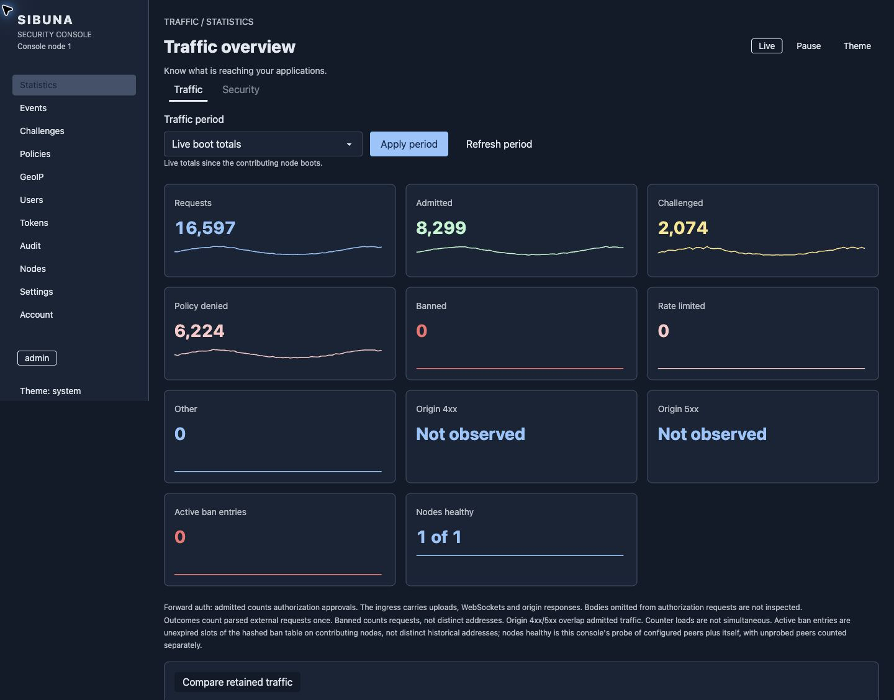
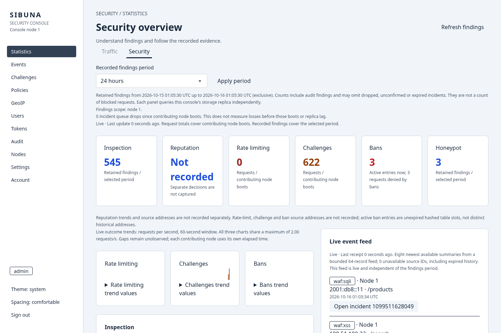

<!-- English source SHA-256: cc1aaa74c7ebf304bf574d29f14c1d1eb9196b30744f92f833e9d2712778bbb8 -->
<div dir="rtl">

<h1 align="center">sibuna</h1>
<p align="center">موازن حمل موزع وجدار حماية لتطبيقات الويب</p>
<p align="center">
  <a href="#features">الميزات</a> ·
  <a href="#load-balancing">موازنة الحمل</a> ·
  <a href="#beside-haproxy-and-envoy">القياسات</a> ·
  <a href="#quickstart">بدء سريع</a> ·
  <a href="#console">وحدة التحكم</a> ·
  <a href="#how-it-works">كيف يعمل</a> ·
  <a href="#documentation">الوثائق</a>
</p>

<!-- language-navigation -->
<p align="center">
  <a href="README.md">English</a> · <a href="README.zh-CN.md">简体中文</a> ·
  <a href="README.ko.md">한국어</a> · <a href="README.ja.md">日本語</a> ·
  <a href="README.es.md">Español</a> · <a href="README.de.md">Deutsch</a> ·
  <a href="README.hi.md">हिन्दी</a> · <a href="README.ar.md">العربية</a>
</p>

يوجّه Sibuna حركة TCP وUDP وHTTP إلى خوادم سليمة. يمكننا تشغيل عقدة طرفية واحدة أو ربط عدة عقد في شبكة مترابطة، وإنهاء TLS عند كل عقدة وتطبيق جدار الحماية على مسارات HTTP محددة.

## أين نستخدم Sibuna

- **المواقع العامة**

  نخدم المتصفحات عبر HTTP/2 أو HTTP/3، ونجدد الشهادات العامة من خلال Let's Encrypt، ونفحص الطلبات قبل تمريرها إلى نُسخ الخدمة عبر HTTP/1.1.
- **خدمات gRPC الداخلية**

  نصدر شهادات للأسماء الداخلية من سلطة التصديق المحلية. تثق التطبيقات العميلة بشهادتها الجذرية وتستدعي الخدمة عبر TLS. وتنقل الخدمة الخلفية عبر HTTP/2 رسائل gRPC وترويساتها الختامية.
- **عنقود من العقد الطرفية**

  نوزع إعدادات التوجيه بعد التحقق منها على الشبكة. يمكن للعقد تبادل قرارات الحظر وارتباطات العملاء بالخوادم، بينما تمرر كل عقدة الحركة إلى مجموعات خوادمها الخلفية.

[ما هو Sibuna؟](https://insanai.github.io/sibuna/ar/book/introduction.html)

<a id="features"></a>

## الميزات

- **ملف تنفيذي واحد:** المحرك، وتخزين SQLite المدمج، وبرنامج حل الألغاز في المتصفح، وموارد وحدة التحكم.
- **حزم أصلية:** Linux وmacOS وWindows وFreeBSD وOpenBSD. يستخدم برنامج حل الألغاز في المتصفح WebAssembly.
- **تحديات المتصفح:** إثبات العمل المتسلسل (الافتراضي) أو Hashcash، تتبعه جلسة موقعة.
- **سياسات الوصول:** اسمح بالطلبات أو تحدَّها أو زِنها أو ارفضها وفق العنوان والمسار والترويسات وUser-Agent.
- **موازنة الحمل:** TCP وUDP وHTTP أمام عدة خوادم، مع إنهاء TLS والشهادات التلقائية ووضع العنقود. راجع [موازنة الحمل](#load-balancing).
- **بصمات TLS:** طابِق بصمة JA4 التي يمررها وكيل دخول موثوق، تطابقًا تامًا أو وفق البادئة.
- **فحص التطبيق:** فحوص مدمجة لحقن SQL وXSS واجتياز المسارات وحقن الأوامر.
- **حدود محلية للمعدل:** ضبط الدفعات والحركة المستمرة، مع حدود اختيارية لكل قاعدة.
- **وحدة تحكم للمشغل:** حركة المرور، وعينات نشاط البلدان، والحوادث المسجلة، وتحرير السياسات.
- **دعم العناقيد:** يشارك بناء منفصل السياسات والسمعة عبر PostgreSQL.

<a id="load-balancing"></a>

## موازنة الحمل

يتضمن Sibuna 1.0.0-rc.5 وضع الحافة. يمكننا أيضا [بناء الإصدار المرشح من المصدر](#build-from-source).

<div dir="ltr">

```sh
sibuna lb --bind :8080 --server 10.0.0.1:80 --server 10.0.0.2:80
sibuna lb --tls auto --domain example.org --server 10.0.0.1:80
sibuna lb --bind :8080 --server 10.0.0.1:80 --print-config > edge.jlv
sibuna check -f edge.jlv
sibuna --config-file edge.jlv
```

[إعداد Sibuna بلغة Jlavi](https://insanai.github.io/sibuna/ar/book/jlavi.html)

</div>

- **التمرير:** TCP وUDP، وتمرير TLS دون فك تشفيره موجَّهًا بحسب اسم الخادم، وتمرير QUIC، وبروتوكول PROXY.
- **تحت الهجوم:** حدود للتدفقات لكل عنوان عميل ولكل واجهة، وحظر يُفحص عند قبول الاتصال ويُشارك عبر الشبكة المتداخلة، وحظر تلقائي، ورفض بإعادة الضبط أو بالاحتجاز (tarpit)، ووضع ضغط يقبل العملاء المعروفين أولًا، وخيوط قبول على عدة أنوية، وميزانية لحزم UDP تحفظ احتياطيًا للعملاء المؤكَّدين.
- **HTTP:** إنهاء TLS بحزم PEM على طريقة HAProxy مع تبادل مفاتيح مقاوم للحوسبة الكمومية (X25519MLKEM768)؛ وHTTP/1.1 وHTTP/2 وHTTP/3 وWebSocket؛ والتوجيه بحسب اسم المضيف والمسار إلى خوادم HTTP/1.1 أو HTTP/2 أو HTTP/3. وفي Linux يخدم الاتصالات عمال مدفوعون بالأحداث، عامل واحد لكل معالج.
- **الشهادات:** تلقائية عبر ACME مع التجديد والسلطات الاحتياطية وربط الحساب الخارجي؛ وشهادات البدل (wildcard) عبر DNS ببرنامج خطاف أو تحديث RFC 2136 أو واجهة Cloudflare API؛ وتدبيس OCSP؛ وشهادات عند الطلب خلف حارس؛ وسلطة محلية لـ `localhost` والأسماء الداخلية وعناوين IP، مع قائمة إبطال وخادم ACME خاص بها.
- **الخوادم:** فحوص السلامة، والبدء التدريجي، والتصريف، والأوزان، وتثبيت الجلسات، وحد للتدفقات لكل خادم.
- **التغيير أثناء التشغيل:** تحافظ إعادة التحميل الناجحة على اتصالات TCP القائمة. ويصرّف مقبس الإدارة الخوادم ويغيّر أوزانها ويضيفها ويزيلها (`sibuna ctl /run/sibuna/edge.sock set server app/10.0.0.1:80 state drain`). وفي Linux يأخذ الملف التنفيذي الجديد مقابس الاستماع وتعيينات UDP من القديم؛ وتنتهي اتصالات QUIC.
- **العنقود:** تتشارك عقد الشبكة المتداخلة جدول تثبيت الجلسات وحدود التدفقات للخادم، وتمرر العميل إلى العقدة التي تملكه. ويمكن لقاعدة بيانات PostgreSQL أن تنشر إعدادات واحدة على كل عقدة وأن تتراجع عنها. ويحفظ ملف معيَّن في الذاكرة (mapped file) تلميحات تثبيت الجلسات عبر إعادة التشغيل.
- **الخطافات:** عند الاتصال وعند الطلب، مصرَّفة داخل البرنامج، أو بصيغة WebAssembly بميزانية محددة، أو وكيلًا على مقبس Unix.
- **الرصد:** المقاييس، وسجلات الوصول، وعرض في وحدة التحكم للخوادم والتدفقات وحالات الرفض.

يُطبَّق Gate أو Shield على الأسماء التي تحتاج إليه، أو لا يُطبَّق على أي منها. ويبقى الملف هو المرجع: يستمر التغيير وقت التشغيل حتى إعادة التحميل التالية.

يبقى اختبار موازن الحمل مع حركة مرور إنتاجية مطلوبا. واختُبرت ميزات العنقدة فيه على ثلاثة مضيفين. ويذكر كل [نقاش تصميم](https://insanai.github.io/sibuna/sid/) ما بُني والثغرات المعروفة.

<a id="quickstart"></a>

## بدء سريع

[نزّل إصدارًا](https://github.com/insanai/sibuna/releases/tag/v1.0.0-rc.5) لمنصتك. تشمل الحزمة الافتراضية دعم التخزين ووحدة التحكم. تبدأ وحدة التحكم مع `--console`.

| المنصة | الحزمة | المتطلبات |
| --- | --- | --- |
| Linux x86-64 | `sibuna-linux-amd64.tar.gz` | Linux 5.10 أو أحدث؛ musl مرتبط ثابتًا |
| Linux ARM64 | `sibuna-linux-arm64.tar.gz` | Linux 5.10 أو أحدث؛ musl مرتبط ثابتًا |
| macOS Apple Silicon | `sibuna-macos-arm64.tar.gz` | macOS 12 أو أحدث |
| macOS Intel | `sibuna-macos-amd64.tar.gz` | macOS 12 أو أحدث |
| Windows x86-64 | `sibuna-windows-amd64.zip` | Windows 10 / Server 2016 أو أحدث؛ `sibuna.exe` أصلي |
| FreeBSD x86-64 | `sibuna-1.0.0-rc.5-freebsd-15.1-amd64.pkg` | FreeBSD 15.1؛ حزمة CLI |
| OpenBSD x86-64 | `sibuna-1.0.0-rc.5.tgz` | OpenBSD 7.9؛ حزمة CLI |

بناءات macOS غير موقعة. تتضمن كل حزمة الرخص، وروابط المصدر، وبيان البناء. تحقق من الأرشيف مقابل `SHA256SUMS` قبل استخدامه.

تغطي حزم Debian/RPM نظام Linux على x86-64 وARM64؛ وتغطي حزمة Arch `sibuna-bin` معمارية x86-64. تغطي حزم FreeBSD 15.1 وOpenBSD 7.9 معمارية x86-64 وتثبّت واجهة CLI. تتضمن حزم Linux خدمة systemd اختيارية معطلة. لا تنشئ حزم BSD خدمة أو حسابًا أو حالة. هذه تنزيلات من المشروع نفسه؛ والقبول في الأرشيفات المجتمعية إجراء منفصل. يتضمن الإصدار أيضًا مخطط Helm وصورة حاوية، `ghcr.io/insanai/sibuna`. راجع [دليل تشغيل الحزم](https://insanai.github.io/sibuna/ar/book/operations.html) للتثبيت والتحقق والحالة الخاصة والترقيات وإعداد Kubernetes.

يوفر [مستودع Homebrew الخاص بـ Sibuna](https://github.com/insanai/homebrew-sibuna) صيغة CLI تثبّت أرشيف الإصدار المُتحقَّق منه لنظامي macOS وLinux (Apple Silicon وARM64 وx86-64). يتبع المستودع أحدث إصدار منشور. لا يبدأ التثبيت أي خدمة:

<div dir="ltr">

```sh
brew tap insanai/sibuna
brew install insanai/sibuna/sibuna
sibuna --version
```

</div>

على Linux x86-64، مع تطبيقك يستمع على المنفذ 3000:

<div dir="ltr">

```sh
curl -fLO https://github.com/insanai/sibuna/releases/download/v1.0.0-rc.5/sibuna-linux-amd64.tar.gz
curl -fLO https://github.com/insanai/sibuna/releases/download/v1.0.0-rc.5/SHA256SUMS
sha256sum --ignore-missing -c SHA256SUMS
tar -xzf sibuna-linux-amd64.tar.gz
(umask 077; openssl rand -hex 32 > sibuna.seed)
./sibuna --host 127.0.0.1 --port 8080 --upstream-port 3000 --secret-file ./sibuna.seed
```

</div>

افتح `http://127.0.0.1:8080` لتجربته محليًا. لموقع عام، أنهِ HTTPS عند وكيل دخول موثوق، وأبقِ مستمع Sibuna خاصًا. اتبع [دليل النشر](https://insanai.github.io/sibuna/ar/book/operations.html) لإعداد Caddy أو nginx.

الوضع الافتراضي هو `reverse_proxy`. استخدم `--mode forward_auth` عندما يمرر وكيل الدخول الطلبات ويسأل Sibuna عن قرار الوصول. يتضمن الدليل الإعدادين كليهما. فحص Shield المدمج مفعل افتراضيًا. استخدم `--gate` للقبول من دون ذلك الفاحص. اختر قواعد الوصول بـ `--policy-file <file>`، بما فيها قواعد لعملاء API ولفحوص الصحة التي لا تستطيع تشغيل تحدي متصفح. يسرد `./sibuna --help` كل الخيارات.

على Windows، فك ضغط ملف ZIP وشغّل `.\sibuna.exe --help` في PowerShell. استخدم Ctrl+C لإيقافه. قيّد الوصول إلى ملفات البذور وبيانات الاعتماد والبيانات باستخدام قوائم Windows ACL.

<a id="build-from-source"></a>

### البناء من المصدر

نبني ونختبر باستخدام **Rust 1.100**، الذي يتطلبه مترجم JLV الافتراضي. ويمكننا بناء البرنامج الخدمي المقتصر على JSON باستخدام Rust 1.100 مع `--no-default-features`، واختيار `sqlite,console` حسب الحاجة. برنامج حل الألغاز في المتصفح وواجهة وحدة التحكم مكتوبان بلغة Rust ومترجمان إلى WebAssembly؛ ولا يحتاج البناء إلى Node أو npm.

<div dir="ltr">

```sh
git clone https://github.com/insanai/sibuna.git
cd sibuna
rustup toolchain install 1.100.0 --profile minimal --target wasm32-unknown-unknown
cargo +1.100.0 build --release -p sibuna
```

</div>

الملف التنفيذي هو `target/release/sibuna`. يخزن حالته في SQLite مع `--data-dir`. تستخدم بناءات العنقود `--features postgres-tls` وتتشارك قاعدة بيانات PostgreSQL واحدة عبر `--database-url-file` و`--cluster-node`. راجع [CONTRIBUTING.md](CONTRIBUTING.md) للاختبارات وفحوص lint وفحوص الحجم.

<a id="console"></a>

## وحدة التحكم

تعمل وحدة التحكم في الملف التنفيذي نفسه. أنشئ مسؤولًا أوليًا أثناء توقف البرنامج:

<div dir="ltr">

```sh
./sibuna init-admin admin --data-dir ./data
./sibuna --host 127.0.0.1 --upstream-port 3000 --secret-file ./sibuna.seed \
  --data-dir ./data --console 127.0.0.1:19446
```

</div>

افتح `http://127.0.0.1:19446/console/` وغيّر كلمة المرور المؤقتة. يشرح [دليل التشغيل](https://insanai.github.io/sibuna/ar/book/operations.html) الوصول عبر HTTPS، واستيراد GeoIP، والمستخدمين، ورموز API، وشاشات العرض الجدارية.


تعرض الكرة الأرضية عينات نشاط البلدان خلال الدقيقة الأخيرة. تحدد العلامات مواقع تقريبية للبلدان. تشير الأسهم نحو الموقع المعد للخادم. ولا تعرض اتصالات حية منفردة. يحتاج GeoIP إلى مجموعة بيانات مستوردة بصورة منفصلة. اضبط `--console-location <latitude,longitude>` لوضع الخادم على الكرة الأرضية.

<details>
<summary>نظرة عامة على الحركة، ونظرة عامة على الأمان، والسياسات، والتحقيق في الحوادث</summary>

**نظرة عامة على الحركة** - نتائج الطلبات الحية وعدادات القبول والتحديات وحالة العقد والمخططات المصغرة.



**نظرة عامة على الأمان** - النتائج المسجلة والتحديات وحالات الحظر وموجز أحداث حي.



**السياسات** - القواعد التي تطبقها العقدة، بالترتيب، مع عدد مرات مطابقتها المسجلة.


**الأحداث** - الحوادث المسجلة، مع مرشحات حسب الوحدة والبلد والعنوان والمسار والوقت.


</details>

التُقطت صور الكرة الأرضية ونظرة عامة على الحركة في نافذة Chrome عادية أثناء تشغيل v1.0.0-beta.2؛ وتعرض الصور الأخرى v1.0.0-beta.1. تستخدم جميع اللقطات عقدة اختبار محلية مع حركة مولّدة وربط GeoIP تجريبي. الأعداد المعروضة ليست نتائج قياس أداء.

<a id="how-it-works"></a>

## كيف يعمل

تستقبل الواجهة الأمامية الاتصال. يختار Sibuna خادما لكل تدفق TCP أو UDP. وفي HTTP يطابق المضيف والمسار لكل طلب، ويطبق سياسة جدار الحماية الخاصة بالمسار ثم يرسل الطلب المقبول إلى خادم سليم في المجموعة المختارة. تتخذ كل عقدة قرارها بينما تتبادل العقد تحديثات ارتباط العملاء بالخوادم وقرارات الحظر.

قد يُقبل طلب أو يُعرض عليه تحدٍّ أو يُرفض. يحصل الزائر الذي يحل تحديًا على جلسة موقعة. تمر الطلبات اللاحقة مع ذلك بفحوص السياسة والمعدل المطبقة.

<picture>
  <source media="(prefers-color-scheme: dark)" srcset="docs/readme/images/admission-session-dark.svg">
  
</picture>

يفحص Gate قواعد الوصول والجلسات والحدود المحلية للمعدل. يضيف Shield فاحص الهجمات المدمج. Shield هو الافتراضي؛ ويختار `--gate` نمط Gate عند بدء التشغيل.

<details>
<summary>Gate وShield والوحدات داخل Sibuna</summary>

<picture>
  <source media="(prefers-color-scheme: dark)" srcset="docs/readme/images/protection-surfaces-dark.svg">
  
</picture>

يوضح الرسم فحوص Gate وShield المدمجة. لا تتجاوز الجلسة الصالحة فحوص الهجمات أو حدود الطلبات المطبقة.

<picture>
  <source media="(prefers-color-scheme: dark)" srcset="docs/readme/images/subsystems-dark.svg">
  
</picture>

تفصل الوحدات الشبكات والإثباتات والسياسات والحالة المحلية والتخزين والإدارة. يشرح [الكتاب](https://insanai.github.io/sibuna/ar/book/) مسؤولياتها.

</details>

<a id="deployment-limits"></a>

### حدود النشر

يستخدم المستمع الخاص HTTP/1.1 خلف وكيل دخول خارجي. وفي وضع الحافة يمكننا إنهاء TLS وHTTP/2 وHTTP/3 في Sibuna والتمرير إلى مجمّعات خوادم HTTP/1.1 أو HTTP/2 أو HTTP/3. يفحص forward-auth البيانات الوصفية التي يوفرها وكيل الدخول. في وضع الوكيل العكسي، يغطي الفاحص المدمج أول 8 KiB من الجسم. تتدفق عمليات الرفع إلى تطبيقك. وتُمرَّر رسائل WebSocket بلا فحص. الفاحص استدلالي (heuristic)، وليس محللًا لغويًا كاملًا.

الحدود المحلية للمعدل تخص كل عقدة. لا يوفر Sibuna الحماية من الهجمات التي تُغرق الشبكة بحجم كبير من حركة المرور. واستبدال الملف التنفيذي دون فقدان اتصالات والعمال المدفوعون بالأحداث موجودان في Linux فقط. ترتبط التحديات بالعقدة التي أصدرتها؛ لذا وجّه التحدي وحله إلى العقدة نفسها. لم يجتز هدف أداء وحدة التحكم الصارم قبولًا رسميًا. راجع [حدود النشر والقياسات](https://insanai.github.io/sibuna/ar/book/operations.html) قبل تمكين وحدة التحكم بجانب تطبيق إنتاجي.

<a id="benchmarks"></a>

## قياسات الأداء

يسجل الكتاب مراجعة المصدر والإعداد والمضيف لكل تشغيل. تبين هذه القياسات تكلفة الطلب تحت بضعة أعباء عمل على جهاز واحد. ولا تقيس حماية متكافئة أو دقة كشف الروبوتات.

<a id="sibuna-on-one-host"></a>

### Sibuna على مضيف واحد

استخدمت هذه التشغيلات معالج AMD Ryzen 9 5950X. حصل البرنامج الخدمي على أربع وحدات CPU وعمل في الذاكرة؛ وعمل مولد الحمل وخادم أصلي بديل (stub) على ثماني وحدات CPU أخرى. استخدم `wrk` أربعة وستين اتصالًا عبر واجهة الاسترجاع (loopback). الأرقام هي الوسيط لثلاثة تشغيلات.

- في وضع forward-auth، عملت كل أعباء العمل بمعدل 197,532 إلى 211,636 طلبًا في الثانية، مع p99 بين 305 و327 us، و11.7 إلى 13.8 us من وقت CPU لكل طلب. كان مولد الحمل هو الحد.
- عملت الطلبات الممررة عبر الوكيل بمعدل 138,965 إلى 147,303 طلبًا في الثانية. بلغت ذروة الذاكرة نحو 16 MiB.
- عند حمل معروض متساوٍ قدره 100,000 طلب مقبول في الثانية، كان زمن الاستجابة p99.9 يساوي 62 us في وضع forward-auth و150 us في وضع الوكيل العكسي.

<a id="beside-haproxy-and-envoy"></a>

### إلى جانب HAProxy وEnvoy

في 25 نوفمبر 2026 قسنا Sibuna وHAProxy 3.0.11 وEnvoy 1.40.2 مع BoringSSL على المضيف نفسه. خصصنا لكل وكيل ثماني وحدات معالجة وثمانية خيوط عمل. استخدمنا خوادم الأصل والشهادة ومولد الحمل نفسها مع 256 اتصالا عبر واجهة الاسترجاع واستجابة من بايتين. تعرض الصفوف الثلاثة الأولى وسيط عدد الطلبات في الثانية عبر ثلاث جولات مدة كل منها ثماني ثوان. وتعرض الصفوف الثلاثة الأخيرة الذاكرة المقيمة في نهاية الجولة. بلغ التفاوت في معدل الطلبات 4% على الأكثر واكتملت جميع الطلبات.

| الحالة | Sibuna | HAProxy | Envoy |
| --- | ---: | ---: | ---: |
| HTTP/1.1 | 220,040 | 220,323 | 70,909 |
| HTTP/1.1 عبر TLS | 174,611 | 165,199 | 63,399 |
| HTTP/2 | 104,132 | 153,899 | 68,972 |
| الذاكرة المقيمة، HTTP/1.1 | 14 MiB | 48 MiB | 58 MiB |
| الذاكرة المقيمة، HTTP/1.1 عبر TLS | 21 MiB | 61 MiB | 61 MiB |
| الذاكرة المقيمة، HTTP/2 | 116 MiB | 112 MiB | 140 MiB |

تقارب معدل الطلبات لكل من Sibuna وHAProxy في HTTP غير المشفر. وفي HTTP/2 عالج HAProxy طلبات أكثر بنحو 48% من Sibuna واستخدم ذاكرة أقل قليلا. استخدمنا إعدادا ثابتا لبرنامج Envoy مع مرشح التوجيه. وقد تختلف النتيجة مع إعدادات أو أحمال أخرى. لا تخبرنا هذه الجولات القصيرة بالكثير عن الإعداد الديناميكي أو زمن استجابة التطبيق أو الأداء على شبكة فعلية. [القياسات](https://insanai.github.io/sibuna/ar/book/benchmarks.html#sibuna-haproxy-and-envoy)

<a id="beside-anubis"></a>

### إلى جانب Anubis

قسنا الملف التنفيذي الرسمي لإصدار Anubis 1.27.0 بأعباء العمل ووحدات CPU ومولد الحمل نفسها. كان عمل Hashcash متكافئًا: 8 بتات صفرية لـ Sibuna، ورقمان ست عشريان صفريان لـ Anubis. كان الخادم الأصلي `caddy respond`. يعرض الجدول الطلبات المقبولة التي لديها جلسة.

| الطلبات المقبولة | Sibuna Gate | Sibuna Shield | Anubis 1.27.0 |
| --- | ---: | ---: | ---: |
| Forward auth، req/s | 210,682 | 208,635 | 36,509 |
| Forward auth، p99 | 305 us | 308 us | 7,477 us |
| Forward auth، وقت CPU لكل طلب | 12.1 us | 13.2 us | 106.3 us |
| الوكيل العكسي، req/s | 106,376 | 103,298 | 19,398 |
| الوكيل العكسي، p99 | 3,331 us | 3,321 us | 11,062 us |

قاس التشغيل الثاني زمن عمليات القبول، وعمل كل منتج على وحدتي CPU. عمل Anubis مرة برموز Ed25519 الافتراضية، ومرة برموز HS512.

| العمليات في الثانية | Sibuna (BLAKE3 ذو مفتاح) | Anubis (Ed25519) | Anubis (HS512) |
| --- | ---: | ---: | ---: |
| فحص جلسة صالحة | 88,104 | 10,951 | 16,976 |
| فحص بلا مصادقة | 78,997 | 28,619 | 27,785 |
| تمهيد التحدي | 42,664 | 7,893 | 7,952 |
| التحقق من الإثبات | 57,924 | 12,668 | 19,261 |

بقيت ذروة ذاكرة Sibuna قرب 16 MiB. استخدم Anubis نحو 33 MiB في وضع forward-auth، وحتى نحو 600 MiB في وضع الوكيل العكسي. Anubis أداة واسعة الاستخدام وقادرة، وهذه الصفوف ليست ترتيبًا. عدة صفوف ليست مقارنة متطابقة: في وضع forward-auth يجيب Anubis عن بعض المسارات بنفسه، ولا يفحص الحمولة، وصفحات التحدي مختلفة. استخدمت التشغيلات واجهة الاسترجاع بلا TLS أو متصفحات حقيقية أو تخزين.

راجع [سجلات القياس](benchmarks/results/README.md) للطريقة والمجالات وأوامر الإعادة: [product-latest.md](benchmarks/results/product-latest.md)، [latency-latest.md](benchmarks/results/latency-latest.md)، [comparison-latest.md](benchmarks/results/comparison-latest.md) و[admission-latest.md](benchmarks/results/admission-latest.md). يناقش الجزء العاشر من الكتاب كل اختلاف.

<a id="documentation"></a>

## الوثائق

- [الكتاب](https://insanai.github.io/sibuna/ar/book/): المفاهيم والخوارزميات والأمثلة والقياسات.
- [الورقة التقنية](https://insanai.github.io/sibuna/ar/whitepaper/): المعمارية والبراهين وتفاصيل التصميم.
- [دليل التشغيل](https://insanai.github.io/sibuna/ar/book/operations.html): التثبيت والنشر.
- [المرجع](https://insanai.github.io/sibuna/ar/book/reference.html): تفاصيل CLI والبروتوكول.
- [نقاشات التصميم](https://insanai.github.io/sibuna/sid/): القرارات والعقود الهندسية.
- [المساهمة](CONTRIBUTING.md): البناء من المصدر والفحوص.

<a id="other-software-to-consider"></a>

## برامج أخرى تستحق النظر

- [Anubis](https://github.com/TecharoHQ/anubis): تحديات متصفح لتقليل حركة الزواحف.
- [BunkerWeb](https://github.com/bunkerity/bunkerweb): nginx وModSecurity وCRS وتحديات الروبوتات.
- [ModSecurity](https://github.com/owasp-modsecurity/ModSecurity): محرك WAF يُستخدم عبر موصلات.
- [Coraza](https://github.com/corazawaf/coraza): مكتبة WAF بلغة Go تدعم قواعد ModSecurity وCRS.
- [OWASP Core Rule Set](https://github.com/coreruleset/coreruleset): قواعد كشف هجمات لمحركات WAF.

تغطي هذه المشاريع أجزاء مختلفة من حماية الويب. فاحص Sibuna مدمج فيه؛ ولا يشغّل CRS أو مجموعات قواعد ModSecurity الأخرى. استخدم Sibuna مع WAF كامل عندما يحتاج تطبيقك إلى تغطية أوسع بالقواعد.

<a id="license"></a>

## الرخصة

Sibuna مرخص وفق **LGPL 3.0 أو أحدث**. تغطي الرخصة المحرك والمكتبات وبرنامج حل الألغاز في المتصفح ووحدة التحكم، بما فيها واجهة WebAssembly الخاصة بها.

يوضح [LICENSE](LICENSE) النطاق. يتضمن [LICENSES](LICENSES) الشروط الكاملة. يسرد [NOTICE](NOTICE) الاعتمادات. تتوفر المصادر ونصوص البناء تحت وسم كل إصدار.

كتب Vikrant Rathore برنامج Sibuna بمساعدة Ronak Rathore وKanak Rathore. يمكن للشركات الراغبة في شروط ترخيص أخرى الاتصال بـ Vikrant Rathore. تحتفظ مكتبات ومواد الأطراف الثالثة برخصها الخاصة.

</div>
