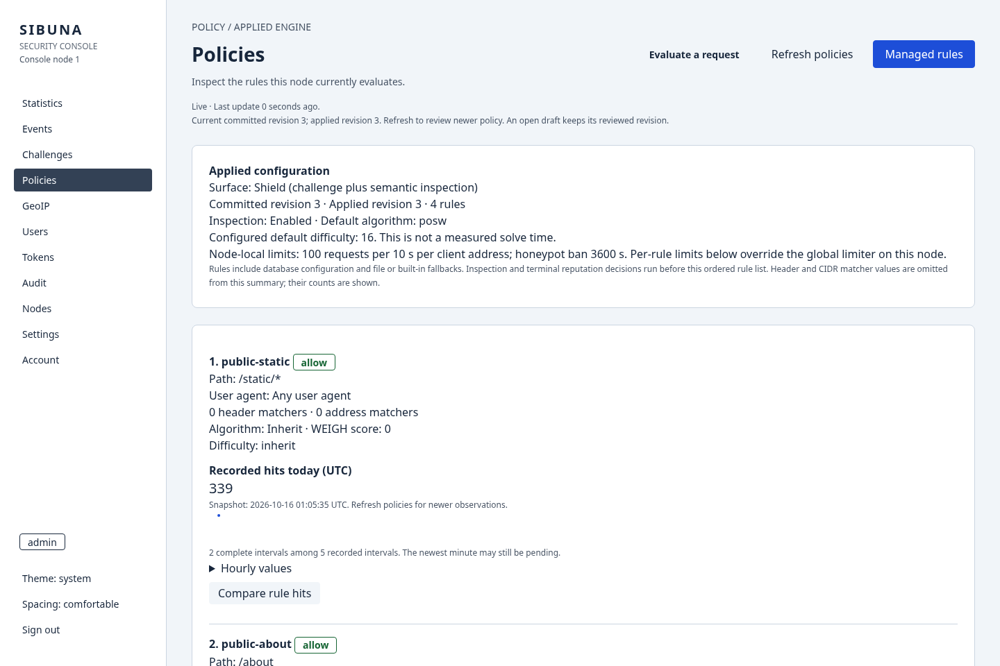

<!-- English source SHA-256: 042dfd1f971e2a895223216b56e2eaa8b0119c40748dfe2230db4fc208e2d004 -->
<h1 align="center">sibuna</h1>
<p align="center">Verteilter Edge-Load-Balancer und Web Application Firewall</p>
<p align="center">
  <a href="#features">Funktionen</a> ·
  <a href="#load-balancing">Load Balancing</a> ·
  <a href="#beside-haproxy-and-envoy">Benchmarks</a> ·
  <a href="#quickstart">Schnellstart</a> ·
  <a href="#console">Konsole</a> ·
  <a href="#how-it-works">Funktionsweise</a> ·
  <a href="#documentation">Dokumentation</a>
</p>

<!-- language-navigation -->
<p align="center">
  <a href="README.md">English</a> · <a href="README.zh-CN.md">简体中文</a> ·
  <a href="README.ko.md">한국어</a> · <a href="README.ja.md">日本語</a> ·
  <a href="README.es.md">Español</a> · <a href="README.de.md">Deutsch</a> ·
  <a href="README.hi.md">हिन्दी</a> · <a href="README.ar.md">العربية</a>
</p>

Sibuna routet TCP, UDP und HTTP von einem einzelnen Edge-Knoten oder einem Mesh an gesunde Server. Es kann TLS terminieren, ausgewählte HTTP-Routen inspizieren und Backends vor DDoS-Fluten schützen.

## Einsatzgebiete von Sibuna

- **Öffentliche Websites**

  Browser über HTTP/2 oder HTTP/3 bedienen, öffentliche Zertifikate über Let's Encrypt erneuern und Anfragen prüfen, bevor sie an HTTP/1.1-Replikas weitergeleitet werden.
- **Interne gRPC-Dienste**

  Zertifikate für interne Namen über die lokale CA ausstellen. Clients vertrauen ihrem Root-Zertifikat und rufen den Dienst über TLS auf. Ein HTTP/2-Backend transportiert gRPC-Nachrichten und Trailer.
- **Ein Cluster aus Edge-Knoten**

  Eine geprüfte Routing-Konfiguration im Mesh verteilen. Knoten können Sperren und gelernte Affinitäten teilen, während jeder Knoten Traffic an seine eigenen Backend-Pools weiterleitet.

[Was ist Sibuna?](https://insanai.github.io/sibuna/de/book/introduction.html)

<a id="features"></a>

## Funktionen

- **Eine einzige Binärdatei:** Engine, eingebetteter SQLite-Speicher, Browser-Solver und Konsolen-Assets.
- **Native Pakete:** Linux, macOS, Windows, FreeBSD und OpenBSD. Der Browser-Solver nutzt WebAssembly.
- **Browser-Challenges:** Proof of Sequential Work (Standard) oder Hashcash, gefolgt von einer signierten Session.
- **Zugriffsrichtlinien:** Anfragen nach Adresse, Pfad, Headern und User-Agent zulassen, mit einer Challenge belegen, gewichten oder ablehnen.
- **Load Balancing:** TCP, UDP und HTTP vor mehreren Servern, mit TLS-Terminierung, automatischen Zertifikaten und einem Cluster-Modus. Siehe [Load Balancing](#load-balancing).
- **[DDoS-Schutz am Edge](https://insanai.github.io/sibuna/de/book/operations.html#edge-admission-under-attack)** Gleichzeitige Flows pro Client-IP und Frontend begrenzen, unter Last die Zulassung neuer Adressen drosseln und UDP-Kapazität für bestätigte Flows reservieren. Bei Angriffen, die den Uplink sättigen, ist vorgelagertes Upstream-Filtering erforderlich.
- **TLS-Fingerprints:** Den JA4-Fingerprint, den ein vertrauenswürdiger Ingress weiterleitet, exakt oder per Präfix abgleichen.
- **Anwendungsprüfung:** Eingebaute Prüfungen auf SQL-Injection, XSS, Path Traversal und Command Injection.
- **Lokale Rate-Limits:** Bursts und Dauerlast steuern, optional mit Limits pro Regel.
- **Operator-Konsole:** Traffic, Länderstichproben, aufgezeichnete Vorfälle und Policy-Bearbeitung.
- **Cluster-Unterstützung:** Ein separater Build teilt Policies und Reputation über PostgreSQL.

<a id="load-balancing"></a>

## Load Balancing

Sibuna 1.0.0-rc.7 enthält den Edge-Modus. Der Release Candidate lässt sich auch [aus dem Quellcode bauen](#build-from-source).

```sh
sibuna lb --bind :8080 --server 10.0.0.1:80 --server 10.0.0.2:80
sibuna lb --tls auto --domain example.org --server 10.0.0.1:80
sibuna lb --bind :8080 --server 10.0.0.1:80 --print-config > edge.jlv
sibuna check -f edge.jlv
sibuna --config-file edge.jlv
```

[Sibuna mit Jlavi konfigurieren](https://insanai.github.io/sibuna/de/book/jlavi.html)

- **Weiterleitung:** TCP und UDP, TLS-Passthrough mit Routing nach Servername (exakt oder Wildcard), QUIC-Passthrough und das PROXY-Protokoll.
- **Unter Angriff:** Flow-Limits pro Client-Adresse und Frontend, Sperren, die bereits beim Verbindungsaufbau geprüft und über das Mesh geteilt werden, automatische Sperren, Ablehnung per Reset oder Tarpit, ein Druckmodus, der bekannte Clients bevorzugt zulässt, Accept-Threads auf mehreren Kernen und ein UDP-Paketbudget mit Reserve für bestätigte Clients.
- **HTTP:** TLS-Terminierung mit PEM-Bundles im HAProxy-Format und Post-Quanten-Schlüsselaustausch (X25519MLKEM768); HTTP/1.1, HTTP/2, HTTP/3 und WebSocket; Routing nach Hostname (exakt oder Wildcard wie `*.example.org`) und Pfad an HTTP/1.1-, HTTP/2- oder HTTP/3-Server. Unter Linux bedienen eventgesteuerte Worker die Verbindungen, ein Worker pro Prozessor.
- **Zertifikate:** Automatisch über ACME mit Erneuerung, Fallback-CAs und External Account Binding; Wildcards über DNS mit einem Hook-Programm, RFC-2136-Update oder der Cloudflare-API; OCSP-Stapling; On-Demand-Zertifikate hinter einem Guard; eine lokale CA für `localhost`, interne Namen und IP-Adressen, mit Sperrliste und eigenem ACME-Server.
- **Server:** Health-Checks, Slow Start, Draining, Gewichte, Sticky Sessions und ein Flow-Limit pro Server.
- **Änderungen im laufenden Betrieb:** Ein akzeptierter Reload erhält bestehende TCP-Verbindungen. Über den Admin-Socket lassen sich Server drainen, gewichten, hinzufügen und entfernen (`sibuna ctl /run/sibuna/edge.sock set server app/10.0.0.1:80 state drain`). Unter Linux übernimmt eine neue Binärdatei die Listening-Sockets und die UDP-Zuordnungen der alten; QUIC-Verbindungen werden dabei beendet.
- **Cluster:** Die Knoten eines Mesh teilen die Sticky-Tabelle und die Flow-Limits eines Servers und leiten einen Client an den zuständigen Knoten weiter. Eine PostgreSQL-Datenbank kann eine Konfiguration an alle Knoten ausrollen und zurückrollen. Eine gemappte Datei bewahrt Affinitätshinweise über einen Neustart hinweg.
- **Hooks:** Auf Verbindungs- und Request-Ebene, einkompiliert, als WebAssembly mit Budget oder als Agent an einem Unix-Socket.
- **Beobachtbarkeit:** Metriken, Access-Logs und eine Konsolenansicht für Server, Flows und Ablehnungen.

Gate oder Shield gelten für die Namen, die sie benötigen, oder für keinen. Die Konfigurationsdatei bleibt
maßgeblich: Änderungen zur Laufzeit gelten bis zum nächsten Reload.

Die Qualifizierung unter Produktivverkehr steht noch aus. Die
Cluster-Funktionen wurden auf drei Hosts getestet. Jede
[Entwurfsdiskussion](https://insanai.github.io/sibuna/sid/) nennt, was bereits umgesetzt ist und
welche Lücken bekannt sind.

<a id="quickstart"></a>

## Schnellstart

[Lade ein Release](https://github.com/insanai/sibuna/releases/tag/v1.0.0-rc.7) für deine
Plattform herunter. Das Standardpaket enthält Speicherung und Konsole. Die Konsole startet mit
`--console`.

| Plattform | Paket | Voraussetzungen |
| --- | --- | --- |
| Linux x86-64 | `sibuna-linux-amd64.tar.gz` | Linux 5.10 oder neuer; statisch gelinktes musl |
| Linux ARM64 | `sibuna-linux-arm64.tar.gz` | Linux 5.10 oder neuer; statisch gelinktes musl |
| macOS Apple Silicon | `sibuna-macos-arm64.tar.gz` | macOS 12 oder neuer |
| macOS Intel | `sibuna-macos-amd64.tar.gz` | macOS 12 oder neuer |
| Windows x86-64 | `sibuna-windows-amd64.zip` | Windows 10 / Server 2016 oder neuer; natives `sibuna.exe` |
| FreeBSD x86-64 | `sibuna-1.0.0-rc.7-freebsd-15.1-amd64.pkg` | FreeBSD 15.1; CLI-Paket |
| OpenBSD x86-64 | `sibuna-1.0.0-rc.7.tgz` | OpenBSD 7.9; CLI-Paket |

macOS-Builds sind unsigniert. Jedes Paket enthält Lizenzen,
Quellverweise und ein Build-Manifest. Prüfe das Archiv vor der Nutzung gegen `SHA256SUMS`.

Debian/RPM-Pakete decken Linux x86-64 und ARM64 ab; Arch `sibuna-bin` deckt x86-64 ab.
Pakete für FreeBSD 15.1 und OpenBSD 7.9 decken x86-64 ab und installieren die CLI.
Linux-Pakete enthalten einen optionalen, deaktivierten systemd-Dienst. BSD-Pakete legen
weder Dienst noch Benutzerkonto oder Zustand an. Dies sind Upstream-Downloads; die Aufnahme in
Community-Archive erfolgt getrennt. Das Release enthält außerdem ein Helm-Chart und ein
Container-Image, `ghcr.io/insanai/sibuna`.
Die [Paket-Betriebsanleitung](https://insanai.github.io/sibuna/de/book/operations.html)
beschreibt Installation, Verifikation, privaten Zustand, Upgrades und das Kubernetes-Setup.

Der [Sibuna-Homebrew-Tap](https://github.com/insanai/homebrew-sibuna) stellt eine CLI-Formel bereit,
die das verifizierte Release-Archiv für macOS und Linux (Apple Silicon, ARM64 und x86-64)
installiert. Der Tap folgt dem neuesten veröffentlichten Release. Die Installation startet keinen Dienst:

```sh
brew tap insanai/sibuna
brew install insanai/sibuna/sibuna
sibuna --version
```

Für Linux x86-64, wenn deine Anwendung auf Port 3000 lauscht:

```sh
curl -fLO https://github.com/insanai/sibuna/releases/download/v1.0.0-rc.7/sibuna-linux-amd64.tar.gz
curl -fLO https://github.com/insanai/sibuna/releases/download/v1.0.0-rc.7/SHA256SUMS
sha256sum --ignore-missing -c SHA256SUMS
tar -xzf sibuna-linux-amd64.tar.gz
(umask 077; openssl rand -hex 32 > sibuna.seed)
./sibuna --host 127.0.0.1 --port 8080 --upstream-port 3000 --secret-file ./sibuna.seed
```

Öffne `http://127.0.0.1:8080`, um es lokal auszuprobieren. Terminiere bei einer öffentlichen
Website HTTPS an einem vertrauenswürdigen Ingress und halte Sibunas Listener privat.
Folge der [Deployment-Anleitung](https://insanai.github.io/sibuna/de/book/operations.html) für Caddy
oder nginx.

Der Standardmodus ist `reverse_proxy`. Nutze `--mode forward_auth`, wenn dein Ingress
Anfragen weiterleitet und Sibuna um eine Zugangsentscheidung bittet. Die Anleitung enthält
beide Konfigurationen. Shields eingebaute Prüfung ist standardmäßig aktiv. Nutze `--gate` für
die Zulassung ohne diesen Inspektor. Definiere Zugriffsregeln mit `--policy-file <file>`, einschließlich Regeln für
API-Clients und Health-Checks, die keine Browser-Challenge ausführen können. `./sibuna --help`
listet alle Optionen auf.

Entpacke unter Windows das ZIP-Archiv und führe `.\sibuna.exe --help` in PowerShell aus.
Beende Sibuna mit Strg+C. Beschränke den Zugriff auf Seed-, Zugangsdaten- und Datendateien mit
Windows-ACLs.

<a id="build-from-source"></a>

### Aus dem Quellcode bauen

Alle Feature-Sets erfordern **Rust 1.100**. Der reine JSON-Daemon lässt sich mit `--no-default-features` bauen, und `sqlite,console` können bei Bedarf ausgewählt werden.
Der Browser-Solver und die Konsolenoberfläche sind in Rust geschrieben und werden zu WebAssembly kompiliert; der
Build braucht weder Node noch npm.

```sh
git clone https://github.com/insanai/sibuna.git
cd sibuna
rustup toolchain install 1.100.0 --profile minimal --target wasm32-unknown-unknown
cargo +1.100.0 build --release -p sibuna
```

Die Binärdatei liegt unter `target/release/sibuna`. Mit `--data-dir` speichert sie ihren Zustand
in SQLite. Cluster-Builds nutzen `--features postgres-tls` und teilen eine PostgreSQL-Datenbank
über `--database-url-file` und `--cluster-node`.
[CONTRIBUTING.md](CONTRIBUTING.md) beschreibt Tests, Lints und Größenprüfungen.

<a id="console"></a>

## Konsole

Die Konsole läuft in derselben Binärdatei. Initialisiere einen Administrator bei gestopptem Daemon:

```sh
./sibuna init-admin admin --data-dir ./data
./sibuna --host 127.0.0.1 --upstream-port 3000 --secret-file ./sibuna.seed \
  --data-dir ./data --console 127.0.0.1:19446
```

Öffne `http://127.0.0.1:19446/console/` und ändere das temporäre Passwort.
Die [Betriebsanleitung](https://insanai.github.io/sibuna/de/book/operations.html) erklärt
HTTPS-Zugriff, GeoIP-Importe, Benutzer, API-Tokens und Wall-Displays.


Der Globus zeigt Stichproben der Länderaktivität aus der letzten Minute. Marker geben ungefähre Länderpositionen
an. Pfeile zeigen zum konfigurierten Standort des Servers. Sie stellen keine einzelnen
Live-Verbindungen dar. GeoIP benötigt einen getrennt importierten Datensatz.
Setze `--console-location <latitude,longitude>`, um den Server auf dem Globus zu platzieren.

<details>
<summary>Traffic-Übersicht, Sicherheitsübersicht, Policies und Vorfallsuntersuchung</summary>

**Traffic-Übersicht** - Live-Anfrageergebnisse, Zähler für Zulassungen und Challenges, Knotenstatus und Sparklines.


**Sicherheitsübersicht** - aufgezeichnete Funde, Challenges, Sperren und ein Live-Event-Feed.


**Policies** - die Regeln, die ein Knoten der Reihe nach anwendet, mit ihren aufgezeichneten Treffern.



**Ereignisse** - aufgezeichnete Vorfälle, mit Filtern nach Modul, Land, Adresse, Pfad und Zeit.


</details>

Der Globus und die Traffic-Übersicht wurden in einem normalen Chrome-Fenster mit
v1.0.0-beta.2 aufgenommen; die anderen Ansichten zeigen v1.0.0-beta.1. Alle Aufnahmen
verwenden einen lokalen Testknoten mit generiertem Traffic und GeoIP-Testzuordnungen.
Die angezeigten Zähler sind keine Benchmark-Ergebnisse.

<a id="how-it-works"></a>

## Funktionsweise

Ein Frontend nimmt die Verbindung an. Bei TCP oder UDP wählt Sibuna einen Server für den Flow. Bei HTTP gleicht Sibuna Host und Pfad jeder Anfrage ab, wendet die Firewall-Policy der Route an und leitet zugelassenen Traffic an einen gesunden Server im gewählten Pool weiter. Jeder Edge-Knoten trifft diese Entscheidung selbst, während seine Peers Affinitäts- und Sperr-Updates austauschen.

Eine Anfrage kann zugelassen, mit einer Challenge belegt oder abgelehnt werden. Ein Besucher, der eine
Challenge löst, erhält eine signierte Session. Spätere Anfragen durchlaufen weiterhin die
geltenden Policy- und Rate-Limit-Prüfungen.

<picture>
  <source media="(prefers-color-scheme: dark)" srcset="docs/readme/images/admission-session-dark.svg">
  
</picture>

Gate prüft Zugriffsregeln, Sessions und lokale Rate-Limits. Shield ergänzt den eingebauten
Angriffsinspektor. Shield ist der Standard; `--gate` wählt beim Start Gate.

<details>
<summary>Gate, Shield und die Crates in Sibuna</summary>

<picture>
  <source media="(prefers-color-scheme: dark)" srcset="docs/readme/images/protection-surfaces-dark.svg">
  
</picture>

Das Diagramm zeigt die eingebauten Gate- und Shield-Prüfungen.
Eine gültige Session umgeht weder geltende Angriffsprüfungen noch Request-Limits.

<picture>
  <source media="(prefers-color-scheme: dark)" srcset="docs/readme/images/subsystems-dark.svg">
  
</picture>

Die Crates trennen Netzwerk, Proofs, Policies, lokalen Zustand, Speicherung und Verwaltung.
Das [Handbuch](https://insanai.github.io/sibuna/de/book/) erklärt ihre Aufgaben.

</details>

<a id="deployment-limits"></a>

### Einsatzgrenzen

Der private Listener nutzt HTTP/1.1 hinter einem externen Ingress. Im Edge-Modus kann Sibuna TLS, HTTP/2 und HTTP/3 selbst terminieren und an Server-Pools mit HTTP/1.1, HTTP/2 oder HTTP/3 weiterleiten.
Im Forward-Auth-Modus prüft Sibuna die Metadaten, die der Ingress liefert. Im
Reverse-Proxy-Modus deckt der eingebaute Inspektor die ersten 8 KiB eines Bodys ab. Uploads werden
zu deiner Anwendung gestreamt. WebSocket-Nachrichten werden ungeprüft weitergeleitet. Der
Inspektor ist eine Heuristik, kein vollständiger Sprachparser.

Rate-Limits sind knotenlokal. Sibuna bietet keinen Schutz vor volumetrischen
Netzwerkangriffen.
Das unterbrechungsfreie Binary-Upgrade und die eventgesteuerten
Worker gibt es nur unter Linux.
Challenges sind an den Knoten gebunden, der sie ausgestellt hat; route eine Challenge und ihre
Lösung zum selben Knoten. Das strenge Leistungsziel der Konsole wurde noch nicht
formal nachgewiesen. Prüfe die
[Einsatzgrenzen und Messungen](https://insanai.github.io/sibuna/de/book/operations.html), bevor du
die Konsole neben einer produktiven Anwendung aktivierst.

<a id="benchmarks"></a>

## Benchmarks

Das Handbuch dokumentiert Quellrevision, Konfiguration und Host jedes Laufs. Diese Messungen zeigen
Anfragekosten unter einigen Workloads auf einer Maschine. Sie messen weder gleichwertigen Schutz
noch Bot-Erkennungsgenauigkeit.

<a id="sibuna-on-one-host"></a>

### Sibuna auf einem Host

Diese Läufe nutzten einen AMD Ryzen 9 5950X. Der Daemon hatte vier CPUs und lief im
Arbeitsspeicher; Lastgenerator und ein Stub-Origin liefen auf acht anderen CPUs. `wrk`
nutzte 64 Verbindungen über Loopback.
Die Werte sind Mediane aus drei Läufen.

- Im Forward-Auth-Modus lief jeder Workload mit 197.532 bis 211.636 Anfragen pro Sekunde, mit einem
  p99 von 305 bis 327 µs und 11,7 bis 13,8 µs CPU pro Anfrage. Der Lastgenerator war das Limit.
- Weitergeleitete Anfragen liefen mit 138.965 bis 147.303 pro Sekunde. Der Spitzenspeicher lag
  bei etwa 16 MiB.
- Bei gleicher angebotener Last von 100.000 zugelassenen Anfragen pro Sekunde betrug die
  p99.9-Latenz 62 µs im Forward-Auth-Modus und 150 µs im Reverse-Proxy-Modus.

<a id="beside-haproxy-and-envoy"></a>

### Neben HAProxy und Envoy

Am 25. November 2026 haben wir Sibuna, HAProxy 3.0.11 und Envoy 1.40.2 mit BoringSSL auf demselben Host gemessen. Jeder Proxy hatte acht CPUs und acht Worker-Threads. Wir verwendeten dieselben Origins, dasselbe Zertifikat und denselben Lastgenerator mit 256 Verbindungen und einer Antwort von zwei Bytes über Loopback. Die ersten drei Zeilen zeigen den Median der Anfragen pro Sekunde aus drei Läufen zu je acht Sekunden. Die letzten drei zeigen den residenten Speicher am Ende des Laufs. Die Streuung der Anfragerate betrug in jedem Fall höchstens 4 %. Alle Anfragen wurden abgeschlossen.

| Fall | Sibuna | HAProxy | Envoy |
| --- | ---: | ---: | ---: |
| HTTP/1.1 | 220.040 | 220.323 | 70.909 |
| HTTP/1.1 über TLS | 174.611 | 165.199 | 63.399 |
| HTTP/2 | 104.132 | 153.899 | 68.972 |
| Residenter Speicher, HTTP/1.1 | 14 MiB | 48 MiB | 58 MiB |
| Residenter Speicher, HTTP/1.1 über TLS | 21 MiB | 61 MiB | 61 MiB |
| Residenter Speicher, HTTP/2 | 116 MiB | 112 MiB | 140 MiB |

Bei unverschlüsseltem HTTP lagen Sibuna und HAProxy praktisch gleichauf. Bei HTTP/2 bediente HAProxy rund 48 % mehr Anfragen als Sibuna und benötigte dabei etwas weniger Speicher. Wir nutzten Envoy mit einer statischen Konfiguration und seinem Router-Filter. Andere Einstellungen oder Workloads können das Ergebnis verändern. Diese kurzen Läufe sagen wenig über dynamische Konfiguration, Anwendungslatenz oder die Leistung in einem echten Netz aus. [Methode und Messungen](https://insanai.github.io/sibuna/de/book/benchmarks.html#sibuna-haproxy-and-envoy)

<a id="beside-anubis"></a>

### Neben Anubis

Wir haben die offizielle Release-Binärdatei von Anubis 1.27.0 mit denselben Workloads, CPUs und
demselben Lastgenerator gemessen. Die Hashcash-Arbeit war angeglichen: 8 Nullbits für Sibuna,
2 hexadezimale Nullziffern für Anubis. Der Origin war `caddy respond`. Die Tabelle zeigt
zugelassene Anfragen mit Session.

| Zugelassene Anfragen | Sibuna Gate | Sibuna Shield | Anubis 1.27.0 |
| --- | ---: | ---: | ---: |
| Forward-Auth, Anfr./s | 210.682 | 208.635 | 36.509 |
| Forward-Auth, p99 | 305 µs | 308 µs | 7.477 µs |
| Forward-Auth, CPU pro Anfrage | 12,1 µs | 13,2 µs | 106,3 µs |
| Reverse Proxy, Anfr./s | 106.376 | 103.298 | 19.398 |
| Reverse Proxy, p99 | 3.331 µs | 3.321 µs | 11.062 µs |

Der zweite Lauf maß Zulassungsoperationen, jedes Produkt auf zwei CPUs. Anubis
lief einmal mit seinen standardmäßigen Ed25519-Tokens und einmal mit HS512-Tokens.

| Operationen pro Sekunde | Sibuna (Keyed BLAKE3) | Anubis (Ed25519) | Anubis (HS512) |
| --- | ---: | ---: | ---: |
| Prüfung einer gültigen Session | 88.104 | 10.951 | 16.976 |
| Prüfung ohne Authentifizierung | 78.997 | 28.619 | 27.785 |
| Challenge-Bootstrap | 42.664 | 7.893 | 7.952 |
| Proof-Verifikation | 57.924 | 12.668 | 19.261 |

Sibunas Spitzenspeicher blieb nahe 16 MiB. Anubis nutzte etwa 33 MiB im Forward-Auth-Modus und
bis zu etwa 600 MiB im Reverse-Proxy-Modus. Anubis ist ein weit verbreitetes und
leistungsfähiges Tool, und diese Zeilen sind keine Rangliste. Mehrere davon sind nicht direkt
vergleichbar: Im Forward-Auth-Modus beantwortet Anubis einige Pfade selbst, es prüft keine
Payloads, und die Challenge-Seiten unterscheiden sich. Die Läufe nutzten Loopback ohne TLS,
ohne echte Browser und ohne Speicherung.

Die [Benchmark-Aufzeichnungen](benchmarks/results/README.md) enthalten Methode, Bereiche und
Wiederholungsbefehle: [product-latest.md](benchmarks/results/product-latest.md),
[latency-latest.md](benchmarks/results/latency-latest.md),
[comparison-latest.md](benchmarks/results/comparison-latest.md) und
[admission-latest.md](benchmarks/results/admission-latest.md).
Teil X des Handbuchs bespricht jeden Unterschied.

<a id="documentation"></a>

## Dokumentation

- [Handbuch](https://insanai.github.io/sibuna/de/book/): Konzepte, Algorithmen, Beispiele und Messungen.
- [Whitepaper](https://insanai.github.io/sibuna/de/whitepaper/): Architektur, Beweise und Entwurfsdetails.
- [Betriebsanleitung](https://insanai.github.io/sibuna/de/book/operations.html): Installation und Deployment.
- [Referenz](https://insanai.github.io/sibuna/de/book/reference.html): Details zu CLI und Protokoll.
- [Entwurfsdiskussionen](https://insanai.github.io/sibuna/sid/): Entscheidungen und technische Verträge.
- [Mitwirken](CONTRIBUTING.md): Quellbuilds und Prüfungen.

<a id="other-software-to-consider"></a>

## Weitere Software

- [Anubis](https://github.com/TecharoHQ/anubis): Browser-Challenges, um Crawler-Traffic zu verringern.
- [BunkerWeb](https://github.com/bunkerity/bunkerweb): nginx, ModSecurity, CRS und Bot-Challenges.
- [ModSecurity](https://github.com/owasp-modsecurity/ModSecurity): eine WAF-Engine, die über Connectoren genutzt wird.
- [Coraza](https://github.com/corazawaf/coraza): eine Go-WAF-Bibliothek mit Unterstützung für ModSecurity-Regeln und CRS.
- [OWASP Core Rule Set](https://github.com/coreruleset/coreruleset): Angriffserkennungsregeln für WAF-Engines.

Diese Projekte decken verschiedene Bereiche des Webschutzes ab. Sibunas Inspektor ist eingebaut;
er führt weder CRS noch andere ModSecurity-Regelsätze aus. Kombiniere Sibuna mit einer
vollständigen WAF, wenn deine Anwendung eine breitere Regelabdeckung braucht.

<a id="license"></a>

## Lizenz

Sibuna steht unter **LGPL 3.0 oder später**. Die Lizenz umfasst die Engine, die Bibliotheken,
den Browser-Solver und die Konsole einschließlich ihrer WebAssembly-Oberfläche.

[LICENSE](LICENSE) beschreibt den Umfang. [LICENSES](LICENSES) enthält die vollständigen
Bedingungen. [NOTICE](NOTICE) nennt Abhängigkeiten. Quellen und Build-Skripte stehen unter
jedem Release-Tag bereit.

Sibuna wurde von Vikrant Rathore geschrieben, mit Unterstützung von Ronak Rathore und Kanak
Rathore. Unternehmen, die andere Lizenzbedingungen wünschen, können Vikrant Rathore kontaktieren.
Drittanbieter-Bibliotheken und -Materialien behalten ihre jeweiligen Lizenzen.
