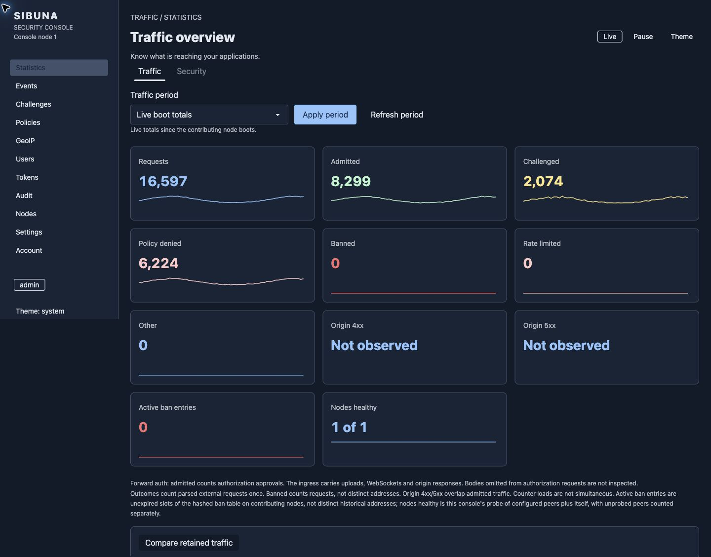

<!-- English source SHA-256: 331b33dcfa1187045c4d09efe004a4c272482ff10db48816f67090e01a0a80f8 -->
<h1 align="center">sibuna</h1>
<p align="center">Webschutz mit Proof of Work im Browser und optionaler Konsole.</p>
<p align="center">
  <a href="#features">Funktionen</a> ·
  <a href="#quickstart">Schnellstart</a> ·
  <a href="#console">Konsole</a> ·
  <a href="#how-it-works">Funktionsweise</a> ·
  <a href="#documentation">Dokumentation</a>
</p>

<!-- language-navigation -->
<p align="center">
  <a href="README.md">English</a> · <a href="README.zh-CN.md">简体中文</a> ·
  <a href="README.ko.md">한국어</a> · <a href="README.ja.md">日本語</a> ·
  <a href="README.es.md">Español</a> · <a href="README.de.md">Deutsch</a> ·
  <a href="README.hi.md">हिन्दी</a> · <a href="README.ar.md">العربية</a>
</p>

**Sibuna hilft, Websites und APIs vor unerwünschtem Datenverkehr von Bots zu schützen.** Es kann
Anfragen an deine Anwendung weiterleiten oder neben einem vorhandenen Proxy wie Caddy oder
nginx arbeiten.

Anfragen zu senden ist oft billig. Ihre Verarbeitung kann deine Anwendung mehr Arbeit kosten.
Sibuna verlangt von Clients, vor dem Zugang ein Rätsel zu lösen. Das Rätsel ist so entworfen,
dass das Erzeugen des Nachweises mehr Rechenarbeit kostet als seine Prüfung. Automatisierte
Clients tragen so einen größeren Teil der Kosten für den Zugriff auf eine Website.

Rechnen verbraucht auch Energie, aber die Menge hängt von Hardware und Einstellungen ab.
Proof of Work fügt Zulassungskosten hinzu. Es beweist nicht, dass ein Besucher ein Mensch ist,
und stoppt nicht jeden Angriff. Eine signierte Sitzung lässt zugelassene Clients zurückkehren,
ohne bei jeder Anfrage ein neues Rätsel zu lösen. Nutze Zugangsregeln und lokale Ratenlimits,
um zu steuern, was diese Clients danach anfordern dürfen.

<a id="features"></a>

## Funktionen

- **Eine ausführbare Datei:** Engine, eingebetteter SQLite-Speicher, Browser-Löser und Konsolen-Assets.
- **Native Pakete:** Linux, macOS, Windows, FreeBSD und OpenBSD. Der Browser-Löser nutzt WebAssembly.
- **Browser-Challenges:** Nachweis sequenzieller Arbeit (Standard) oder Hashcash, danach eine signierte Sitzung.
- **Zugangsrichtlinien:** Anfragen nach Adresse, Pfad, Headern und User-Agent zulassen, mit einer Challenge belegen, gewichten oder ablehnen.
- **TLS-Fingerabdrücke:** den JA4-Fingerabdruck, den ein vertrauenswürdiger Eingangsproxy weiterleitet, exakt oder per Präfix abgleichen.
- **Anwendungsprüfung:** eingebaute Prüfungen für SQL-Injection, XSS, Path Traversal und Command Injection.
- **Lokale Ratenlimits:** Bursts und Dauerlast steuern, optional mit Limits je Regel.
- **Betreiberkonsole:** Datenverkehr, Länderstichproben, aufgezeichnete Vorfälle und Richtlinienbearbeitung.
- **Cluster-Unterstützung:** ein gesonderter Build teilt Richtlinien und Reputation über PostgreSQL.

<a id="quickstart"></a>

## Schnellstart

[Lade ein Release](https://github.com/insanai/sibuna/releases/tag/v1.0.0-beta.2) für deine
Plattform herunter. Das Standardpaket unterstützt Speicherung und Konsole. Die Konsole startet mit
`--console`.

| Plattform | Paket | Voraussetzungen |
| --- | --- | --- |
| Linux x86-64 | `sibuna-linux-amd64.tar.gz` | Linux 5.10 oder neuer; statisch gebundenes musl |
| Linux ARM64 | `sibuna-linux-arm64.tar.gz` | Linux 5.10 oder neuer; statisch gebundenes musl |
| macOS Apple Silicon | `sibuna-macos-arm64.tar.gz` | macOS 12 oder neuer |
| macOS Intel | `sibuna-macos-amd64.tar.gz` | macOS 12 oder neuer |
| Windows x86-64 | `sibuna-windows-amd64.zip` | Windows 10 / Server 2016 oder neuer; natives `sibuna.exe` |
| FreeBSD x86-64 | `sibuna-1.0.0-beta.2-freebsd-15.1-amd64.pkg` | FreeBSD 15.1; CLI-Paket |
| OpenBSD x86-64 | `sibuna-1.0.0-beta.2.tgz` | OpenBSD 7.9; CLI-Paket |

Dies ist ein Beta-Release. macOS-Builds sind unsigniert. Jedes Paket enthält Lizenzen,
Quellverweise und ein Build-Manifest. Prüfe das Archiv vor der Nutzung gegen `SHA256SUMS`.

Debian/RPM-Pakete unterstützen Linux x86-64 und ARM64; Arch `sibuna-bin` unterstützt x86-64.
Pakete für FreeBSD 15.1 und OpenBSD 7.9 unterstützen x86-64 und installieren die CLI.
Linux-Pakete enthalten einen optionalen, deaktivierten systemd-Dienst. BSD-Pakete erzeugen
weder Dienst noch Konto oder Zustand. Dies sind Upstream-Downloads; die Aufnahme in
Community-Archive ist ein separates Verfahren. Das Release enthält auch ein Helm-Chart und ein
Container-Image, `ghcr.io/insanai/sibuna`.
Die [Paket-Betriebsanleitung](https://insanai.github.io/sibuna/book/operations.html)
beschreibt Installation, Verifikation, privaten Zustand, Upgrades und die Einrichtung unter
Kubernetes.

Der [Sibuna-Homebrew-Tap](https://github.com/insanai/homebrew-sibuna) bietet eine CLI-Formel,
die das geprüfte Release-Archiv für macOS und Linux (Apple Silicon, ARM64 und x86-64)
installiert. Der Tap folgt dem neuesten veröffentlichten Release, daher bietet er diese Beta
bereits an. Die Installation startet keinen Dienst:

```sh
brew tap insanai/sibuna
brew install insanai/sibuna/sibuna
sibuna --version
```

Für Linux x86-64, mit deiner Anwendung auf Port 3000:

```sh
curl -fLO https://github.com/insanai/sibuna/releases/download/v1.0.0-beta.2/sibuna-linux-amd64.tar.gz
curl -fLO https://github.com/insanai/sibuna/releases/download/v1.0.0-beta.2/SHA256SUMS
sha256sum --ignore-missing -c SHA256SUMS
tar -xzf sibuna-linux-amd64.tar.gz
(umask 077; openssl rand -hex 32 > sibuna.seed)
./sibuna --host 127.0.0.1 --port 8080 --upstream-port 3000 --secret-file ./sibuna.seed
```

Öffne `http://127.0.0.1:8080` für einen lokalen Versuch. Terminiere bei einer öffentlichen
Website HTTPS an einem vertrauenswürdigen Eingangsproxy und halte Sibunas Listener privat.
Folge der [Einsatzanleitung](https://insanai.github.io/sibuna/book/operations.html) für Caddy
oder nginx.

Der Standardmodus ist `reverse_proxy`. Nutze `--mode forward_auth`, wenn dein Eingangsproxy
Anfragen weiterleitet und Sibuna nach einer Zugangsentscheidung fragt. Die Anleitung enthält
beide Konfigurationen. Shields eingebaute Prüfung ist standardmäßig aktiv. Nutze `--gate` für
Zulassung ohne diesen Prüfer. Wähle Zugangsregeln mit `--policy-file <file>`, auch Regeln für
API-Clients und Health-Checks, die keine Browser-Challenge ausführen können. `./sibuna --help`
listet alle Optionen auf.

Entpacke unter Windows die ZIP-Datei und führe `.\sibuna.exe --help` in PowerShell aus.
Beende es mit Ctrl+C. Beschränke den Zugriff auf Seed-, Zugangsdaten- und Datendateien mit
Windows-ACLs.

<a id="build-from-source"></a>

### Aus dem Quellcode bauen

Wir bauen und testen mit **Rust 1.99**. Browser-Löser und Konsolenoberfläche sind in Rust
geschrieben und zu WebAssembly kompiliert; der Build braucht weder Node noch npm.

```sh
git clone https://github.com/insanai/sibuna.git
cd sibuna
rustup target add wasm32-unknown-unknown
cargo build --release -p sibuna
```

Die ausführbare Datei liegt unter `target/release/sibuna`. Es speichert seinen Zustand mit `--data-dir`
in SQLite. Cluster-Builds nutzen `--features postgres-tls` und teilen eine PostgreSQL-Datenbank
über `--database-url-file` und `--cluster-node`.
[CONTRIBUTING.md](CONTRIBUTING.md) beschreibt Tests, Lints und Größenprüfungen.

<a id="console"></a>

## Konsole

Die Konsole läuft in derselben ausführbaren Datei. Initialisiere einen Administrator bei gestopptem Daemon:

```sh
./sibuna init-admin admin --data-dir ./data
./sibuna --host 127.0.0.1 --upstream-port 3000 --secret-file ./sibuna.seed \
  --data-dir ./data --console 127.0.0.1:19446
```

Öffne `http://127.0.0.1:19446/console/` und ändere das vorläufige Passwort.
Die [Betriebsanleitung](https://insanai.github.io/sibuna/book/operations.html) erklärt
HTTPS-Zugriff, GeoIP-Importe, Benutzer, API-Tokens und Wandanzeigen.


Der Globus zeigt Länderstichproben der letzten Minute. Marker geben ungefähre Länderpositionen
an. Pfeile zeigen zum eingestellten Standort des Servers. Sie zeigen keine einzelnen
Live-Verbindungen. GeoIP benötigt einen getrennt importierten Datensatz.
Setze `--console-location <latitude,longitude>`, um den Server auf dem Globus zu platzieren.

<details>
<summary>Verkehrsübersicht, Sicherheitsübersicht, Richtlinien und Vorfallsuntersuchung</summary>

**Verkehrsübersicht** - Live-Anfrageergebnisse, Zähler für Zulassungen und Challenges, Knotenstatus und Sparklines.



**Sicherheitsübersicht** - aufgezeichnete Funde, Challenges, Sperren und ein Live-Ereignis-Feed.


**Richtlinien** - die Regeln, die ein Knoten der Reihe nach anwendet, mit ihren aufgezeichneten Treffern.


**Ereignisse** - aufgezeichnete Vorfälle, mit Filtern nach Modul, Land, Adresse, Pfad und Zeit.


</details>

Der Globus und die Verkehrsübersicht wurden in einem normalen Chrome-Fenster mit
v1.0.0-beta.2 aufgenommen; die anderen Ansichten zeigen v1.0.0-beta.1. Alle Aufnahmen
verwenden einen lokalen Testknoten mit erzeugtem Datenverkehr und GeoIP-Testzuordnungen.
Die angezeigten Zähler sind keine Benchmark-Ergebnisse.

<a id="how-it-works"></a>

## Funktionsweise

Eine Anfrage kann zugelassen, mit einer Challenge belegt oder abgelehnt werden. Ein Besucher, der eine
Challenge löst, erhält eine signierte Sitzung. Spätere Anfragen durchlaufen weiterhin die
anwendbaren Richtlinien- und Ratenprüfungen.

<picture>
  <source media="(prefers-color-scheme: dark)" srcset="docs/readme/images/admission-session-dark.svg">
  
</picture>

Gate prüft Zugangsregeln, Sitzungen und lokale Ratenlimits. Shield ergänzt den eingebauten
Angriffsprüfer. Shield ist der Standard; `--gate` wählt beim Start Gate.

<details>
<summary>Gate, Shield und die Crates in Sibuna</summary>

<picture>
  <source media="(prefers-color-scheme: dark)" srcset="docs/readme/images/protection-surfaces-dark.svg">
  
</picture>

Das Diagramm zeigt die eingebauten Gate- und Shield-Prüfungen.
Eine gültige Sitzung umgeht weder anwendbare Angriffsprüfungen noch Anfragelimits.

<picture>
  <source media="(prefers-color-scheme: dark)" srcset="docs/readme/images/subsystems-dark.svg">
  
</picture>

Die Crates trennen Netzwerk, Nachweise, Richtlinien, lokalen Zustand, Speicher und Verwaltung.
Das [Buch](https://insanai.github.io/sibuna/book/) erklärt ihre Aufgaben.

</details>

<a id="deployment-limits"></a>

### Einsatzgrenzen

Sibuna nutzt HTTP/1.1 auf seinem privaten Listener. Dein Eingangsproxy übernimmt öffentliches
TLS und HTTP/2. Im Forward-Auth-Modus prüft Sibuna die Metadaten, die der Eingangsproxy liefert. Im
Reverse-Proxy-Modus deckt der eingebaute Prüfer die ersten 8 KiB eines Bodys ab. Uploads werden
zu deiner Anwendung gestreamt. WebSocket-Nachrichten werden ungeprüft weitergeleitet. Der
Prüfer ist eine Heuristik, kein vollständiger Sprachparser.

Ratenlimits sind knotenlokal. Sibuna bietet keinen Schutz vor volumetrischen
Netzwerkangriffen. Challenges sind an den Knoten gebunden, der sie ausgestellt hat; leite eine
Challenge und ihre Lösung zum selben Knoten. Das strenge Leistungsziel der Konsole ist nicht
formal bestanden. Prüfe die
[Einsatzgrenzen und Messungen](https://insanai.github.io/sibuna/book/operations.html), bevor du
die Konsole neben einer produktiven Anwendung aktivierst.

<a id="benchmarks"></a>

## Benchmarks

Das Buch nennt Quellrevision, Konfiguration und Host jedes Laufs. Diese Messungen zeigen
Anfragekosten unter einigen Lasten auf einer Maschine. Sie messen weder gleichwertigen Schutz
noch Bot-Genauigkeit.

<a id="sibuna-on-one-host"></a>

### Sibuna auf einem Host

Diese Läufe nutzten einen AMD Ryzen 9 5950X. Der Daemon hatte vier CPUs und lief im
Arbeitsspeicher; Lastgenerator und ein Stub-Ursprungsserver liefen auf acht anderen CPUs. `wrk`
nutzte 64 Verbindungen über Loopback.
Die Werte sind Mediane aus drei Läufen.

- Im Forward-Auth-Modus lief jede Last mit 197.532 bis 211.636 Anfragen pro Sekunde, mit einem
  p99 von 305 bis 327 µs und 11,7 bis 13,8 µs CPU pro Anfrage. Die Grenze war der Lastgenerator.
- Weitergeleitete Anfragen liefen mit 138.965 bis 147.303 pro Sekunde. Der Spitzenspeicher lag
  bei etwa 16 MiB.
- Bei gleicher angebotener Last von 100.000 zugelassenen Anfragen pro Sekunde betrug die
  p99.9-Latenz 62 µs im Forward-Auth-Modus und 150 µs im Reverse-Proxy-Modus.

<a id="beside-anubis"></a>

### Neben Anubis

Wir haben die offizielle Release-Binärdatei von Anubis 1.27.0 mit denselben Lasten, CPUs und
demselben Lastgenerator gemessen. Die Hashcash-Arbeit war angeglichen: 8 Nullbits für Sibuna,
2 hexadezimale Nullziffern für Anubis. Der Ursprungsserver war `caddy respond`. Die Tabelle zeigt
zugelassene Anfragen mit Sitzung.

| Zugelassene Anfragen | Sibuna Gate | Sibuna Shield | Anubis 1.27.0 |
| --- | ---: | ---: | ---: |
| Forward-Auth, Anfr./s | 210.682 | 208.635 | 36.509 |
| Forward-Auth, p99 | 305 µs | 308 µs | 7.477 µs |
| Forward-Auth, CPU pro Anfrage | 12,1 µs | 13,2 µs | 106,3 µs |
| Reverse Proxy, Anfr./s | 106.376 | 103.298 | 19.398 |
| Reverse Proxy, p99 | 3.331 µs | 3.321 µs | 11.062 µs |

Der zweite Lauf maß die Dauer von Zulassungsoperationen, jedes Produkt auf zwei CPUs. Anubis
lief einmal mit seinen standardmäßigen Ed25519-Tokens und einmal mit HS512-Tokens.

| Operationen pro Sekunde | Sibuna (BLAKE3 mit Schlüssel) | Anubis (Ed25519) | Anubis (HS512) |
| --- | ---: | ---: | ---: |
| Prüfung einer gültigen Sitzung | 88.104 | 10.951 | 16.976 |
| Prüfung ohne Authentifizierung | 78.997 | 28.619 | 27.785 |
| Start einer Challenge | 42.664 | 7.893 | 7.952 |
| Prüfung des Nachweises | 57.924 | 12.668 | 19.261 |

Sibunas Spitzenspeicher blieb nahe 16 MiB. Anubis nutzte etwa 33 MiB im Forward-Auth-Modus und
bis zu etwa 600 MiB im Reverse-Proxy-Modus. Anubis ist ein weit verbreitetes und
leistungsfähiges Werkzeug, und diese Zeilen sind keine Rangliste. Mehrere sind nicht direkt
vergleichbar: Im Forward-Auth-Modus beantwortet Anubis einige Pfade selbst, es prüft keine
Nutzlasten, und die Challenge-Seiten unterscheiden sich. Die Läufe nutzten Loopback ohne TLS,
ohne echte Browser und ohne Speicherung.

Die [Benchmark-Aufzeichnungen](benchmarks/results/README.md) enthalten Methode, Bereiche und
Wiederholungsbefehle: [product-latest.md](benchmarks/results/product-latest.md),
[latency-latest.md](benchmarks/results/latency-latest.md),
[comparison-latest.md](benchmarks/results/comparison-latest.md) und
[admission-latest.md](benchmarks/results/admission-latest.md).
Teil VIII des Buchs bespricht jeden Unterschied.

<a id="documentation"></a>

## Dokumentation

- [Buch](https://insanai.github.io/sibuna/book/): Konzepte, Algorithmen, Beispiele und Messungen.
- [Whitepaper](https://insanai.github.io/sibuna/whitepaper/): Architektur, Beweise und Entwurfsdetails.
- [Betriebsanleitung](https://insanai.github.io/sibuna/book/operations.html): Installation und Einsatz.
- [Referenz](https://insanai.github.io/sibuna/book/reference.html): Details zu CLI und Protokoll.
- [Entwurfsdiskussionen](https://insanai.github.io/sibuna/sid/): Entscheidungen und technische Verträge.
- [Mitwirken](CONTRIBUTING.md): Quellbuilds und Prüfungen.

<a id="other-software-to-consider"></a>

## Weitere Software

- [Anubis](https://github.com/TecharoHQ/anubis): Browser-Challenges, um den Datenverkehr von Crawlern zu verringern.
- [BunkerWeb](https://github.com/bunkerity/bunkerweb): nginx, ModSecurity, CRS und Bot-Challenges.
- [ModSecurity](https://github.com/owasp-modsecurity/ModSecurity): eine WAF-Engine, die über Connectoren genutzt wird.
- [Coraza](https://github.com/corazawaf/coraza): eine Go-WAF-Bibliothek mit Unterstützung für ModSecurity-Regeln und CRS.
- [OWASP Core Rule Set](https://github.com/coreruleset/coreruleset): Angriffserkennungsregeln für WAF-Engines.

Diese Projekte decken verschiedene Bereiche des Webschutzes ab. Sibunas Prüfer ist eingebaut;
er führt weder CRS noch andere ModSecurity-Regelsätze aus. Kombiniere Sibuna mit einer
vollständigen WAF, wenn deine Anwendung eine breitere Regelabdeckung braucht.

<a id="license"></a>

## Lizenz

Sibuna steht unter **LGPL 3.0 oder später**. Die Lizenz umfasst die Engine, die Bibliotheken,
den Browser-Löser und die Konsole einschließlich ihrer WebAssembly-Oberfläche.

[LICENSE](LICENSE) beschreibt den Umfang. [LICENSES](LICENSES) enthält die vollständigen
Bedingungen. [NOTICE](NOTICE) nennt Abhängigkeiten. Quellen und Build-Skripte stehen unter
jedem Release-Tag bereit.

Sibuna wurde von Vikrant Rathore geschrieben, mit Unterstützung von Ronak Rathore und Kanak
Rathore. Unternehmen, die andere Lizenzbedingungen wünschen, können Vikrant Rathore kontaktieren.
Bibliotheken und Materialien Dritter behalten ihre jeweiligen Lizenzen.
