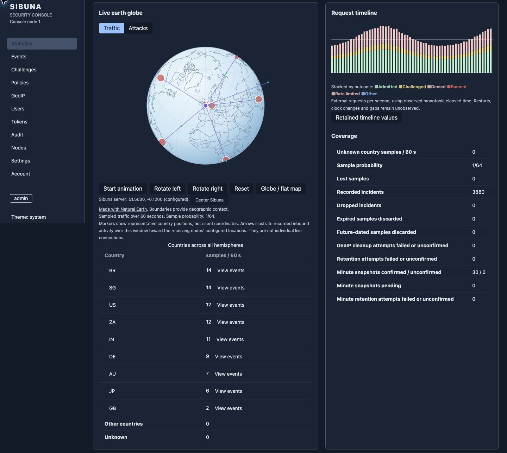
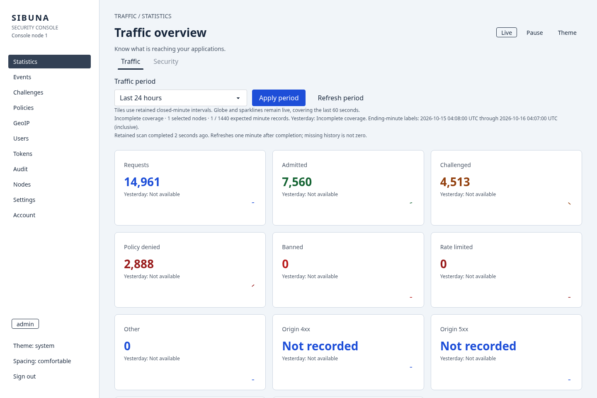
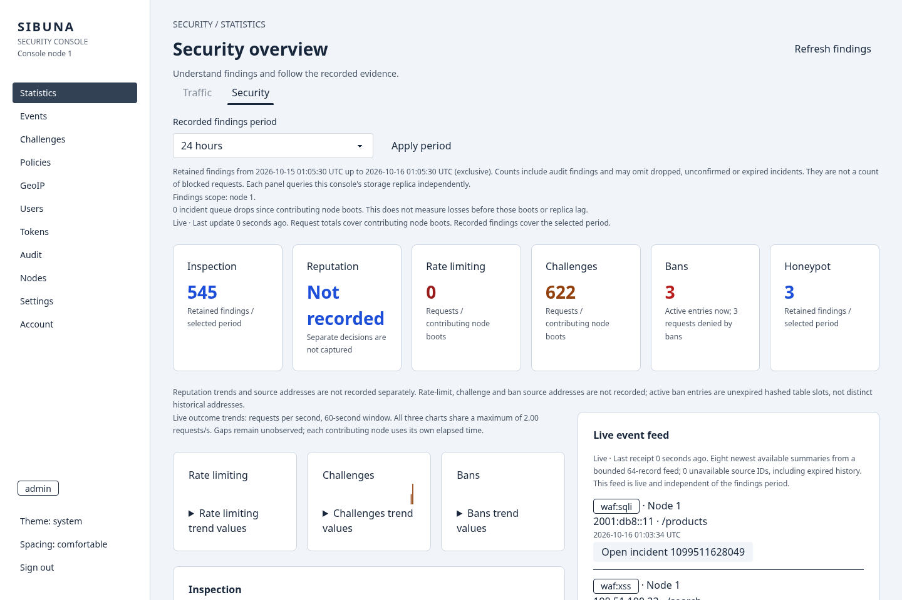
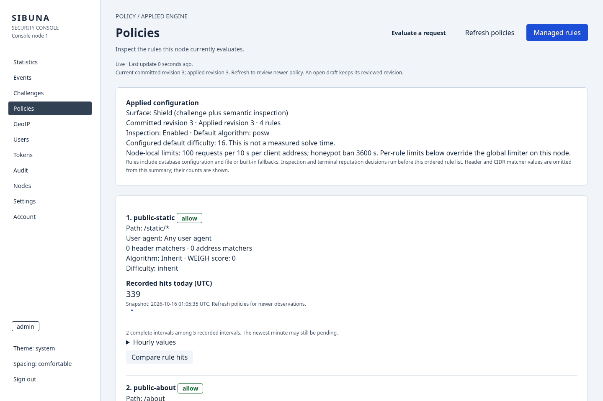
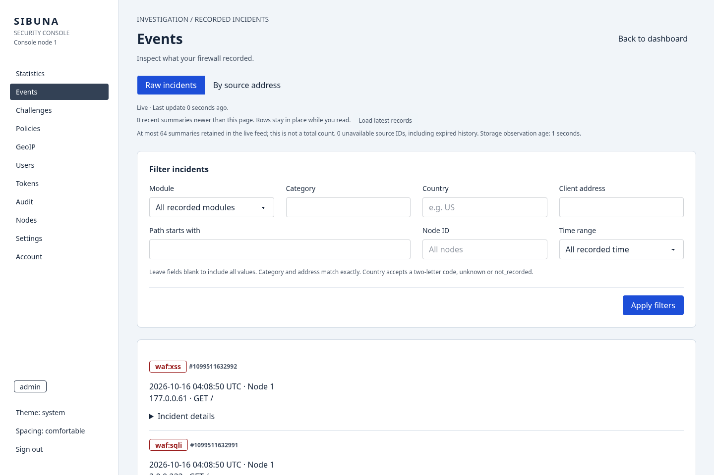
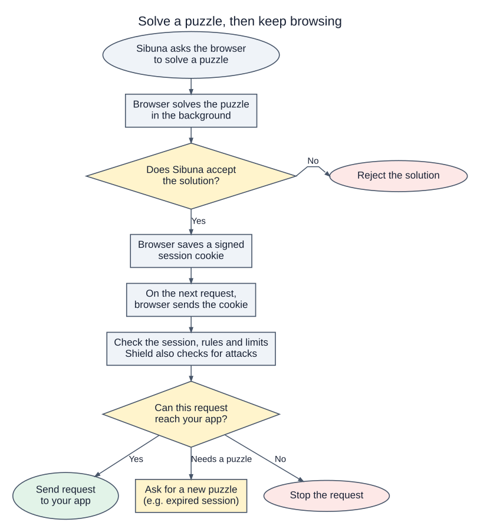
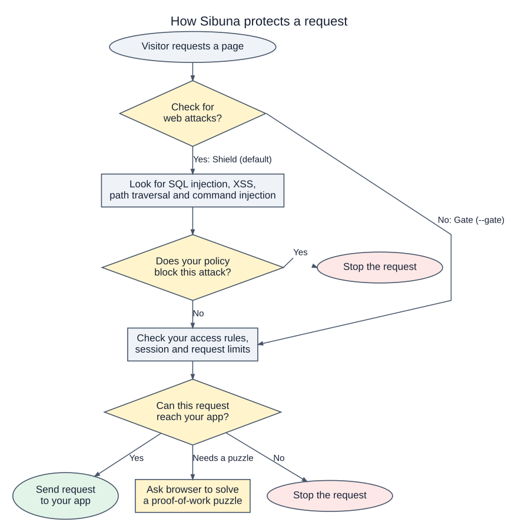
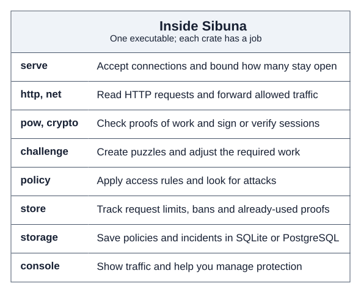

<!-- English source SHA-256: 331b33dcfa1187045c4d09efe004a4c272482ff10db48816f67090e01a0a80f8 -->
<h1 align="center">sibuna</h1>
<p align="center">ब्राउज़र Proof of Work और वैकल्पिक कंसोल के साथ वेब सुरक्षा।</p>
<p align="center">
  <a href="#features">सुविधाएँ</a> ·
  <a href="#quickstart">त्वरित शुरुआत</a> ·
  <a href="#console">कंसोल</a> ·
  <a href="#how-it-works">कार्यप्रणाली</a> ·
  <a href="#documentation">दस्तावेज़</a>
</p>

<!-- language-navigation -->
<p align="center">
  <a href="README.md">English</a> · <a href="README.zh-CN.md">简体中文</a> ·
  <a href="README.ko.md">한국어</a> · <a href="README.ja.md">日本語</a> ·
  <a href="README.es.md">Español</a> · <a href="README.de.md">Deutsch</a> ·
  <a href="README.hi.md">हिन्दी</a> · <a href="README.ar.md">العربية</a>
</p>

**Sibuna वेबसाइटों और APIs को अनचाहे बॉट ट्रैफ़िक से बचाने में मदद करता है।** यह आपके ऐप तक अनुरोध फ़ॉरवर्ड कर सकता है या Caddy अथवा nginx जैसे मौजूदा प्रॉक्सी के साथ मिलकर काम कर सकता है।

अनुरोध भेजना अक्सर सस्ता होता है। उन्हें प्रोसेस करने में आपके ऐप को अधिक काम करना पड़ सकता है। Sibuna ऐक्सेस देने से पहले क्लाइंट्स से एक पहेली हल करवाता है। पहेली को इस तरह डिज़ाइन किया गया है कि प्रूफ़ बनाने में उसे वेरिफ़ाई करने की तुलना में अधिक गणना (Computation) लगे। इससे ऑटोमेटेड क्लाइंट्स साइट ऐक्सेस करने की लागत का अधिक हिस्सा उठाते हैं।

कंप्यूटेशन में ऊर्जा भी लगती है, लेकिन इसकी मात्रा हार्डवेयर और सेटिंग्स पर निर्भर करती है। Proof of work प्रवेश की एक लागत जोड़ता है। यह आगंतुक के इंसान होने का प्रमाण नहीं देता और न ही हर हमले को रोकता है। एक हस्ताक्षरित सत्र (Signed session) स्वीकृत क्लाइंट्स को हर अनुरोध पर नई पहेली हल किए बिना लौटने देता है। बाद में ये क्लाइंट्स क्या अनुरोध कर सकते हैं, इसे एक्सेस नियमों और स्थानीय रेट लिमिट्स से नियंत्रित करें।

<a id="features"></a>

## सुविधाएँ

- **एकल निष्पादन योग्य फ़ाइल (Single executable):** इंजन, एम्बेडेड SQLite स्टोरेज, ब्राउज़र सॉल्वर और कंसोल एसेट्स।
- **नेटिव पैकेज:** Linux, macOS, Windows, FreeBSD और OpenBSD। ब्राउज़र सॉल्वर WebAssembly का उपयोग करता है।
- **ब्राउज़र चैलेंज:** सीक्वेंशियल वर्क का प्रूफ़ (डिफ़ॉल्ट) या Hashcash, जिसके बाद हस्ताक्षरित सत्र।
- **एक्सेस नीतियाँ:** पते, पाथ, हेडर और User-Agent के आधार पर अनुरोधों को अनुमति (Allow), चैलेंज (Challenge), भार (Weigh) या अस्वीकार (Deny) करें।
- **TLS फ़िंगरप्रिंट:** विश्वसनीय इनग्रेस द्वारा फ़ॉरवर्ड किए गए JA4 फ़िंगरप्रिंट का सटीक रूप से या प्रीफ़िक्स (Prefix) के आधार पर मिलान करें।
- **एप्लिकेशन निरीक्षण:** SQL इंजेक्शन, XSS, पाथ ट्रैवर्सल और कमांड इंजेक्शन के लिए इन-बिल्ट जाँच।
- **स्थानीय रेट लिमिट्स:** अचानक बढ़ने वाले (Burst) और निरंतर ट्रैफ़िक को नियंत्रित करें, नियम-वार वैकल्पिक सीमाओं के साथ।
- **ऑपरेटर कंसोल:** ट्रैफ़िक, देश-वार नमूना गतिविधि, दर्ज की गई घटनाएँ और नीति संपादन।
- **क्लस्टर समर्थन:** एक अलग बिल्ड PostgreSQL के माध्यम से नीतियाँ और प्रतिष्ठा (Reputation) डेटा साझा करता है।

<a id="quickstart"></a>

## त्वरित शुरुआत (Quickstart)

अपने प्लेटफ़ॉर्म के लिए [रिलीज़ डाउनलोड करें](https://github.com/insanai/sibuna/releases/tag/v1.0.0-beta.2)। डिफ़ॉल्ट पैकेज में स्टोरेज और कंसोल समर्थन शामिल है। कंसोल `--console` के साथ शुरू होता है।

| प्लेटफ़ॉर्म | पैकेज | आवश्यकताएँ |
| --- | --- | --- |
| Linux x86-64 | `sibuna-linux-amd64.tar.gz` | Linux 5.10 या बाद का; statically linked musl |
| Linux ARM64 | `sibuna-linux-arm64.tar.gz` | Linux 5.10 या बाद का; statically linked musl |
| macOS Apple Silicon | `sibuna-macos-arm64.tar.gz` | macOS 12 या बाद का |
| macOS Intel | `sibuna-macos-amd64.tar.gz` | macOS 12 या बाद का |
| Windows x86-64 | `sibuna-windows-amd64.zip` | Windows 10 / Server 2016 या बाद का; नेटिव `sibuna.exe` |
| FreeBSD x86-64 | `sibuna-1.0.0-beta.2-freebsd-15.1-amd64.pkg` | FreeBSD 15.1; CLI पैकेज |
| OpenBSD x86-64 | `sibuna-1.0.0-beta.2.tgz` | OpenBSD 7.9; CLI पैकेज |

यह एक बीटा रिलीज़ है। macOS बिल्ड बिना हस्ताक्षर वाले (Unsigned) हैं। प्रत्येक पैकेज में लाइसेंस, सोर्स लिंक और बिल्ड मैनिफ़ेस्ट शामिल हैं। उपयोग करने से पहले `SHA256SUMS` के विरुद्ध आर्काइव को सत्यापित (Verify) करें।

Debian/RPM पैकेज Linux x86-64 और ARM64 के लिए हैं; Arch `sibuna-bin` x86-64 के लिए है। FreeBSD 15.1 और OpenBSD 7.9 पैकेज x86-64 के लिए हैं और CLI स्थापित करते हैं। Linux पैकेज में एक वैकल्पिक, निष्क्रिय systemd सेवा शामिल है। BSD पैकेज कोई सेवा, खाता या स्थिति नहीं बनाते। ये upstream डाउनलोड हैं; सामुदायिक रिपॉज़िटरी की स्वीकृति अलग विषय है। रिलीज़ में एक Helm chart और एक कंटेनर इमेज, `ghcr.io/insanai/sibuna`, भी शामिल है। स्थापना, सत्यापन, निजी स्थिति, अपग्रेड और Kubernetes सेटअप के लिए [पैकेज संचालन मार्गदर्शिका](https://insanai.github.io/sibuna/book/operations.html) देखें।

[Sibuna Homebrew tap](https://github.com/insanai/homebrew-sibuna) एक CLI formula प्रदान करता है, जो macOS और Linux (Apple Silicon, ARM64 और x86-64) के लिए सत्यापित रिलीज़ आर्काइव स्थापित करती है। Tap नवीनतम प्रकाशित रिलीज़ का अनुसरण करता है, इसलिए यह बीटा उसमें पहले से उपलब्ध है। स्थापना से कोई सेवा शुरू नहीं होती:

```sh
brew tap insanai/sibuna
brew install insanai/sibuna/sibuna
sibuna --version
```

Linux x86-64 के लिए, यदि आपका ऐप पोर्ट 3000 पर सुन रहा है:

```sh
curl -fLO https://github.com/insanai/sibuna/releases/download/v1.0.0-beta.2/sibuna-linux-amd64.tar.gz
curl -fLO https://github.com/insanai/sibuna/releases/download/v1.0.0-beta.2/SHA256SUMS
sha256sum --ignore-missing -c SHA256SUMS
tar -xzf sibuna-linux-amd64.tar.gz
(umask 077; openssl rand -hex 32 > sibuna.seed)
./sibuna --host 127.0.0.1 --port 8080 --upstream-port 3000 --secret-file ./sibuna.seed
```

स्थानीय रूप से आज़माने के लिए `http://127.0.0.1:8080` खोलें। सार्वजनिक साइट के लिए, विश्वसनीय इनग्रेस (Trusted ingress) पर HTTPS समाप्त (Terminate) करें और Sibuna के लिसनर को निजी रखें। Caddy या nginx के लिए [डिप्लॉयमेंट गाइड](https://insanai.github.io/sibuna/book/operations.html) का पालन करें।

डिफ़ॉल्ट मोड `reverse_proxy` है। जब आपका इनग्रेस अनुरोधों को फ़ॉरवर्ड करता है और Sibuna से एक्सेस निर्णय पूछता है, तब `--mode forward_auth` का उपयोग करें। गाइड में दोनों कॉन्फ़िगरेशन शामिल हैं। Shield का इन-बिल्ट निरीक्षण डिफ़ॉल्ट रूप से सक्षम है। उस इंस्पेक्टर के बिना प्रवेश नियंत्रण (Admission) के लिए `--gate` का उपयोग करें। `--policy-file <file>` से एक्सेस नियम चुनें, जिनमें ऐसे API क्लाइंट्स और हेल्थ चेक्स के नियम भी शामिल हैं जो ब्राउज़र चैलेंज नहीं चला सकते। `./sibuna --help` सभी विकल्पों की सूची दिखाता है।

Windows पर, ZIP एक्सट्रैक्ट करें और PowerShell में `.\sibuna.exe --help` चलाएँ। इसे रोकने के लिए Ctrl+C दबाएँ। Windows ACLs का उपयोग करके सीड (Seed), क्रेडेंशियल और डेटा फ़ाइलों तक पहुँच को सीमित करें।

<a id="build-from-source"></a>

### सोर्स कोड से बिल्ड करें

हम **Rust 1.99** के साथ बिल्ड और परीक्षण करते हैं। ब्राउज़र सॉल्वर और कंसोल इंटरफ़ेस WebAssembly में कंपाइल किया गया Rust कोड हैं; बिल्ड के लिए Node या npm की आवश्यकता नहीं होती।

```sh
git clone https://github.com/insanai/sibuna.git
cd sibuna
rustup target add wasm32-unknown-unknown
cargo build --release -p sibuna
```

निष्पादन योग्य फ़ाइल (Executable) `target/release/sibuna` है। यह `--data-dir` के साथ स्थिति (State) को SQLite में संग्रहीत करती है। क्लस्टर बिल्ड `--features postgres-tls` का उपयोग करते हैं और `--database-url-file` तथा `--cluster-node` के माध्यम से एक PostgreSQL डेटाबेस साझा करते हैं। परीक्षण, लिंट और आकार जाँच के लिए [CONTRIBUTING.md](CONTRIBUTING.md) देखें।

<a id="console"></a>

## कंसोल

कंसोल उसी निष्पादन योग्य फ़ाइल में चलता है। जब डेमन बंद हो, तब एडमिनिस्ट्रेटर को बूटस्ट्रैप करें:

```sh
./sibuna init-admin admin --data-dir ./data
./sibuna --host 127.0.0.1 --upstream-port 3000 --secret-file ./sibuna.seed \
  --data-dir ./data --console 127.0.0.1:19446
```

`http://127.0.0.1:19446/console/` खोलें और अस्थायी पासवर्ड बदलें। [ऑपरेशन्स गाइड](https://insanai.github.io/sibuna/book/operations.html) में HTTPS एक्सेस, GeoIP आयात, उपयोगकर्ताओं, API टोकन और वॉल डिस्प्ले के बारे में बताया गया है।



ग्लोब पिछले एक मिनट में देश-वार नमूना गतिविधि दिखाता है। मार्कर देशों की अनुमानित स्थिति दर्शाते हैं। तीर सर्वर के कॉन्फ़िगर किए गए स्थान की ओर इशारा करते हैं। वे व्यक्तिगत लाइव कनेक्शन नहीं दिखाते हैं। GeoIP के लिए अलग से आयातित डेटासेट की आवश्यकता होती है। सर्वर को ग्लोब पर स्थापित करने के लिए `--console-location <latitude,longitude>` सेट करें।

<details>
<summary>ट्रैफ़िक अवलोकन, सुरक्षा अवलोकन, नीतियाँ और घटना जाँच</summary>

**ट्रैफ़िक अवलोकन** - अनुरोध परिणाम, अवलोकन विंडो और लाइव अपडेट।



**सुरक्षा अवलोकन** - दर्ज किए गए निष्कर्ष (Findings), चैलेंज, प्रतिबंध (Bans) और लाइव इवेंट फ़ीड।



**नीतियाँ** - वे नियम जिन्हें एक नोड क्रम से लागू करता है, उनके दर्ज हिट्स के साथ।



**इवेंट्स** - दर्ज की गई घटनाएँ, मॉड्यूल, देश, पते, पाथ और समय के अनुसार फ़िल्टर के साथ।



</details>

ये एक स्थानीय परीक्षण नोड पर v1.0.0-beta.1 के headless Chromium कैप्चर हैं। ट्रैफ़िक और GeoIP मैपिंग परीक्षण डेटा हैं। प्रदर्शित संख्याएँ बेंचमार्क परिणाम नहीं हैं।

<a id="how-it-works"></a>

## यह कैसे काम करता है

अनुरोध को स्वीकार (Admit), चुनौती (Challenge) या अस्वीकार (Deny) किया जा सकता है। जो आगंतुक चुनौती हल करता है उसे एक हस्ताक्षरित सत्र प्राप्त होता है। बाद के अनुरोध भी लागू नीति और दर जाँच से गुजरते हैं।

<picture>
  <source media="(prefers-color-scheme: dark)" srcset="docs/readme/images/admission-session-dark.svg">
  
</picture>

Gate एक्सेस नियमों, सत्रों और स्थानीय रेट लिमिट्स की जाँच करता है। Shield इन-बिल्ट आक्रमण निरीक्षक जोड़ता है। Shield डिफ़ॉल्ट है; `--gate` स्टार्टअप पर Gate चुनता है।

<details>
<summary>Gate, Shield और Sibuna के अंदर के क्रेट्स (Crates)</summary>

<picture>
  <source media="(prefers-color-scheme: dark)" srcset="docs/readme/images/protection-surfaces-dark.svg">
  
</picture>

यह आरेख इन-बिल्ट Gate और Shield जाँचों को दिखाता है। एक वैध सत्र लागू आक्रमण जाँचों या अनुरोध सीमाओं को बायपास नहीं करता है।

<picture>
  <source media="(prefers-color-scheme: dark)" srcset="docs/readme/images/subsystems-dark.svg">
  
</picture>

क्रेट्स नेटवर्किंग, प्रूफ़, नीतियों, स्थानीय स्थिति, स्टोरेज और प्रबंधन को अलग रखते हैं। [पुस्तक](https://insanai.github.io/sibuna/book/) उनकी ज़िम्मेदारियों की व्याख्या करती है।

</details>

<a id="deployment-limits"></a>

### डिप्लॉयमेंट सीमाएँ

Sibuna अपने निजी लिसनर पर HTTP/1.1 का उपयोग करता है। आपका इनग्रेस सार्वजनिक TLS और HTTP/2 को संभालता है। Forward-auth इनग्रेस द्वारा प्रदान किए गए मेटाडेटा का निरीक्षण करता है। रिवर्स-प्रॉक्सी मोड में, इन-बिल्ट इंस्पेक्टर बॉडी के पहले 8 KiB को कवर करता है। अपलोड आपके ऐप तक स्ट्रीम होते हैं। WebSocket संदेश बिना निरीक्षण के रिले किए जाते हैं। इंस्पेक्टर एक ह्यूरिस्टिक (Heuristic) है, पूर्ण भाषा पार्सर नहीं।

रेट लिमिट्स प्रत्येक नोड के लिए स्थानीय होती हैं। Sibuna वॉल्यूमेट्रिक नेटवर्क शमन (Volumetric network mitigation) प्रदान नहीं करता है। चैलेंज उन्हें जारी करने वाले नोड से बँधे होते हैं; किसी चैलेंज और उसके समाधान को एक ही नोड तक रूट करें। कंसोल का सख्त प्रदर्शन लक्ष्य औपचारिक रूप से पास नहीं हुआ है। प्रोडक्शन ऐप के साथ कंसोल सक्षम करने से पहले [डिप्लॉयमेंट सीमाएँ और मापन](https://insanai.github.io/sibuna/book/operations.html) की समीक्षा करें।

<a id="benchmarks"></a>

## बेंचमार्क

पुस्तक प्रत्येक रन के लिए सोर्स रिविज़न, कॉन्फ़िगरेशन और होस्ट दर्ज करती है। ये मापन एक मशीन पर कुछ वर्कलोड के तहत अनुरोध लागत दिखाते हैं। वे समान सुरक्षा या बॉट सटीकता को नहीं मापते हैं।

<a id="sibuna-on-one-host"></a>

### एक होस्ट पर Sibuna

इन रन में AMD Ryzen 9 5950X का उपयोग किया गया। डेमन को चार CPU मिले और वह मेमोरी में चला; लोड जनरेटर और एक स्टब ओरिजिन आठ अन्य CPU पर चले। `wrk` ने लूपबैक पर 64 कनेक्शन का उपयोग किया। आंकड़े तीन रन की माध्यिका (Median) हैं।

- Forward-auth मोड में, हर वर्कलोड 197,532 से 211,636 अनुरोध प्रति सेकंड पर चला, जिसमें p99 305 से 327 us और प्रति अनुरोध 11.7 से 13.8 us CPU रहा। सीमा लोड जनरेटर की थी।
- प्रॉक्सी किए गए अनुरोध 138,965 से 147,303 प्रति सेकंड पर चले। पीक मेमोरी लगभग 16 MiB थी।
- प्रति सेकंड 100,000 स्वीकृत अनुरोधों के समान प्रस्तावित लोड पर, p99.9 लेटेंसी forward-auth मोड में 62 us और रिवर्स-प्रॉक्सी मोड में 150 us थी।

<a id="beside-anubis"></a>

### Anubis के साथ

हमने आधिकारिक Anubis 1.27.0 रिलीज़ बाइनरी को समान वर्कलोड, CPU और लोड जनरेटर के साथ मापा। Hashcash कार्य बराबर रखा गया: Sibuna के लिए 8 शून्य बिट, Anubis के लिए 2 शून्य हेक्स अंक। ओरिजिन `caddy respond` था। तालिका सत्र वाले स्वीकृत अनुरोध दिखाती है।

| स्वीकृत अनुरोध | Sibuna Gate | Sibuna Shield | Anubis 1.27.0 |
| --- | ---: | ---: | ---: |
| Forward auth, req/s | 210,682 | 208,635 | 36,509 |
| Forward auth, p99 | 305 us | 308 us | 7,477 us |
| Forward auth, प्रति अनुरोध CPU | 12.1 us | 13.2 us | 106.3 us |
| रिवर्स प्रॉक्सी, req/s | 106,376 | 103,298 | 19,398 |
| रिवर्स प्रॉक्सी, p99 | 3,331 us | 3,321 us | 11,062 us |

दूसरे रन में प्रवेश (Admission) संचालनों का समय मापा गया, प्रत्येक उत्पाद दो CPU पर। Anubis एक बार अपने डिफ़ॉल्ट Ed25519 टोकन के साथ और एक बार HS512 टोकन के साथ चला।

| प्रति सेकंड संचालन | Sibuna (कुंजी-युक्त BLAKE3) | Anubis (Ed25519) | Anubis (HS512) |
| --- | ---: | ---: | ---: |
| वैध सत्र जाँच | 88,104 | 10,951 | 16,976 |
| अप्रमाणित जाँच | 78,997 | 28,619 | 27,785 |
| चैलेंज बूटस्ट्रैप | 42,664 | 7,893 | 7,952 |
| प्रूफ़ सत्यापन | 57,924 | 12,668 | 19,261 |

Sibuna की पीक मेमोरी लगभग 16 MiB के आसपास रही। Anubis ने forward-auth मोड में लगभग 33 MiB और रिवर्स-प्रॉक्सी मोड में लगभग 600 MiB तक का उपयोग किया। Anubis एक व्यापक रूप से उपयोग किया जाने वाला और सक्षम टूल है, और ये पंक्तियाँ कोई रैंकिंग नहीं हैं। कई पंक्तियाँ समान स्थितियों की तुलना नहीं हैं: forward-auth मोड में Anubis कुछ पाथ का उत्तर स्वयं देता है, वह पेलोड निरीक्षण नहीं करता, और चैलेंज पेज भिन्न हैं। रन में लूपबैक का उपयोग किया गया, बिना TLS, वास्तविक ब्राउज़र या स्टोरेज के।

विधि, रेंज और पुनः चलाने के कमांड के लिए [बेंचमार्क रिकॉर्ड](benchmarks/results/README.md) देखें: [product-latest.md](benchmarks/results/product-latest.md), [latency-latest.md](benchmarks/results/latency-latest.md), [comparison-latest.md](benchmarks/results/comparison-latest.md) और [admission-latest.md](benchmarks/results/admission-latest.md)। पुस्तक का भाग VIII प्रत्येक अंतर पर चर्चा करता है।

<a id="documentation"></a>

## दस्तावेज़

- [पुस्तक](https://insanai.github.io/sibuna/book/): अवधारणाएँ, एल्गोरिदम, उदाहरण और मापन।
- [व्हाइटपेपर](https://insanai.github.io/sibuna/whitepaper/): आर्किटेक्चर, प्रूफ़ और डिज़ाइन विवरण।
- [ऑपरेशन्स गाइड](https://insanai.github.io/sibuna/book/operations.html): इंस्टॉलेशन और डिप्लॉयमेंट।
- [रेफ़रेंस](https://insanai.github.io/sibuna/book/reference.html): CLI और प्रोटोकॉल विवरण।
- [डिज़ाइन चर्चाएँ](https://insanai.github.io/sibuna/sid/): निर्णय और इंजीनियरिंग अनुबंध।
- [योगदान](CONTRIBUTING.md): सोर्स बिल्ड और जाँच।

<a id="other-software-to-consider"></a>

## अन्य विचारणीय सॉफ़्टवेयर

- [Anubis](https://github.com/TecharoHQ/anubis): क्रॉलर ट्रैफ़िक कम करने के लिए ब्राउज़र चैलेंज।
- [BunkerWeb](https://github.com/bunkerity/bunkerweb): nginx, ModSecurity, CRS और बॉट चैलेंज।
- [ModSecurity](https://github.com/owasp-modsecurity/ModSecurity): कनेक्टर्स के माध्यम से उपयोग किया जाने वाला WAF इंजन।
- [Coraza](https://github.com/corazawaf/coraza): ModSecurity नियमों और CRS का समर्थन करने वाली Go WAF लाइब्रेरी।
- [OWASP Core Rule Set](https://github.com/coreruleset/coreruleset): WAF इंजनों के लिए आक्रमण-पहचान नियम।

ये प्रोजेक्ट वेब सुरक्षा के विभिन्न पहलुओं को संभालते हैं। Sibuna का इंस्पेक्टर इन-बिल्ट है; यह CRS या अन्य ModSecurity नियम सेट नहीं चलाता। जब आपके ऐप को व्यापक नियम कवरेज की आवश्यकता हो, तब Sibuna को एक पूर्ण WAF के साथ उपयोग करें।

<a id="license"></a>

## लाइसेंस

Sibuna **LGPL 3.0 या बाद के संस्करण** के तहत है। यह लाइसेंस इंजन, लाइब्रेरी, ब्राउज़र सॉल्वर और कंसोल को, उसके WebAssembly इंटरफ़ेस सहित, कवर करता है।

[LICENSE](LICENSE) इसके दायरे का वर्णन करता है। [LICENSES](LICENSES) में पूर्ण शर्तें शामिल हैं। [NOTICE](NOTICE) निर्भरताएँ सूचीबद्ध करता है। सोर्स और बिल्ड स्क्रिप्ट प्रत्येक रिलीज़ टैग के तहत उपलब्ध हैं।

Sibuna को Vikrant Rathore ने Ronak Rathore और Kanak Rathore की सहायता से लिखा है। अन्य लाइसेंस शर्तों की तलाश करने वाली कंपनियाँ Vikrant Rathore से संपर्क कर सकती हैं। तृतीय-पक्ष लाइब्रेरी और सामग्रियाँ अपने संबंधित लाइसेंस बनाए रखती हैं।
