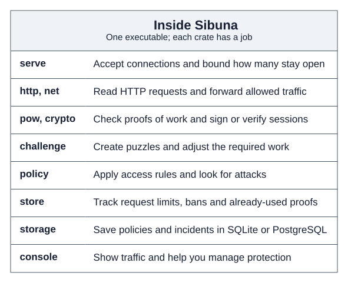

<!-- English source SHA-256: 4f4a4074b23f24663e85b168db739f9d4ca9cf40431e796253bdc84612f5fcea -->
<h1 align="center">sibuna</h1>
<p align="center">वितरित लोड बैलेंसर और वेब एप्लिकेशन फ़ायरवॉल</p>
<p align="center">
  <a href="#features">सुविधाएँ</a> ·
  <a href="#load-balancing">लोड बैलेंसिंग</a> ·
  <a href="#quickstart">त्वरित शुरुआत</a> ·
  <a href="#console">कंसोल</a> ·
  <a href="#how-it-works">कार्यप्रणाली</a> ·
  <a href="#documentation">दस्तावेज़</a>
</p>

<!-- language-navigation -->
<p align="center">
  <a href="README.md">English</a> · <a href="README.zh-CN.md">简体中文</a> ·
  <a href="README.ko.md">한국어</a> · <a href="README.ja.md">日本語</a> ·
  <a href="README.es.md">Español</a> · <a href="README.de.md">Deutsch</a> ·
  <a href="README.hi.md">हिन्दी</a> · <a href="README.ar.md">العربية</a>
</p>

Sibuna TCP, UDP और HTTP ट्रैफ़िक को स्वस्थ सर्वरों तक पहुँचाता है। हम एक एज चला सकते हैं या कई एज को मेश में जोड़ सकते हैं। हर एज पर TLS समाप्त कर सकते हैं और चुने हुए HTTP रूट पर फ़ायरवॉल लगा सकते हैं।

## Sibuna के उपयोग

- **सार्वजनिक वेबसाइट**

  हम ब्राउज़र को HTTP/2 या HTTP/3 पर सेवा देते हैं, Let's Encrypt से सार्वजनिक प्रमाणपत्र नवीनीकृत करते हैं और अनुरोधों को HTTP/1.1 प्रतिकृतियों तक भेजने से पहले जाँचते हैं।
- **आंतरिक gRPC सेवाएँ**

  हम स्थानीय CA से आंतरिक नामों के प्रमाणपत्र जारी करते हैं। क्लाइंट उसके रूट पर भरोसा करते हैं और TLS पर सेवा को कॉल करते हैं। HTTP/2 बैकएंड gRPC संदेश और ट्रेलर पहुँचाता है।
- **एज नोड का क्लस्टर**

  हम जाँचा हुआ रूटिंग कॉन्फ़िगरेशन पूरे मेश में वितरित करते हैं। हर नोड अपने बैकएंड पूल को ट्रैफ़िक भेजता है और प्रतिबंध व सीखे हुए सर्वर आवंटन साझा कर सकता है।

[Jlavi से Sibuna का कॉन्फ़िगरेशन](https://insanai.github.io/sibuna/hi/book/jlavi.html)

<a id="features"></a>

## सुविधाएँ

- **एक ही बाइनरी:** इंजन, एम्बेडेड SQLite स्टोरेज, ब्राउज़र सॉल्वर और कंसोल की फ़ाइलें।
- **नेटिव पैकेज:** Linux, macOS, Windows, FreeBSD और OpenBSD। ब्राउज़र सॉल्वर WebAssembly का उपयोग करता है।
- **ब्राउज़र चैलेंज:** अनुक्रमिक कार्य का प्रमाण (डिफ़ॉल्ट) या Hashcash, जिसके बाद हस्ताक्षरित सत्र मिलता है।
- **पहुँच नीतियाँ:** पते, पाथ, हेडर और User-Agent के आधार पर अनुरोधों को allow, challenge, weigh या deny करें।
- **लोड बैलेंसिंग:** कई सर्वर के आगे TCP, UDP और HTTP, TLS टर्मिनेशन, स्वचालित सर्टिफ़िकेट और क्लस्टर मोड के साथ। [लोड बैलेंसिंग](#load-balancing) देखें।
- **TLS फ़िंगरप्रिंट:** विश्वसनीय इनग्रेस द्वारा फ़ॉरवर्ड किए गए JA4 फ़िंगरप्रिंट का ठीक-ठीक या प्रीफ़िक्स से मिलान करें।
- **एप्लिकेशन निरीक्षण:** SQL injection, XSS, path traversal और command injection के लिए बिल्ट-इन जाँचें।
- **स्थानीय रेट लिमिट:** बर्स्ट और लगातार ट्रैफ़िक को नियंत्रित करें, वैकल्पिक प्रति-नियम सीमाओं के साथ।
- **ऑपरेटर कंसोल:** ट्रैफ़िक, देशों की सैंपल की गई गतिविधि, दर्ज घटनाएँ और नीति संपादन।
- **क्लस्टर समर्थन:** एक अलग बिल्ड PostgreSQL के ज़रिए नीतियाँ और प्रतिष्ठा साझा करता है।

<a id="load-balancing"></a>

## लोड बैलेंसिंग

Sibuna 1.0.0-rc.1 में एज मोड शामिल है। नीचे दिए गए डाउनलोड beta.3 के लिए हैं। हम [रिलीज़ कैंडिडेट को स्रोत से भी बिल्ड कर सकते हैं](#build-from-source)।

```sh
sibuna lb --bind :8080 --server 10.0.0.1:80 --server 10.0.0.2:80
sibuna lb --tls auto --domain example.org --server 10.0.0.1:80
sibuna lb --bind :8080 --server 10.0.0.1:80 --print-config > edge.jlv
sibuna check -f edge.jlv
sibuna --config-file edge.jlv
```

- **फ़ॉरवर्डिंग:** TCP और UDP, सर्वर नाम के आधार पर रूट होने वाला TLS पासथ्रू, QUIC पासथ्रू और PROXY प्रोटोकॉल।
- **HTTP:** HAProxy-शैली के PEM बंडल के साथ TLS टर्मिनेशन; HTTP/1.1, HTTP/2, HTTP/3 और WebSocket; होस्ट नाम और पाथ के आधार पर HTTP/1.1, HTTP/2 या HTTP/3 सर्वर तक रूटिंग। Linux पर इवेंट-ड्रिवन वर्कर कनेक्शन संभालते हैं, हर प्रोसेसर पर एक वर्कर।
- **सर्टिफ़िकेट:** ACME के ज़रिए स्वचालित, नवीनीकरण, फ़ॉलबैक अथॉरिटी और एक्सटर्नल अकाउंट बाइंडिंग के साथ; हुक प्रोग्राम, RFC 2136 अपडेट या Cloudflare API के साथ DNS के ज़रिए वाइल्डकार्ड; OCSP स्टेपलिंग; गार्ड के पीछे माँग पर सर्टिफ़िकेट; `localhost`, आंतरिक नामों और IP पतों के लिए एक स्थानीय अथॉरिटी, जिसकी अपनी रिवोकेशन सूची और अपना ACME सर्वर है।
- **सर्वर:** हेल्थ चेक, स्लो स्टार्ट, ड्रेनिंग, वेट, स्टिकी सत्र और हर सर्वर के लिए फ़्लो की एक सीमा।
- **चलते हुए बदलाव:** सफल रीलोड के बाद मौजूदा TCP कनेक्शन बने रहते हैं। एडमिन सॉकेट सर्वर को ड्रेन करता है, उनका वेट बदलता है, उन्हें जोड़ता और हटाता है (`sibuna ctl /run/sibuna/edge.sock set server app/10.0.0.1:80 state drain`)। Linux पर नया एक्ज़ीक्यूटेबल पुराने से लिसनिंग सॉकेट और UDP मैपिंग ले लेता है; QUIC कनेक्शन समाप्त हो जाते हैं।
- **क्लस्टर:** मेश के नोड स्टिकी टेबल और सर्वर की फ़्लो लिमिट साझा करते हैं, और क्लाइंट को उस नोड पर फ़ॉरवर्ड करते हैं जो उसका मालिक है। PostgreSQL डेटाबेस एक ही कॉन्फ़िगरेशन हर नोड पर प्रकाशित कर सकता है और उसे रोल बैक कर सकता है। एक मैप की गई फ़ाइल रीस्टार्ट के बाद भी एफ़िनिटी के संकेत बनाए रखती है।
- **हुक:** कनेक्शन पर और अनुरोध पर, साथ में कंपाइल होकर, बजट वाले WebAssembly के रूप में, या Unix सॉकेट पर एक एजेंट के रूप में।
- **निगरानी:** मेट्रिक्स, एक्सेस लॉग और सर्वर, फ़्लो और अस्वीकृतियों का कंसोल व्यू।

Gate या Shield उन्हीं नामों पर लागू होता है जिन्हें इसकी ज़रूरत है, या किसी पर नहीं। फ़ाइल ही आधिकारिक स्रोत रहती है: रनटाइम पर किया गया बदलाव अगले रीलोड तक रहता है।

प्रोडक्शन ट्रैफ़िक पर परीक्षण अभी बाकी है। इसकी क्लस्टर सुविधाएँ तीन होस्ट पर परखी गईं। हर [डिज़ाइन चर्चा](https://insanai.github.io/sibuna/sid/) बताती है कि क्या बन चुका है और कौन-सी कमियाँ ज्ञात हैं।

<a id="quickstart"></a>

## त्वरित शुरुआत

अपने प्लेटफ़ॉर्म के लिए [रिलीज़ डाउनलोड करें](https://github.com/insanai/sibuna/releases/tag/v1.0.0-beta.3)। डिफ़ॉल्ट पैकेज में स्टोरेज और कंसोल का समर्थन शामिल है। कंसोल `--console` के साथ शुरू होता है।

| प्लेटफ़ॉर्म | पैकेज | आवश्यकताएँ |
| --- | --- | --- |
| Linux x86-64 | `sibuna-linux-amd64.tar.gz` | Linux 5.10 या बाद का; स्टैटिक रूप से लिंक किया गया musl |
| Linux ARM64 | `sibuna-linux-arm64.tar.gz` | Linux 5.10 या बाद का; स्टैटिक रूप से लिंक किया गया musl |
| macOS Apple Silicon | `sibuna-macos-arm64.tar.gz` | macOS 12 या बाद का |
| macOS Intel | `sibuna-macos-amd64.tar.gz` | macOS 12 या बाद का |
| Windows x86-64 | `sibuna-windows-amd64.zip` | Windows 10 / Server 2016 या बाद का; नेटिव `sibuna.exe` |
| FreeBSD x86-64 | `sibuna-1.0.0-beta.3-freebsd-15.1-amd64.pkg` | FreeBSD 15.1; CLI पैकेज |
| OpenBSD x86-64 | `sibuna-1.0.0-beta.3.tgz` | OpenBSD 7.9; CLI पैकेज |

यह एक बीटा रिलीज़ है। macOS बिल्ड अहस्ताक्षरित हैं। हर पैकेज में लाइसेंस, स्रोत के लिंक और एक बिल्ड manifest है। उपयोग से पहले आर्काइव को `SHA256SUMS` से सत्यापित करें।

Debian/RPM पैकेज Linux x86-64 और ARM64 के लिए हैं; Arch का `sibuna-bin` x86-64 के लिए है। FreeBSD 15.1 और OpenBSD 7.9 पैकेज x86-64 के लिए हैं और CLI इंस्टॉल करते हैं। Linux पैकेज में एक वैकल्पिक, अक्षम systemd सेवा शामिल है। BSD पैकेज कोई सेवा, खाता या संग्रहीत अवस्था नहीं बनाते। ये upstream डाउनलोड हैं; सामुदायिक रिपॉज़िटरी में स्वीकृति एक अलग विषय है। रिलीज़ में एक Helm chart और एक कंटेनर इमेज, `ghcr.io/insanai/sibuna`, भी है। इंस्टॉलेशन, सत्यापन, निजी अवस्था, अपग्रेड और Kubernetes सेटअप के लिए [पैकेज संचालन गाइड](https://insanai.github.io/sibuna/hi/book/operations.html) देखें।

[Sibuna Homebrew tap](https://github.com/insanai/homebrew-sibuna) एक CLI फ़ॉर्मूला देता है, जो macOS और Linux (Apple Silicon, ARM64 और x86-64) के लिए सत्यापित रिलीज़ आर्काइव इंस्टॉल करता है। tap नवीनतम प्रकाशित रिलीज़ का अनुसरण करता है, इसलिए यह बीटा उसमें पहले से उपलब्ध है। इंस्टॉलेशन कोई सेवा शुरू नहीं करता:

```sh
brew tap insanai/sibuna
brew install insanai/sibuna/sibuna
sibuna --version
```

Linux x86-64 पर, जब आपका ऐप पोर्ट 3000 पर सुन रहा हो:

```sh
curl -fLO https://github.com/insanai/sibuna/releases/download/v1.0.0-beta.3/sibuna-linux-amd64.tar.gz
curl -fLO https://github.com/insanai/sibuna/releases/download/v1.0.0-beta.3/SHA256SUMS
sha256sum --ignore-missing -c SHA256SUMS
tar -xzf sibuna-linux-amd64.tar.gz
(umask 077; openssl rand -hex 32 > sibuna.seed)
./sibuna --host 127.0.0.1 --port 8080 --upstream-port 3000 --secret-file ./sibuna.seed
```

स्थानीय रूप से आज़माने के लिए `http://127.0.0.1:8080` खोलें। सार्वजनिक साइट के लिए HTTPS को किसी विश्वसनीय इनग्रेस पर टर्मिनेट करें और Sibuna का लिसनर निजी रखें। Caddy या nginx के लिए [डिप्लॉयमेंट गाइड](https://insanai.github.io/sibuna/hi/book/operations.html) का पालन करें।

डिफ़ॉल्ट मोड `reverse_proxy` है। जब आपका इनग्रेस अनुरोधों को आगे भेजता है और Sibuna से पहुँच का निर्णय पूछता है, तब `--mode forward_auth` का उपयोग करें। गाइड में दोनों कॉन्फ़िगरेशन हैं। Shield का बिल्ट-इन निरीक्षण डिफ़ॉल्ट रूप से सक्षम है। उस निरीक्षक के बिना प्रवेश के लिए `--gate` का उपयोग करें। `--policy-file <file>` से पहुँच के नियम चुनें, जिनमें उन API क्लाइंट और health check के नियम भी हों जो ब्राउज़र चैलेंज नहीं चला सकते। `./sibuna --help` सभी विकल्पों की सूची देता है।

Windows पर ZIP को extract करें और PowerShell में `.\sibuna.exe --help` चलाएँ। रोकने के लिए Ctrl+C दबाएँ। सीड, credential और डेटा फ़ाइलों तक पहुँच Windows ACL से सीमित करें।

<a id="build-from-source"></a>

### स्रोत से बिल्ड करें

हम **Rust 1.100** के साथ बिल्ड और परीक्षण करते हैं, जिसकी ज़रूरत डिफ़ॉल्ट JLV कंपाइलर को है। केवल JSON वाले डेमन को हम Rust 1.100 पर `--no-default-features` के साथ बिल्ड कर सकते हैं और ज़रूरत के अनुसार `sqlite,console` चुन सकते हैं। ब्राउज़र सॉल्वर और कंसोल इंटरफ़ेस WebAssembly में कंपाइल किया गया Rust कोड हैं; बिल्ड के लिए Node या npm की ज़रूरत नहीं होती।

```sh
git clone https://github.com/insanai/sibuna.git
cd sibuna
rustup toolchain install 1.100.0 --profile minimal --target wasm32-unknown-unknown
cargo +1.100.0 build --release -p sibuna
```

बाइनरी `target/release/sibuna` है। `--data-dir` के साथ यह अपनी अवस्था SQLite में संग्रहीत करती है। क्लस्टर बिल्ड `--features postgres-tls` का उपयोग करते हैं और `--database-url-file` तथा `--cluster-node` के ज़रिए एक PostgreSQL डेटाबेस साझा करते हैं। परीक्षण, lint और आकार की जाँच के लिए [CONTRIBUTING.md](CONTRIBUTING.md) देखें।

<a id="console"></a>

## कंसोल

कंसोल उसी बाइनरी में चलता है। डेमन बंद रहते हुए एक एडमिनिस्ट्रेटर बूटस्ट्रैप करें:

```sh
./sibuna init-admin admin --data-dir ./data
./sibuna --host 127.0.0.1 --upstream-port 3000 --secret-file ./sibuna.seed \
  --data-dir ./data --console 127.0.0.1:19446
```

`http://127.0.0.1:19446/console/` खोलें और अस्थायी पासवर्ड बदलें। [संचालन गाइड](https://insanai.github.io/sibuna/hi/book/operations.html) HTTPS पहुँच, GeoIP आयात, उपयोगकर्ता, API टोकन और wall display के बारे में बताता है।


ग्लोब पिछले एक मिनट में देशों की सैंपल की गई गतिविधि दिखाता है। मार्कर देशों की अनुमानित स्थिति बताते हैं। तीर सर्वर के कॉन्फ़िगर किए गए स्थान की ओर इशारा करते हैं। वे अलग-अलग लाइव कनेक्शन नहीं दिखाते। GeoIP के लिए अलग से आयात किया गया डेटासेट चाहिए। सर्वर को ग्लोब पर रखने के लिए `--console-location <latitude,longitude>` सेट करें।

<details>
<summary>ट्रैफ़िक अवलोकन, सुरक्षा अवलोकन, नीतियाँ और घटना जाँच</summary>

**ट्रैफ़िक अवलोकन** - लाइव अनुरोध परिणाम, प्रवेश और चैलेंज काउंटर, नोड की स्थिति और स्पार्कलाइन।


**सुरक्षा अवलोकन** - दर्ज निष्कर्ष, चैलेंज, प्रतिबंध और लाइव इवेंट फ़ीड।


**नीतियाँ** - वे नियम जिन्हें कोई नोड क्रम से लागू करता है, उनके दर्ज हिट के साथ।


**इवेंट** - दर्ज घटनाएँ, मॉड्यूल, देश, पते, पाथ और समय के अनुसार फ़िल्टर के साथ।


</details>

ग्लोब और ट्रैफ़िक अवलोकन के स्क्रीनशॉट v1.0.0-beta.2 चलाते हुए सामान्य Chrome विंडो में लिए गए हैं; अन्य दृश्य v1.0.0-beta.1 के हैं। सभी स्क्रीनशॉट एक स्थानीय परीक्षण नोड पर बनाए गए ट्रैफ़िक और परीक्षण GeoIP मैपिंग का उपयोग करते हैं। दिखाई गई संख्याएँ बेंचमार्क परिणाम नहीं हैं।

<a id="how-it-works"></a>

## यह कैसे काम करता है

फ्रंटएंड कनेक्शन स्वीकार करता है। TCP या UDP के लिए Sibuna हर प्रवाह का सर्वर चुनता है। HTTP में हर अनुरोध के होस्ट और पथ का मिलान होता है, उस रूट की फ़ायरवॉल नीति लागू होती है और स्वीकृत अनुरोध चुने गए पूल के किसी स्वस्थ सर्वर पर जाता है। हर एज यह निर्णय लेता है, जबकि नोड आपस में सर्वर-अफ़िनिटी और प्रतिबंधों के बदलाव साझा करते हैं।

अनुरोध को प्रवेश दिया जा सकता है, चैलेंज किया जा सकता है या अस्वीकार किया जा सकता है। चैलेंज हल करने वाले आगंतुक को एक हस्ताक्षरित सत्र मिलता है। बाद के अनुरोध भी लागू नीति और रेट की जाँचों से गुज़रते हैं।

<picture>
  <source media="(prefers-color-scheme: dark)" srcset="docs/readme/images/admission-session-dark.svg">
  
</picture>

Gate पहुँच के नियमों, सत्रों और स्थानीय रेट लिमिट की जाँच करता है। Shield बिल्ट-इन आक्रमण-निरीक्षक जोड़ता है। Shield डिफ़ॉल्ट है; `--gate` स्टार्टअप पर Gate चुनता है।

<details>
<summary>Gate, Shield और Sibuna के भीतर के क्रेट</summary>

<picture>
  <source media="(prefers-color-scheme: dark)" srcset="docs/readme/images/protection-surfaces-dark.svg">
  
</picture>

यह आरेख Gate और Shield की बिल्ट-इन जाँचें दिखाता है। वैध सत्र लागू आक्रमण-जाँचों या अनुरोध सीमाओं को बायपास नहीं करता।

<picture>
  <source media="(prefers-color-scheme: dark)" srcset="docs/readme/images/subsystems-dark.svg">
  
</picture>

क्रेट नेटवर्किंग, प्रमाण, नीतियों, स्थानीय अवस्था, स्टोरेज और प्रबंधन को अलग रखते हैं। [पुस्तक](https://insanai.github.io/sibuna/hi/book/) उनकी ज़िम्मेदारियाँ समझाती है।

</details>

<a id="deployment-limits"></a>

### डिप्लॉयमेंट की सीमाएँ

निजी लिसनर किसी बाहरी इनग्रेस के पीछे HTTP/1.1 का उपयोग करता है। एज मोड में हम TLS, HTTP/2 और HTTP/3 को Sibuna में टर्मिनेट कर सकते हैं और HTTP/1.1, HTTP/2 या HTTP/3 सर्वर पूल तक फ़ॉरवर्ड कर सकते हैं। Forward-auth इनग्रेस द्वारा दिए गए मेटाडेटा का निरीक्षण करता है। रिवर्स-प्रॉक्सी मोड में बिल्ट-इन निरीक्षक बॉडी के पहले 8 KiB को ढकता है। अपलोड आपके ऐप तक स्ट्रीम होते हैं। WebSocket संदेश बिना निरीक्षण के रिले किए जाते हैं। निरीक्षक एक ह्यूरिस्टिक है, भाषा का पूरा पार्सर नहीं।

रेट लिमिट हर नोड पर स्थानीय हैं। Sibuna वॉल्यूमेट्रिक नेटवर्क हमलों से सुरक्षा नहीं देता। बिना कनेक्शन खोए एक्ज़ीक्यूटेबल बदलना और इवेंट-ड्रिवन वर्कर केवल Linux पर उपलब्ध हैं। चैलेंज उन्हें जारी करने वाले नोड से बँधे हैं; चैलेंज और उसके समाधान को एक ही नोड तक रूट करें। कंसोल का सख़्त प्रदर्शन लक्ष्य अभी औपचारिक रूप से पूरा नहीं हुआ है। प्रोडक्शन ऐप के साथ कंसोल सक्षम करने से पहले [डिप्लॉयमेंट की सीमाएँ और मापन](https://insanai.github.io/sibuna/hi/book/operations.html) देखें।

<a id="benchmarks"></a>

## बेंचमार्क

पुस्तक हर रन के लिए स्रोत revision, कॉन्फ़िगरेशन और होस्ट दर्ज करती है। ये मापन एक मशीन पर कुछ वर्कलोड के तहत अनुरोध की लागत दिखाते हैं। ये समान सुरक्षा या बॉट पहचान की सटीकता नहीं मापते।

<a id="sibuna-on-one-host"></a>

### एक होस्ट पर Sibuna

इन रन में AMD Ryzen 9 5950X का उपयोग हुआ। डेमन को चार CPU मिले और वह मेमोरी में चला; लोड जनरेटर और एक स्टब ऑरिजिन आठ अन्य CPU पर चले। `wrk` ने loopback पर 64 कनेक्शन उपयोग किए। आँकड़े तीन रन की माध्यिका हैं।

- forward-auth मोड में हर वर्कलोड प्रति सेकंड 197,532 से 211,636 अनुरोधों पर चला, 305 से 327 us के p99 और प्रति अनुरोध 11.7 से 13.8 us CPU के साथ। सीमा लोड जनरेटर की थी।
- प्रॉक्सी किए गए अनुरोध प्रति सेकंड 138,965 से 147,303 पर चले। पीक मेमोरी लगभग 16 MiB थी।
- प्रति सेकंड 100,000 स्वीकृत अनुरोधों के समान प्रस्तावित लोड पर p99.9 लेटेंसी forward-auth मोड में 62 us और रिवर्स-प्रॉक्सी मोड में 150 us थी।

<a id="beside-haproxy-and-envoy"></a>

### HAProxy और Envoy के साथ

हमने तीनों प्रॉक्सी को एक होस्ट पर loopback के ज़रिए एक के बाद एक चलाया, हर एक को तीन बार: HAProxy 3.0.11, Envoy 1.40.2 और 2026-11-25 के सोर्स ट्री से Sibuna। हर एक को वही आठ CPU और आठ थ्रेड, 256 कनेक्शन, और हर मामले के लिए आठ सेकंड मिले। तालिका तीन रन में प्रति सेकंड अनुरोधों की माध्यिका देती है। कोई अनुरोध विफल नहीं हुआ।

| मामला | Sibuna | HAProxy | Envoy |
| --- | ---: | ---: | ---: |
| HTTP/1.1 | 220,040 | 220,323 | 70,909 |
| TLS पर HTTP/1.1 | 174,611 | 165,199 | 63,399 |
| HTTP/2 | 104,132 | 153,899 | 68,972 |
| रेज़िडेंट मेमोरी, HTTP/1.1 | 14 MiB | 48 MiB | 58 MiB |

कृपया इसे एक छोटे मापन के रूप में पढ़ें, रैंकिंग के रूप में नहीं। सादे HTTP में Sibuna और HAProxy बराबर हैं, और HTTP/2 में HAProxy स्पष्ट रूप से तेज़ है। हम Envoy के विशेषज्ञ नहीं हैं: हमने एक सादा स्टैटिक कॉन्फ़िगरेशन उपयोग किया, और बेहतर कॉन्फ़िगरेशन से उसके आँकड़े बदल सकते हैं, इसकी पूरी संभावना है। Envoy की खूबियाँ, जैसे डायनेमिक कॉन्फ़िगरेशन और उसके फ़िल्टर, वे चीज़ें नहीं हैं जिन्हें यह परीक्षण मापता है। प्रतिक्रिया loopback पर दो बाइट की थी, जिससे हर अनुरोध की लागत बढ़-चढ़कर दिखती है; वास्तविक ट्रैफ़िक में अंतर कम हो जाते हैं। [पुस्तक](https://insanai.github.io/sibuna/hi/book/benchmarks.html) में विधि, कॉन्फ़िगरेशन, अधिक कनेक्शन संख्याएँ और तीन होस्ट का एक क्लस्टर दिया गया है।

<a id="beside-anubis"></a>

### Anubis के साथ

हमने Anubis 1.27.0 की आधिकारिक रिलीज़ बाइनरी को उन्हीं वर्कलोड, CPU और लोड जनरेटर के साथ मापा। Hashcash कार्य बराबर रखा गया: Sibuna के लिए 8 शून्य बिट, Anubis के लिए 2 शून्य हेक्स अंक। ऑरिजिन `caddy respond` था। तालिका सत्र वाले स्वीकृत अनुरोध दिखाती है।

| स्वीकृत अनुरोध | Sibuna Gate | Sibuna Shield | Anubis 1.27.0 |
| --- | ---: | ---: | ---: |
| Forward auth, req/s | 210,682 | 208,635 | 36,509 |
| Forward auth, p99 | 305 us | 308 us | 7,477 us |
| Forward auth, प्रति अनुरोध CPU | 12.1 us | 13.2 us | 106.3 us |
| रिवर्स प्रॉक्सी, req/s | 106,376 | 103,298 | 19,398 |
| रिवर्स प्रॉक्सी, p99 | 3,331 us | 3,321 us | 11,062 us |

दूसरे रन में प्रवेश ऑपरेशनों का समय मापा गया, हर उत्पाद दो CPU पर। Anubis एक बार अपने डिफ़ॉल्ट Ed25519 टोकन के साथ और एक बार HS512 टोकन के साथ चला।

| प्रति सेकंड ऑपरेशन | Sibuna (कुंजी-युक्त BLAKE3) | Anubis (Ed25519) | Anubis (HS512) |
| --- | ---: | ---: | ---: |
| वैध सत्र जाँच | 88,104 | 10,951 | 16,976 |
| अप्रमाणित जाँच | 78,997 | 28,619 | 27,785 |
| चैलेंज बूटस्ट्रैप | 42,664 | 7,893 | 7,952 |
| प्रमाण सत्यापन | 57,924 | 12,668 | 19,261 |

Sibuna की पीक मेमोरी लगभग 16 MiB रही। Anubis ने forward-auth मोड में लगभग 33 MiB और रिवर्स-प्रॉक्सी मोड में लगभग 600 MiB तक मेमोरी उपयोग की। Anubis एक व्यापक रूप से उपयोग होने वाला और सक्षम उपकरण है, और ये पंक्तियाँ कोई रैंकिंग नहीं हैं। कई पंक्तियाँ एक जैसी स्थितियों की तुलना नहीं करतीं: forward-auth मोड में Anubis कुछ पाथ का उत्तर स्वयं देता है, वह पेलोड का निरीक्षण नहीं करता, और चैलेंज पेज अलग हैं। रन loopback पर चले, बिना TLS, वास्तविक ब्राउज़र या स्टोरेज के।

विधि, श्रेणियों और दोबारा चलाने के कमांड के लिए [बेंचमार्क रिकॉर्ड](benchmarks/results/README.md) देखें: [product-latest.md](benchmarks/results/product-latest.md), [latency-latest.md](benchmarks/results/latency-latest.md), [comparison-latest.md](benchmarks/results/comparison-latest.md) और [admission-latest.md](benchmarks/results/admission-latest.md)। पुस्तक का भाग X हर अंतर पर चर्चा करता है।

<a id="documentation"></a>

## दस्तावेज़

- [पुस्तक](https://insanai.github.io/sibuna/hi/book/): अवधारणाएँ, एल्गोरिदम, उदाहरण और मापन।
- [व्हाइटपेपर](https://insanai.github.io/sibuna/hi/whitepaper/): आर्किटेक्चर, प्रमाण और डिज़ाइन का विवरण।
- [संचालन गाइड](https://insanai.github.io/sibuna/hi/book/operations.html): इंस्टॉलेशन और डिप्लॉयमेंट।
- [संदर्भ](https://insanai.github.io/sibuna/hi/book/reference.html): CLI और प्रोटोकॉल का विवरण।
- [डिज़ाइन चर्चाएँ](https://insanai.github.io/sibuna/sid/) (अंग्रेज़ी में): निर्णय और इंजीनियरिंग अनुबंध।
- [योगदान](CONTRIBUTING.md): स्रोत से बिल्ड और जाँचें।

<a id="other-software-to-consider"></a>

## अन्य विचारणीय सॉफ़्टवेयर

- [Anubis](https://github.com/TecharoHQ/anubis): क्रॉलर ट्रैफ़िक कम करने के लिए ब्राउज़र चैलेंज।
- [BunkerWeb](https://github.com/bunkerity/bunkerweb): nginx, ModSecurity, CRS और बॉट चैलेंज।
- [ModSecurity](https://github.com/owasp-modsecurity/ModSecurity): connector के ज़रिए उपयोग होने वाला WAF इंजन।
- [Coraza](https://github.com/corazawaf/coraza): ModSecurity नियमों और CRS का समर्थन करने वाली Go WAF लाइब्रेरी।
- [OWASP Core Rule Set](https://github.com/coreruleset/coreruleset): WAF इंजनों के लिए आक्रमण-पहचान नियम।

ये प्रोजेक्ट वेब सुरक्षा के अलग-अलग हिस्से संभालते हैं। Sibuna का निरीक्षक बिल्ट-इन है; वह CRS या ModSecurity के अन्य नियम-समुच्चय नहीं चलाता। जब आपके ऐप को व्यापक नियम-कवरेज चाहिए, तब Sibuna को किसी पूर्ण WAF के साथ उपयोग करें।

<a id="license"></a>

## लाइसेंस

Sibuna **LGPL 3.0 या बाद के संस्करण** के तहत है। यह लाइसेंस इंजन, लाइब्रेरी, ब्राउज़र सॉल्वर और कंसोल को, उसके WebAssembly इंटरफ़ेस सहित, कवर करता है।

[LICENSE](LICENSE) उसका दायरा बताता है। [LICENSES](LICENSES) में पूरी शर्तें हैं। [NOTICE](NOTICE) निर्भरताओं की सूची देता है। स्रोत और बिल्ड स्क्रिप्ट हर रिलीज़ टैग के तहत उपलब्ध हैं।

Sibuna को Vikrant Rathore ने Ronak Rathore और Kanak Rathore के सहयोग से लिखा है। अलग लाइसेंस शर्तें चाहने वाली कंपनियाँ Vikrant Rathore से संपर्क कर सकती हैं। तृतीय-पक्ष लाइब्रेरी और सामग्री अपने-अपने लाइसेंस बनाए रखती हैं।
