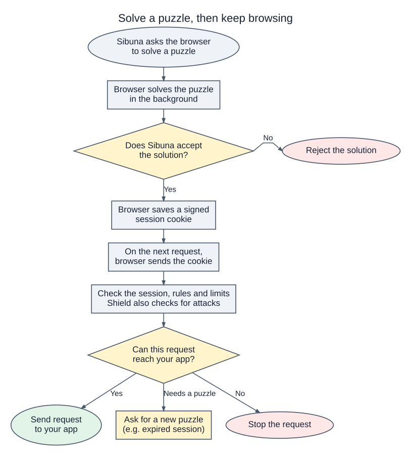

<!-- English source SHA-256: 2213ca66b48390aac695b02731322e1fa885d704796a4fd3304bc5e157897a0c -->
<h1 align="center">sibuna</h1>
<p align="center">ロードバランサーと、ブラウザーでの作業証明によるWeb保護を、1つの実行ファイルで。</p>
<p align="center">
  <a href="#features">機能</a> ·
  <a href="#load-balancing">負荷分散</a> ·
  <a href="#quickstart">クイックスタート</a> ·
  <a href="#console">コンソール</a> ·
  <a href="#how-it-works">仕組み</a> ·
  <a href="#documentation">ドキュメント</a>
</p>

<!-- language-navigation -->
<p align="center">
  <a href="README.md">English</a> · <a href="README.zh-CN.md">简体中文</a> ·
  <a href="README.ko.md">한국어</a> · <a href="README.ja.md">日本語</a> ·
  <a href="README.es.md">Español</a> · <a href="README.de.md">Deutsch</a> ·
  <a href="README.hi.md">हिन्दी</a> · <a href="README.ar.md">العربية</a>
</p>

**Sibunaは、WebサイトやAPIを不要なボットトラフィックから守るためのソフトウェアです。** アプリにリクエストを転送するほか、Caddyやnginxなどの既存のプロキシと組み合わせて使えます。エッジモードでは、Sibuna自体がロードバランサーになります。TCPとUDPを転送し、TLSを終端し、HTTPを複数のサーバーへルーティングします。

リクエストの送信は多くの場合安価です。一方、その処理はアプリにとってより多くの作業になることがあります。Sibunaは、アクセスを許可する前にクライアントにパズルを解いてもらいます。このパズルは、証明の生成に検証より多くの計算が必要になるよう設計されています。これにより、自動化されたクライアントがサイトへのアクセスにかかるコストをより多く負担します。

計算にはエネルギーも使いますが、その量はハードウェアや設定によって変わります。作業証明は、アクセスの許可にコストを加えるものです。訪問者が人間であることを証明するものではなく、すべての攻撃を防ぐものでもありません。署名付きセッションがあれば、許可されたクライアントはリクエストごとに新しいパズルを解かずに再訪できます。その後にこれらのクライアントが要求できる内容は、アクセスルールとローカルのレート制限で制御してください。

<a id="features"></a>

## 機能

- **実行ファイルは1つ：** エンジン、組み込みのSQLiteストレージ、ブラウザーのソルバー、コンソールのリソースを含みます。
- **ネイティブパッケージ：** Linux、macOS、Windows、FreeBSD、OpenBSDに対応します。ブラウザーのソルバーはWebAssemblyを使います。
- **ブラウザーチャレンジ：** 逐次作業証明（標準）またはHashcashを使い、完了すると署名付きセッションを発行します。
- **アクセスポリシー：** アドレス、パス、ヘッダー、User-Agentに応じて、リクエストを許可、チャレンジ、重み付け、拒否します。
- **負荷分散：** 複数のサーバーの前でTCP、UDP、HTTPを扱います。TLS終端、証明書の自動取得、クラスターモードに対応します。[負荷分散](#load-balancing)を参照してください。
- **TLSフィンガープリント：** 信頼できるイングレスが転送するJA4フィンガープリントを、完全一致または前方一致で照合します。
- **アプリケーション検査：** SQLインジェクション、XSS、パストラバーサル、コマンドインジェクションの検査を内蔵しています。
- **ローカルのレート制限：** 突発的なトラフィックと継続的なトラフィックを制御します。ルールごとの制限も設定できます。
- **運用コンソール：** トラフィック、サンプリングされた国別の活動、記録済みインシデント、ポリシーの編集。
- **クラスター対応：** 別のビルドで、PostgreSQLを通じてポリシーとレピュテーションを共有します。

<a id="load-balancing"></a>

## 負荷分散

Sibuna 1.0.0-rc.1 にはエッジモードが含まれます。以下のクイックスタートのダウンロードは beta.3 用です。リリース候補を[ソースからビルド](#build-from-source)することもできます。

```sh
sibuna lb --bind :8080 --server 10.0.0.1:80 --server 10.0.0.2:80
sibuna lb --tls auto --domain example.org --server 10.0.0.1:80
sibuna lb --bind :8080 --server 10.0.0.1:80 --print-config > edge.jlv
sibuna --config-file edge.jlv
```

- **転送：** TCPとUDP、サーバー名でルーティングするTLSパススルー、QUICパススルー、PROXYプロトコル。
- **HTTP：** HAProxy形式のPEMバンドルでTLSを終端します。HTTP/1.1、HTTP/2、HTTP/3、WebSocketに対応し、ホスト名とパスでHTTP/1.1、HTTP/2、HTTP/3のサーバーへルーティングします。Linuxでは、イベント駆動のワーカーが接続を処理します。ワーカーはプロセッサーごとに1つです。
- **証明書：** ACMEによる自動取得と更新、フォールバック認証局、外部アカウントバインディング。フックプログラム、RFC 2136更新、Cloudflare APIを使ったDNS経由のワイルドカード証明書。OCSPステープリング。ガードの背後でのオンデマンド証明書。`localhost`、内部の名前、IPアドレス向けのローカル認証局。ローカル認証局は失効リストと独自のACMEサーバーを備えます。
- **サーバー：** ヘルスチェック、スロースタート、ドレイン、重み、スティッキーセッション、サーバーごとのフロー数の上限。
- **動かしたままの変更：** 設定の再読み込みに成功すると、確立済みのTCP接続は維持されます。管理ソケットで、サーバーのドレイン、重み付け、追加、削除ができます（`sibuna ctl /run/sibuna/edge.sock set server app/10.0.0.1:80 state drain`）。Linuxでは、新しい実行ファイルが古い実行ファイルからリスニングソケットとUDPマッピングを引き継ぎます。QUIC接続は終了します。
- **クラスター：** メッシュのノードはスティッキーテーブルとサーバーのフロー数の上限を共有し、クライアントをそれを所有するノードへ転送します。PostgreSQLデータベースは1つの設定をすべてのノードに配布し、ロールバックすることもできます。マップしたファイルが、再起動後もアフィニティのヒントを保持します。
- **フック：** 接続時とリクエスト時に実行されます。組み込みでコンパイルするか、予算付きのWebAssemblyとして動かすか、Unixソケット上のエージェントとして動かします。
- **観測：** メトリクス、アクセスログ、サーバー、フロー、拒否を表示するコンソール画面。

GateまたはShieldは、必要な名前だけに適用することも、どこにも適用しないこともできます。設定ファイルが常に正となります。実行中の変更は、次の再読み込みまで有効です。

本番トラフィックでの検証は今後の課題です。クラスター機能は3台のホストでテストしました。各[設計議論](https://insanai.github.io/sibuna/sid/)に、実装済みの内容と既知の課題を記載しています。

<a id="quickstart"></a>

## クイックスタート

プラットフォームに合った[リリースをダウンロード](https://github.com/insanai/sibuna/releases/tag/v1.0.0-beta.3)してください。標準パッケージにはストレージとコンソールのサポートが含まれます。コンソールは`--console`で起動します。

| プラットフォーム | パッケージ | 動作要件 |
| --- | --- | --- |
| Linux x86-64 | `sibuna-linux-amd64.tar.gz` | Linux 5.10以降、muslを静的リンク |
| Linux ARM64 | `sibuna-linux-arm64.tar.gz` | Linux 5.10以降、muslを静的リンク |
| macOS Apple Silicon | `sibuna-macos-arm64.tar.gz` | macOS 12以降 |
| macOS Intel | `sibuna-macos-amd64.tar.gz` | macOS 12以降 |
| Windows x86-64 | `sibuna-windows-amd64.zip` | Windows 10 / Server 2016以降、ネイティブの`sibuna.exe` |
| FreeBSD x86-64 | `sibuna-1.0.0-beta.3-freebsd-15.1-amd64.pkg` | FreeBSD 15.1、CLIパッケージ |
| OpenBSD x86-64 | `sibuna-1.0.0-beta.3.tgz` | OpenBSD 7.9、CLIパッケージ |

これはベータ版のリリースです。macOS向けビルドは未署名です。各パッケージにはライセンス、ソースへのリンク、ビルドマニフェストが含まれます。使用する前に、`SHA256SUMS`と照合してアーカイブを検証してください。

Debian/RPMパッケージはLinux x86-64とARM64に、Archの`sibuna-bin`はx86-64に対応します。FreeBSD 15.1とOpenBSD 7.9のパッケージはx86-64に対応し、CLIをインストールします。Linuxパッケージには、任意で使える無効状態のsystemdサービスが含まれます。BSDパッケージはサービス、アカウント、状態を作成しません。これらは上流の配布物で、コミュニティのアーカイブへの採用は別の手続きです。リリースにはHelm chartとコンテナーイメージ`ghcr.io/insanai/sibuna`も含まれます。インストール、検証、非公開の状態、アップグレード、Kubernetesの設定は[パッケージ運用ガイド](https://insanai.github.io/sibuna/book/operations.html)を参照してください。

[Sibuna Homebrew tap](https://github.com/insanai/homebrew-sibuna)は、検証済みのリリースアーカイブをインストールするCLI formulaを提供します。対応するのはmacOSとLinux（Apple Silicon、ARM64、x86-64）です。tapは公開済みの最新リリースに追従するため、このベータ版もすでに提供されています。インストールしてもサービスは起動しません：

```sh
brew tap insanai/sibuna
brew install insanai/sibuna/sibuna
sibuna --version
```

Linux x86-64で、アプリがポート3000で待ち受けている場合：

```sh
curl -fLO https://github.com/insanai/sibuna/releases/download/v1.0.0-beta.3/sibuna-linux-amd64.tar.gz
curl -fLO https://github.com/insanai/sibuna/releases/download/v1.0.0-beta.3/SHA256SUMS
sha256sum --ignore-missing -c SHA256SUMS
tar -xzf sibuna-linux-amd64.tar.gz
(umask 077; openssl rand -hex 32 > sibuna.seed)
./sibuna --host 127.0.0.1 --port 8080 --upstream-port 3000 --secret-file ./sibuna.seed
```

`http://127.0.0.1:8080`を開くとローカルで試せます。公開サイトでは、信頼できるイングレスでHTTPSを終端し、Sibunaのリスナーは非公開にしてください。Caddyまたはnginxでの構成は[デプロイガイド](https://insanai.github.io/sibuna/book/operations.html)に従ってください。

標準モードは`reverse_proxy`です。イングレスがリクエストを転送し、Sibunaにアクセス判断を問い合わせる構成では`--mode forward_auth`を使います。ガイドには両方の設定が載っています。Shieldの内蔵検査は標準で有効です。この検査器を使わずにアクセスの許可だけを行う場合は`--gate`を使います。アクセスルールは`--policy-file <file>`で選びます。ブラウザーチャレンジを実行できないAPIクライアントやヘルスチェック向けのルールも含められます。`./sibuna --help`はすべてのオプションを一覧表示します。

WindowsではZIPを展開し、PowerShellで`.\sibuna.exe --help`を実行します。停止するにはCtrl+Cを押します。シード、認証情報、データファイルへのアクセスはWindows ACLで制限してください。

<a id="build-from-source"></a>

### ソースからビルドする

ビルドとテストには**Rust 1.100**を使っています。標準のJLVコンパイラーがこのバージョンを必要とするためです。JSONのみのデーモンは、Rust 1.100で`--no-default-features`を指定してビルドでき、必要に応じて`sqlite,console`を選べます。ブラウザーのソルバーとコンソールのインターフェースは、WebAssemblyにコンパイルしたRustです。ビルドにNodeやnpmは必要ありません。

```sh
git clone https://github.com/insanai/sibuna.git
cd sibuna
rustup toolchain install 1.100.0 --profile minimal --target wasm32-unknown-unknown
cargo +1.100.0 build --release -p sibuna
```

実行ファイルは`target/release/sibuna`です。`--data-dir`を指定すると、状態をSQLiteに保存します。クラスター版は`--features postgres-tls`でビルドし、`--database-url-file`と`--cluster-node`を使って1つのPostgreSQLデータベースを共有します。テスト、lint、サイズの検査は[CONTRIBUTING.md](CONTRIBUTING.md)を参照してください。

<a id="console"></a>

## コンソール

コンソールは同じ実行ファイルで動作します。デーモンを停止した状態で、管理者を初期設定してください：

```sh
./sibuna init-admin admin --data-dir ./data
./sibuna --host 127.0.0.1 --upstream-port 3000 --secret-file ./sibuna.seed \
  --data-dir ./data --console 127.0.0.1:19446
```

`http://127.0.0.1:19446/console/`を開き、一時パスワードを変更してください。[運用ガイド](https://insanai.github.io/sibuna/book/operations.html)では、HTTPSでのアクセス、GeoIPのインポート、ユーザー、APIトークン、ウォールディスプレイについて説明しています。


地球儀は、直近1分間のサンプリングされた国別の活動を示します。マーカーは国のおおよその位置を示します。矢印は、設定したサーバーの位置へ向かいます。個々のライブ接続を示すものではありません。GeoIPには、別途インポートしたデータセットが必要です。地球儀上にサーバーを配置するには、`--console-location <latitude,longitude>`を設定してください。

<details>
<summary>トラフィックの概要、セキュリティの概要、ポリシー、インシデント調査</summary>

**トラフィックの概要** - ライブのリクエスト結果、許可とチャレンジのカウンター、ノードの稼働状態、スパークライン。


**セキュリティの概要** - 記録された検出結果、チャレンジ、アクセス禁止、ライブのイベントフィード。


**ポリシー** - ノードが順に適用するルールと、記録されたヒット数。


**イベント** - 記録されたインシデント。モジュール、国、アドレス、パス、時間で絞り込めます。


</details>

地球儀とトラフィック概要は、v1.0.0-beta.2を実行し、通常のChromeウィンドウで撮影しました。他の画面はv1.0.0-beta.1のものです。すべての画像は、生成したトラフィックとテスト用GeoIPマッピングを使用したローカルのテストノードで撮影しています。表示された数値はベンチマーク結果ではありません。

<a id="how-it-works"></a>

## 仕組み

リクエストは許可される場合も、チャレンジを要求される場合も、拒否される場合もあります。チャレンジを解いた訪問者は署名付きセッションを受け取ります。その後のリクエストも、適用されるポリシーとレートの検査を通ります。

<picture>
  <source media="(prefers-color-scheme: dark)" srcset="docs/readme/images/admission-session-dark.svg">
  
</picture>

Gateはアクセスルール、セッション、ローカルのレート制限を確認します。Shieldは内蔵の攻撃検査器を追加します。標準はShieldで、起動時に`--gate`を指定するとGateになります。

<details>
<summary>Gate、Shield、Sibuna内部のクレート</summary>

<picture>
  <source media="(prefers-color-scheme: dark)" srcset="docs/readme/images/protection-surfaces-dark.svg">
  
</picture>

図はGateとShieldの内蔵検査を示しています。有効なセッションがあっても、適用される攻撃検査やリクエスト制限は省略されません。

<picture>
  <source media="(prefers-color-scheme: dark)" srcset="docs/readme/images/subsystems-dark.svg">
  
</picture>

クレートは、ネットワーク、証明、ポリシー、ローカル状態、ストレージ、管理の責務を分けています。[技術ガイド](https://insanai.github.io/sibuna/book/)でそれぞれの役割を説明しています。

</details>

<a id="deployment-limits"></a>

### デプロイ時の制約

非公開リスナーは、外部のイングレスの背後でHTTP/1.1を使います。エッジモードでは、TLS、HTTP/2、HTTP/3をSibunaで終端し、HTTP/1.1、HTTP/2、HTTP/3のサーバープールへ転送できます。Forward-authはイングレスから渡されたメタデータを検査します。リバースプロキシモードでは、内蔵検査器はボディーの先頭8 KiBを対象とします。アップロードはストリーミングでアプリへ転送します。WebSocketメッセージは検査せずに中継します。検査器はヒューリスティックであり、完全な言語パーサーではありません。

レート制限はノードごとにローカルで適用されます。Sibunaは大規模なネットワークトラフィック攻撃の緩和機能を提供しません。接続を失わない実行ファイルの置き換えと、イベント駆動のワーカーは、Linuxにのみあります。チャレンジは、それを発行したノードに結び付けられます。チャレンジとその解答は同じノードへルーティングしてください。コンソールの厳格な性能目標は、まだ正式には通過していません。本番アプリと一緒にコンソールを有効にする前に、[デプロイ時の制約と測定結果](https://insanai.github.io/sibuna/book/operations.html)を確認してください。

<a id="benchmarks"></a>

## ベンチマーク

技術ガイドでは、各実行のソースリビジョン、設定、ホストを記録しています。これらの測定は、1台のマシン上のいくつかのワークロードにおけるリクエストのコストを示します。同等の防御性能やボット識別の精度を測るものではありません。

<a id="sibuna-on-one-host"></a>

### 1台のホスト上のSibuna

これらの実行ではAMD Ryzen 9 5950Xを使いました。デーモンには4つのCPUを割り当て、メモリ上で動かしました。負荷生成器とスタブのオリジンは、別の8つのCPUで動かしました。`wrk`はループバック経由で64接続を使いました。数値は3回の実行の中央値です。

- forward-authモードでは、すべてのワークロードが毎秒197,532から211,636リクエストで動作し、p99は305から327マイクロ秒、リクエストあたりのCPU時間は11.7から13.8マイクロ秒でした。上限を決めていたのは負荷生成器です。
- プロキシしたリクエストは毎秒138,965から147,303件でした。最大メモリは約16 MiBでした。
- 毎秒100,000件の許可済みリクエストという同じ負荷では、p99.9レイテンシーはforward-authモードで62マイクロ秒、リバースプロキシモードで150マイクロ秒でした。

<a id="beside-haproxy-and-envoy"></a>

### HAProxy、Envoyと並べて

3つのプロキシを、1台のホスト上でループバック経由で順番に、それぞれ3回ずつ実行しました。HAProxy 3.0.11、Envoy 1.40.2、そして2026-11-25時点のソースツリーのSibunaです。どれも同じ8つのCPUと8つのスレッド、256接続を使い、各ケースを8秒間実行しました。表は、3回の実行における毎秒リクエスト数の中央値です。失敗したリクエストはありません。

| ケース | Sibuna | HAProxy | Envoy |
| --- | ---: | ---: | ---: |
| HTTP/1.1 | 220,040 | 220,323 | 70,909 |
| TLS上のHTTP/1.1 | 174,611 | 165,199 | 63,399 |
| HTTP/2 | 104,132 | 153,899 | 68,972 |
| 常駐メモリ、HTTP/1.1 | 14 MiB | 48 MiB | 58 MiB |

これは順位付けではなく、1つの小さな測定として読んでください。平文のHTTPではSibunaとHAProxyは同等で、HTTP/2ではHAProxyのほうが明らかに速いです。私たちはEnvoyの専門家ではありません。単純な静的設定を使ったので、より良い設定にすれば数値が変わる可能性は十分にあります。動的な設定やフィルターといったEnvoyの強みは、このテストでは測っていません。応答はループバック上の2バイトだったため、リクエストごとのコストが誇張されています。実際のトラフィックでは差は縮まります。[技術ガイド](https://insanai.github.io/sibuna/book/benchmarks.html)に、方法、設定、さらに多くの接続数、3台のホストによるクラスターを載せています。

<a id="beside-anubis"></a>

### Anubisと並べて

公式のAnubis 1.27.0リリースバイナリを、同じワークロード、CPU、負荷生成器で測定しました。Hashcashの作業量はそろえました。Sibunaはゼロビット8個、Anubisは16進数のゼロ2桁です。オリジンは`caddy respond`でした。表は、セッションを持つ許可済みリクエストの結果です。

| 許可済みリクエスト | Sibuna Gate | Sibuna Shield | Anubis 1.27.0 |
| --- | ---: | ---: | ---: |
| Forward auth、req/s | 210,682 | 208,635 | 36,509 |
| Forward auth、p99 | 305マイクロ秒 | 308マイクロ秒 | 7,477マイクロ秒 |
| Forward auth、リクエストあたりのCPU時間 | 12.1マイクロ秒 | 13.2マイクロ秒 | 106.3マイクロ秒 |
| リバースプロキシ、req/s | 106,376 | 103,298 | 19,398 |
| リバースプロキシ、p99 | 3,331マイクロ秒 | 3,321マイクロ秒 | 11,062マイクロ秒 |

2回目の実行では、各製品に2つのCPUを割り当て、許可処理の各操作を計測しました。Anubisは、標準のEd25519トークンで1回、HS512トークンで1回実行しました。

| 毎秒の操作数 | Sibuna（鍵付きBLAKE3） | Anubis（Ed25519） | Anubis（HS512） |
| --- | ---: | ---: | ---: |
| 有効なセッションの確認 | 88,104 | 10,951 | 16,976 |
| 未認証の確認 | 78,997 | 28,619 | 27,785 |
| チャレンジの初期化 | 42,664 | 7,893 | 7,952 |
| 証明の検証 | 57,924 | 12,668 | 19,261 |

Sibunaの最大メモリは16 MiB前後にとどまりました。Anubisはforward-authモードで約33 MiB、リバースプロキシモードで最大約600 MiBを使いました。Anubisは広く使われている有能なツールであり、これらの行は順位付けではありません。いくつかの行は同じ条件での比較ではありません。forward-authモードのAnubisは一部のパスに自ら応答し、ペイロード検査を行わず、チャレンジページも異なります。実行はループバックで行い、TLS、実際のブラウザー、ストレージは使っていません。

手法、範囲、再実行コマンドは[ベンチマーク記録](benchmarks/results/README.md)を参照してください：[product-latest.md](benchmarks/results/product-latest.md)、[latency-latest.md](benchmarks/results/latency-latest.md)、[comparison-latest.md](benchmarks/results/comparison-latest.md)、[admission-latest.md](benchmarks/results/admission-latest.md)。技術ガイドの第VIII部で、それぞれの違いを説明しています。

<a id="documentation"></a>

## ドキュメント

- [技術ガイド](https://insanai.github.io/sibuna/book/)：概念、アルゴリズム、例、測定結果。
- [ホワイトペーパー](https://insanai.github.io/sibuna/whitepaper/)：アーキテクチャ、証明、設計の詳細。
- [運用ガイド](https://insanai.github.io/sibuna/book/operations.html)：インストールとデプロイ。
- [リファレンス](https://insanai.github.io/sibuna/book/reference.html)：CLIとプロトコルの詳細。
- [設計議論](https://insanai.github.io/sibuna/sid/)：設計上の決定とエンジニアリング上の契約。
- [貢献ガイド](CONTRIBUTING.md)：ソースからのビルドと検査。

<a id="other-software-to-consider"></a>

## あわせて検討できるソフトウェア

- [Anubis](https://github.com/TecharoHQ/anubis)：クローラーのトラフィックを減らすためのブラウザーチャレンジ。
- [BunkerWeb](https://github.com/bunkerity/bunkerweb)：nginx、ModSecurity、CRS、ボットチャレンジ。
- [ModSecurity](https://github.com/owasp-modsecurity/ModSecurity)：コネクターを通じて利用するWAFエンジン。
- [Coraza](https://github.com/corazawaf/coraza)：ModSecurityのルールとCRSに対応したGoのWAFライブラリ。
- [OWASP Core Rule Set](https://github.com/coreruleset/coreruleset)：WAFエンジン向けの攻撃検出ルール。

これらのプロジェクトは、Web保護の異なる領域を扱っています。Sibunaの検査器は内蔵のもので、CRSやその他のModSecurityルールセットは実行しません。より広いルールの適用範囲が必要なアプリでは、Sibunaを本格的なWAFと組み合わせてください。

<a id="license"></a>

## ライセンス

Sibunaのライセンスは**LGPL 3.0以降**です。このライセンスは、エンジン、ライブラリ、ブラウザーのソルバー、そしてWebAssemblyインターフェースを含むコンソールを対象とします。

[LICENSE](LICENSE)は適用範囲を説明しています。[LICENSES](LICENSES)には条文全文があります。[NOTICE](NOTICE)には依存関係を記載しています。各リリースタグで、ソースとビルドスクリプトを入手できます。

SibunaはVikrant Rathoreが作成し、Ronak RathoreとKanak Rathoreが協力しています。別のライセンス条件を希望する企業は、Vikrant Rathoreにお問い合わせください。第三者のライブラリや資料には、それぞれのライセンスが適用されます。
