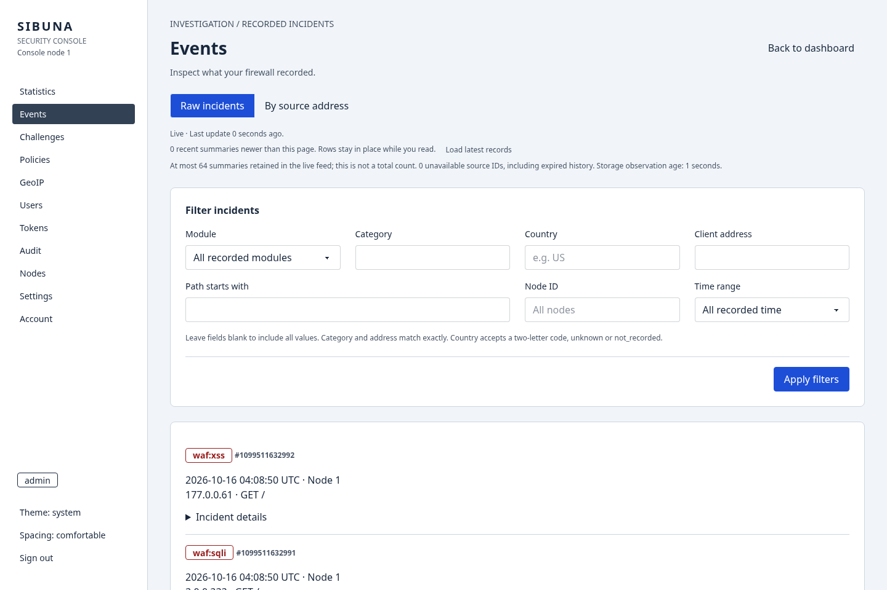
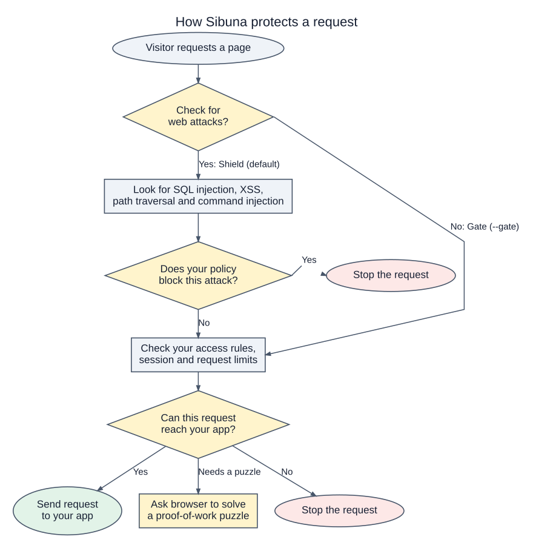

<!-- English source SHA-256: 4c67703ca6d3304b7b577e9000320ec59884185b2ef46b6fcc2b14a811cf150f -->
<h1 align="center">sibuna</h1>
<p align="center">分布式边缘负载均衡器和 Web 应用防火墙</p>
<p align="center">
  <a href="#features">功能</a> ·
  <a href="#load-balancing">负载均衡</a> ·
  <a href="#beside-haproxy-and-envoy">基准测试</a> ·
  <a href="#quickstart">快速入门</a> ·
  <a href="#console">控制台</a> ·
  <a href="#how-it-works">工作原理</a> ·
  <a href="#documentation">文档</a>
</p>

<!-- language-navigation -->
<p align="center">
  <a href="README.md">English</a> · <a href="README.zh-CN.md">简体中文</a> ·
  <a href="README.ko.md">한국어</a> · <a href="README.ja.md">日本語</a> ·
  <a href="README.es.md">Español</a> · <a href="README.de.md">Deutsch</a> ·
  <a href="README.hi.md">हिन्दी</a> · <a href="README.ar.md">العربية</a>
</p>

Sibuna 可通过单个边缘节点或网状集群将 TCP、UDP 和 HTTP 流量分发到健康的服务器。它可以在边缘终止 TLS、检查指定的 HTTP 路由，并帮助后端抵御 DDoS 流量洪泛。

## Sibuna 的应用场景

- **公共网站**

  通过 HTTP/2 或 HTTP/3 接受浏览器连接，用 Let's Encrypt 续订公有证书，并在向 HTTP/1.1 副本转发前检查请求。
- **内部 gRPC 服务**

  使用本地 CA 为内部名称签发证书。客户端信任其根证书，通过 TLS 调用服务。HTTP/2 后端传输 gRPC 消息和尾部字段。
- **边缘节点集群**

  在网状集群中分发已验证的路由配置。各节点可以共享封禁和已学习的客户端亲和性，同时向各自的后端池转发流量。

[Sibuna 是什么？](https://insanai.github.io/sibuna/zh-hans/book/introduction.html)

<a id="features"></a>

## 功能

- **一个可执行文件：** 包含引擎、嵌入式 SQLite 存储、浏览器求解器和控制台资源。
- **原生安装包：** 支持 Linux、macOS、Windows、FreeBSD 和 OpenBSD。浏览器求解器使用 WebAssembly。
- **浏览器挑战：** 顺序工作量证明（默认）或 Hashcash，完成后获得签名会话。
- **访问策略：** 根据地址、路径、请求头和 User-Agent 放行、挑战、加权评估或拒绝请求。
- **负载均衡：** 在多台服务器前处理 TCP、UDP 和 HTTP，支持 TLS 终止、自动证书和集群模式。见[负载均衡](#load-balancing)。
- **[边缘 DDoS 防护](https://insanai.github.io/sibuna/zh-hans/book/operations.html#edge-admission-under-attack)** 我们可以限制每个客户端 IP 和每个前端的并发流数，在负载过高时限制新地址的接入速率，并为已确认的流预留 UDP 处理容量。如果攻击流量占满上联链路，就需要在上游过滤。
- **TLS 指纹：** 按受信任的入口代理转发的 JA4 指纹匹配请求，可精确匹配，也可按前缀匹配。
- **应用层检查：** 内置 SQL 注入、XSS、路径遍历和命令注入检查。
- **本地速率限制：** 控制突发和持续流量，也可为单条规则设置限额。
- **管理控制台：** 流量、按国家采样的活动、已记录的事件和策略编辑。
- **集群支持：** 单独的构建版本通过 PostgreSQL 共享策略和信誉数据。

<a id="load-balancing"></a>

## 负载均衡

Sibuna 1.0.0-rc.6 包含边缘模式。我们也可以[从源码构建候选版本](#build-from-source)。

```sh
sibuna lb --bind :8080 --server 10.0.0.1:80 --server 10.0.0.2:80
sibuna lb --tls auto --domain example.org --server 10.0.0.1:80
sibuna lb --bind :8080 --server 10.0.0.1:80 --print-config > edge.jlv
sibuna check -f edge.jlv
sibuna --config-file edge.jlv
```

[使用 Jlavi 配置 Sibuna](https://insanai.github.io/sibuna/zh-hans/book/jlavi.html)

- **转发：** TCP 和 UDP、按服务器名称（精确或通配符）路由的 TLS 透传、QUIC 透传以及 PROXY 协议。
- **受到攻击时：** 每个客户端地址和每个前端的流上限，在接受连接时检查并通过网格共享的封禁，自动封禁，以重置或 tarpit 方式拒绝，优先接纳已知客户端的压力模式，运行在多个核心上的接受线程，以及为已确认客户端保留份额的 UDP 数据包预算。
- **HTTP：** 使用 HAProxy 风格的 PEM 证书包终止 TLS，并采用后量子密钥交换（X25519MLKEM768）；支持 HTTP/1.1、HTTP/2、HTTP/3 和 WebSocket；按主机名（精确或 `*.example.org` 这样的通配符）和路径路由到 HTTP/1.1、HTTP/2 或 HTTP/3 服务器。在 Linux 上，由事件驱动的 worker 处理连接，每个处理器一个 worker。
- **证书：** 通过 ACME 自动获取并续期，支持备用证书颁发机构和外部账户绑定；通过 DNS 获取通配符证书，可使用钩子程序、RFC 2136 更新或 Cloudflare API；OCSP 装订；在守卫之后按需获取证书；为 `localhost`、内部名称和 IP 地址提供本地证书颁发机构，它有自己的吊销列表和 ACME 服务器。
- **服务器：** 健康检查、慢启动、排空、权重、会话保持，以及每台服务器的流数量限制。
- **运行中变更：** 成功重新加载后，已建立的 TCP 连接仍然有效。管理套接字可以排空、调整权重、添加和移除服务器（`sibuna ctl /run/sibuna/edge.sock set server app/10.0.0.1:80 state drain`）。在 Linux 上，新的可执行文件从旧的可执行文件接管监听套接字和 UDP 映射；QUIC 连接会终止。
- **集群：** 网格中的节点共享会话保持表和服务器的流数量限制，并把客户端转发给拥有它的节点。PostgreSQL 数据库可以把同一份配置发布到每个节点，也可以回滚。一个映射文件在重启后保留会话保持的提示信息。
- **钩子：** 在连接阶段和请求阶段运行：可以编译进程序，可以作为带预算的 WebAssembly，也可以作为 Unix 套接字上的代理程序。
- **观测：** 指标、访问日志，以及展示服务器、流和拒绝情况的控制台视图。

Gate 或 Shield 只应用于需要它的名称，也可以不应用于任何名称。配置文件始终是权威来源：运行时的变更只持续到下一次重新加载。

生产流量验证仍待完成。它的集群功能在三台主机上测试过。每篇[设计讨论](https://insanai.github.io/sibuna/sid/)都列出已经实现的部分和已知的不足。

<a id="quickstart"></a>

## 快速入门

[下载适合所用平台的发行版](https://github.com/insanai/sibuna/releases/tag/v1.0.0-rc.6)。默认安装包包含存储和控制台支持。控制台通过 `--console` 启动。

| 平台 | 安装包 | 要求 |
| --- | --- | --- |
| Linux x86-64 | `sibuna-linux-amd64.tar.gz` | Linux 5.10 或更高版本；静态链接 musl |
| Linux ARM64 | `sibuna-linux-arm64.tar.gz` | Linux 5.10 或更高版本；静态链接 musl |
| macOS Apple Silicon | `sibuna-macos-arm64.tar.gz` | macOS 12 或更高版本 |
| macOS Intel | `sibuna-macos-amd64.tar.gz` | macOS 12 或更高版本 |
| Windows x86-64 | `sibuna-windows-amd64.zip` | Windows 10 / Server 2016 或更高版本；原生 `sibuna.exe` |
| FreeBSD x86-64 | `sibuna-1.0.0-rc.6-freebsd-15.1-amd64.pkg` | FreeBSD 15.1；CLI 软件包 |
| OpenBSD x86-64 | `sibuna-1.0.0-rc.6.tgz` | OpenBSD 7.9；CLI 软件包 |

macOS 构建未签名。每个安装包都包含许可证、源码链接和构建清单。使用前，请对照 `SHA256SUMS` 校验压缩包。

Debian/RPM 软件包支持 Linux x86-64 和 ARM64；Arch `sibuna-bin` 支持 x86-64。FreeBSD 15.1 和 OpenBSD 7.9 软件包支持 x86-64，并安装 CLI。Linux 软件包包含一个可选的 systemd 服务，默认停用。BSD 软件包不创建服务、账户或状态。这些是上游提供的下载；社区仓库是否收录需另行审核。发行版还包含一个 Helm chart 和一个容器镜像 `ghcr.io/insanai/sibuna`。安装、验证、私密状态、升级及 Kubernetes 设置请参阅[软件包运维指南](https://insanai.github.io/sibuna/zh-hans/book/operations.html)。

[Sibuna Homebrew tap](https://github.com/insanai/homebrew-sibuna) 提供一个 CLI formula，用于安装经过校验的发行版压缩包，支持 macOS 和 Linux（Apple Silicon、ARM64 和 x86-64）。该 tap 跟随最新发布的版本。安装不会启动服务：

```sh
brew tap insanai/sibuna
brew install insanai/sibuna/sibuna
sibuna --version
```

在 Linux x86-64 上，假设应用监听 3000 端口：

```sh
curl -fLO https://github.com/insanai/sibuna/releases/download/v1.0.0-rc.6/sibuna-linux-amd64.tar.gz
curl -fLO https://github.com/insanai/sibuna/releases/download/v1.0.0-rc.6/SHA256SUMS
sha256sum --ignore-missing -c SHA256SUMS
tar -xzf sibuna-linux-amd64.tar.gz
(umask 077; openssl rand -hex 32 > sibuna.seed)
./sibuna --host 127.0.0.1 --port 8080 --upstream-port 3000 --secret-file ./sibuna.seed
```

打开 `http://127.0.0.1:8080` 即可在本地试用。对于公开网站，请由受信任的入口代理终止 HTTPS，并保持 Sibuna 的监听端口不对外公开。Caddy 或 nginx 的配置请按照[部署指南](https://insanai.github.io/sibuna/zh-hans/book/operations.html)进行。

默认模式为 `reverse_proxy`。如果入口代理负责转发请求，并向 Sibuna 查询访问决策，请使用 `--mode forward_auth`。指南包含这两种配置。Shield 的内置检查默认启用。若只需要准入控制、不需要该检查器，请使用 `--gate`。通过 `--policy-file <file>` 选择访问规则，其中可以包括为无法运行浏览器挑战的 API 客户端和健康检查准备的规则。`./sibuna --help` 列出所有选项。

在 Windows 上，解压 ZIP 后在 PowerShell 中运行 `.\sibuna.exe --help`。按 Ctrl+C 停止程序。请使用 Windows ACL 限制对种子、凭据和数据文件的访问。

<a id="build-from-source"></a>

### 从源码构建

我们使用 **Rust 1.100** 进行构建和测试，默认的 JLV 编译器需要这个版本。仅支持 JSON 的守护进程可以用 Rust 1.100 配合 `--no-default-features` 构建，并按需选择 `sqlite,console`。浏览器求解器和控制台界面由 Rust 编译为 WebAssembly；构建不需要 Node 或 npm。

```sh
git clone https://github.com/insanai/sibuna.git
cd sibuna
rustup toolchain install 1.100.0 --profile minimal --target wasm32-unknown-unknown
cargo +1.100.0 build --release -p sibuna
```

可执行文件位于 `target/release/sibuna`。它通过 `--data-dir` 将状态存储在 SQLite 中。集群构建使用 `--features postgres-tls`，并通过 `--database-url-file` 和 `--cluster-node` 共享同一个 PostgreSQL 数据库。测试、lint 和大小检查见 [CONTRIBUTING.md](CONTRIBUTING.md)。

<a id="console"></a>

## 控制台

控制台在同一个可执行文件中运行。请在守护进程停止时初始化管理员账户：

```sh
./sibuna init-admin admin --data-dir ./data
./sibuna --host 127.0.0.1 --upstream-port 3000 --secret-file ./sibuna.seed \
  --data-dir ./data --console 127.0.0.1:19446
```

打开 `http://127.0.0.1:19446/console/` 并修改临时密码。[运维指南](https://insanai.github.io/sibuna/zh-hans/book/operations.html)介绍 HTTPS 访问、GeoIP 导入、用户、API 令牌和大屏显示。


地球显示过去一分钟内按国家采样的活动。标记给出国家的大致位置。箭头指向配置的服务器位置。它们不表示单条实时连接。GeoIP 需要单独导入数据集。设置 `--console-location <latitude,longitude>` 可以将服务器标注在地球视图上。

<details>
<summary>流量概览、安全概览、策略和事件调查</summary>

**流量概览** - 实时请求结果、准入和挑战计数、节点健康状态及迷你趋势图。


**安全概览** - 已记录的检出结果、挑战、封禁和实时事件流。


**策略** - 节点按顺序应用的规则及其记录的命中次数。


**事件** - 已记录的事件，可按模块、国家、地址、路径和时间筛选。



</details>

地球和流量概览截图是在运行 v1.0.0-beta.2 时通过普通 Chrome 窗口截取的；其他视图展示的是 v1.0.0-beta.1。所有截图均来自使用生成流量和测试 GeoIP 映射的本地测试节点。图中显示的计数不是基准测试结果。

<a id="how-it-works"></a>

## 工作原理

前端接收连接。对于 TCP 或 UDP，Sibuna 为每个流选择一个服务器。对于 HTTP，Sibuna 逐请求匹配主机名和路径，应用相应路由的防火墙策略，再把获准的请求转发给选定池中的健康服务器。各边缘节点独立做出决定，同时与对等节点交换亲和性和封禁信息。

请求可能被放行、被要求完成挑战或被拒绝。完成挑战的访问者会获得签名会话。之后的请求仍需通过适用的策略检查和速率检查。

<picture>
  <source media="(prefers-color-scheme: dark)" srcset="docs/readme/images/admission-session-dark.svg">
  
</picture>

Gate 检查访问规则、会话和本地速率限制。Shield 在此基础上增加内置攻击检查器。默认使用 Shield；`--gate` 在启动时选择 Gate。

<details>
<summary>Gate、Shield 与 Sibuna 内部的 crate</summary>

<picture>
  <source media="(prefers-color-scheme: dark)" srcset="docs/readme/images/protection-surfaces-dark.svg">
  
</picture>

图中展示的是 Gate 和 Shield 的内置检查。有效会话不会绕过适用的攻击检查或请求限制。

<picture>
  <source media="(prefers-color-scheme: dark)" srcset="docs/readme/images/subsystems-dark.svg">
  
</picture>

这些 crate 分别负责网络、证明、策略、本地状态、存储和管理。[技术手册](https://insanai.github.io/sibuna/zh-hans/book/)介绍了它们的职责。

</details>

<a id="deployment-limits"></a>

### 部署限制

私有监听端口在外部入口代理之后使用 HTTP/1.1。在边缘模式下，我们可以在 Sibuna 中终止 TLS、HTTP/2 和 HTTP/3，并转发到 HTTP/1.1、HTTP/2 或 HTTP/3 服务器池。forward-auth 模式只检查入口代理提供的元数据。在反向代理模式下，内置检查器覆盖请求体的前 8 KiB。上传数据以流式方式传给应用。WebSocket 消息直接转发，不进行检查。该检查器是一种启发式方法，不是完整的语言解析器。

速率限制在每个节点本地计算。Sibuna 不提供针对大流量网络攻击的缓解。不丢失连接的可执行文件替换和事件驱动的 worker 只在 Linux 上提供。挑战与签发它的节点绑定；请将挑战及其解答路由到同一个节点。控制台的严格性能目标尚未正式通过。在生产应用旁启用控制台之前，请阅读[部署限制和测量结果](https://insanai.github.io/sibuna/zh-hans/book/operations.html)。

<a id="benchmarks"></a>

## 基准测试

技术手册为每次运行记录源码版本、配置和主机。这些测量展示一台机器上几种工作负载下的请求成本。它们不衡量同等防护能力或机器人识别准确率。

<a id="sibuna-on-one-host"></a>

### 单台主机上的 Sibuna

这些测试使用 AMD Ryzen 9 5950X。守护进程使用四个 CPU，并在内存中运行；负载生成器和一个桩源站运行在另外八个 CPU 上。`wrk` 通过回环接口使用 64 个连接。数据为三次运行的中位数。

- 在 forward-auth 模式下，各工作负载的速率为每秒 197,532 至 211,636 个请求，p99 为 305 至 327 微秒，每个请求耗费 11.7 至 13.8 微秒 CPU 时间。瓶颈在负载生成器。
- 代理请求的速率为每秒 138,965 至 147,303 个。内存峰值约为 16 MiB。
- 在每秒 100,000 个已准入请求的相同负载下，p99.9 延迟在 forward-auth 模式下为 62 微秒，在反向代理模式下为 150 微秒。

<a id="beside-haproxy-and-envoy"></a>

### 与 HAProxy 和 Envoy 对照

2026 年 11 月 25 日，我们在同一台主机上测量了 Sibuna、HAProxy 3.0.11 和使用 BoringSSL 的 Envoy 1.40.2。每个代理分配了 8 个 CPU 和 8 个工作线程。三者使用相同的源站、证书和负载生成器，通过回环接口建立 256 个连接，响应正文为两个字节。前三行是三轮测试的每秒请求数中位数，每轮 8 秒。后三行是测试结束时的常驻内存。各轮请求速率的差异最多为 4%，所有请求均已完成。

| 场景 | Sibuna | HAProxy | Envoy |
| --- | ---: | ---: | ---: |
| HTTP/1.1 | 220,040 | 220,323 | 70,909 |
| 基于 TLS 的 HTTP/1.1 | 174,611 | 165,199 | 63,399 |
| HTTP/2 | 104,132 | 153,899 | 68,972 |
| 常驻内存，HTTP/1.1 | 14 MiB | 48 MiB | 58 MiB |
| 常驻内存，基于 TLS 的 HTTP/1.1 | 21 MiB | 61 MiB | 61 MiB |
| 常驻内存，HTTP/2 | 116 MiB | 112 MiB | 140 MiB |

在明文 HTTP 上，Sibuna 和 HAProxy 的吞吐量几乎相同。在 HTTP/2 上，HAProxy 比 Sibuna 多处理约 48% 的请求，用的内存也略少。我们为 Envoy 使用了静态配置和路由过滤器。其他配置或负载可能得到不同的结果。这些短时间测试很难说明动态配置、应用延迟或真实网络中的性能。 [基准测试](https://insanai.github.io/sibuna/zh-hans/book/benchmarks.html#sibuna-haproxy-and-envoy)

<a id="beside-anubis"></a>

### 与 Anubis 对照

我们使用相同的工作负载、CPU 和负载生成器，测量了官方 Anubis 1.27.0 发行版可执行文件。双方的 Hashcash 工作量保持一致：Sibuna 为 8 个零比特，Anubis 为 2 个十六进制零位。源站为 `caddy respond`。表中为携带会话的已准入请求。

| 已准入请求 | Sibuna Gate | Sibuna Shield | Anubis 1.27.0 |
| --- | ---: | ---: | ---: |
| Forward auth，req/s | 210,682 | 208,635 | 36,509 |
| Forward auth，p99 | 305 微秒 | 308 微秒 | 7,477 微秒 |
| Forward auth，每个请求的 CPU 时间 | 12.1 微秒 | 13.2 微秒 | 106.3 微秒 |
| 反向代理，req/s | 106,376 | 103,298 | 19,398 |
| 反向代理，p99 | 3,331 微秒 | 3,321 微秒 | 11,062 微秒 |

第二次运行测量准入操作，每个产品使用两个 CPU。Anubis 分别使用默认的 Ed25519 令牌和 HS512 令牌各运行一次。

| 每秒操作数 | Sibuna（带密钥 BLAKE3） | Anubis（Ed25519） | Anubis（HS512） |
| --- | ---: | ---: | ---: |
| 有效会话检查 | 88,104 | 10,951 | 16,976 |
| 未认证检查 | 78,997 | 28,619 | 27,785 |
| 挑战引导 | 42,664 | 7,893 | 7,952 |
| 证明验证 | 57,924 | 12,668 | 19,261 |

Sibuna 的内存峰值保持在 16 MiB 左右。Anubis 在 forward-auth 模式下约使用 33 MiB，在反向代理模式下最多约使用 600 MiB。Anubis 是一款广泛使用且能力出色的工具，这些数据并非排名。其中几项并非同等条件的对比：在 forward-auth 模式下，Anubis 会自行响应部分路径，它不做载荷检查，而且两者的挑战页面也不同。测试通过回环接口进行，未使用 TLS、真实浏览器或存储。

方法、范围和复现命令见[基准测试记录](benchmarks/results/README.md)：[product-latest.md](benchmarks/results/product-latest.md)、[latency-latest.md](benchmarks/results/latency-latest.md)、[comparison-latest.md](benchmarks/results/comparison-latest.md) 和 [admission-latest.md](benchmarks/results/admission-latest.md)。技术手册第 X 部分讨论了每一项差异。

<a id="documentation"></a>

## 文档

- [技术手册](https://insanai.github.io/sibuna/zh-hans/book/)：概念、算法、示例和测量结果。
- [白皮书](https://insanai.github.io/sibuna/zh-hans/whitepaper/)：架构、证明和设计细节。
- [运维指南](https://insanai.github.io/sibuna/zh-hans/book/operations.html)：安装和部署。
- [参考手册](https://insanai.github.io/sibuna/zh-hans/book/reference.html)：CLI 和协议细节。
- [设计讨论](https://insanai.github.io/sibuna/sid/)：决策和工程约定。
- [贡献指南](CONTRIBUTING.md)：源码构建和检查。

<a id="other-software-to-consider"></a>

## 也可考虑的软件

- [Anubis](https://github.com/TecharoHQ/anubis)：通过浏览器挑战减少爬虫流量。
- [BunkerWeb](https://github.com/bunkerity/bunkerweb)：nginx、ModSecurity、CRS 和机器人挑战。
- [ModSecurity](https://github.com/owasp-modsecurity/ModSecurity)：通过连接器使用的 WAF 引擎。
- [Coraza](https://github.com/corazawaf/coraza)：支持 ModSecurity 规则和 CRS 的 Go WAF 库。
- [OWASP Core Rule Set](https://github.com/coreruleset/coreruleset)：供 WAF 引擎使用的攻击检测规则。

这些项目覆盖网站防护的不同方面。Sibuna 的检查器是内置的；它不运行 CRS 或其他 ModSecurity 规则集。如果应用需要更广泛的规则覆盖，请将 Sibuna 与完整的 WAF 搭配使用。

<a id="license"></a>

## 许可证

Sibuna 采用 **LGPL 3.0 或更高版本**。该许可证涵盖引擎、库、浏览器求解器和控制台，包括控制台的 WebAssembly 界面。

[LICENSE](LICENSE) 说明适用范围。[LICENSES](LICENSES) 包含完整条款。[NOTICE](NOTICE) 列出依赖。每个发行标签下都提供源码和构建脚本。

Sibuna 由 Vikrant Rathore 编写，Ronak Rathore 和 Kanak Rathore 提供协助。需要其他许可条款的企业可以联系 Vikrant Rathore。第三方库及资料保留各自的许可证。
