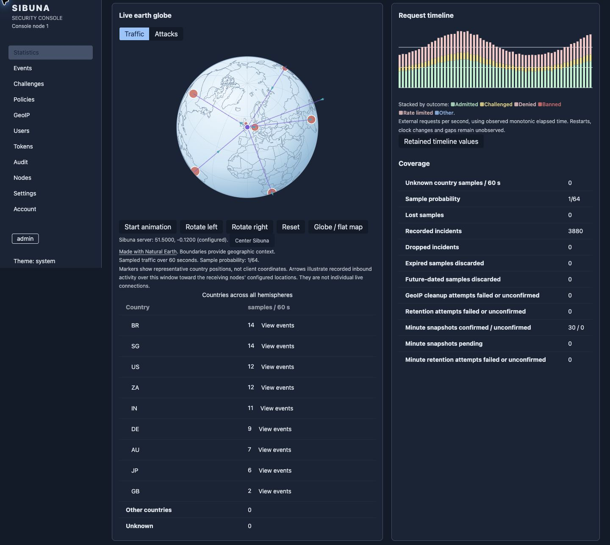

<!-- English source SHA-256: 042dfd1f971e2a895223216b56e2eaa8b0119c40748dfe2230db4fc208e2d004 -->
<h1 align="center">sibuna</h1>
<p align="center">分布式边缘负载均衡器和 Web 应用防火墙</p>
<p align="center">
  <a href="#features">功能</a> ·
  <a href="#load-balancing">负载均衡</a> ·
  <a href="#beside-haproxy-and-envoy">基准测试</a> ·
  <a href="#quickstart">快速入门</a> ·
  <a href="#console">控制台</a> ·
  <a href="#how-it-works">工作原理</a> ·
  <a href="#documentation">文档</a>
</p>

<!-- language-navigation -->
<p align="center">
  <a href="README.md">English</a> · <a href="README.zh-CN.md">简体中文</a> ·
  <a href="README.ko.md">한국어</a> · <a href="README.ja.md">日本語</a> ·
  <a href="README.es.md">Español</a> · <a href="README.de.md">Deutsch</a> ·
  <a href="README.hi.md">हिन्दी</a> · <a href="README.ar.md">العربية</a>
</p>

Sibuna 可通过单个边缘节点或网状集群将 TCP、UDP 和 HTTP 流量路由至健康的后端服务器。它支持边缘 TLS 终止、对指定 HTTP 路由进行请求检查，并帮助后端抵御 DDoS 洪泛攻击。

## Sibuna 的应用场景

- **公开网站**

  通过 HTTP/2 或 HTTP/3 服务浏览器请求，使用 Let's Encrypt 续期公网证书，并在转发给 HTTP/1.1 后端副本前检查请求。
- **内部 gRPC 服务**

  使用本地 CA 为内部名称签发证书。客户端信任其根证书，并通过 TLS 调用服务。HTTP/2 后端负责承载 gRPC 消息和 Trailer。
- **边缘节点集群**

  在网状集群中分发经过校验的路由配置。各节点可共享封禁列表与已学习的会话亲和性，同时将流量转发至各自的后端池。

[Sibuna 是什么？](https://insanai.github.io/sibuna/zh-hans/book/introduction.html)

<a id="features"></a>

## 功能

- **单可执行文件：** 集成核心引擎、嵌入式 SQLite 存储、浏览器求解器与控制台静态资源。
- **原生安装包：** 支持 Linux、macOS、Windows、FreeBSD 和 OpenBSD。浏览器求解器基于 WebAssembly。
- **浏览器挑战：** 顺序工作量证明（默认）或 Hashcash，完成后签发签名会话。
- **访问策略：** 根据客户端地址、路径、请求头和 User-Agent 放行、发起挑战、加权评估或拒绝请求。
- **负载均衡：** 在多台服务器前处理 TCP、UDP 和 HTTP，支持 TLS 终止、自动证书管理与集群模式。详见[负载均衡](#load-balancing)。
- **[边缘 DDoS 防护](https://insanai.github.io/sibuna/zh-hans/book/operations.html#edge-admission-under-attack)** 支持限制每个客户端 IP 和每个前端的并发流数，在高负载压力下限制新地址的接入，并为已确认的流预留 UDP 容量。若攻击流量打满上联带宽，则仍需上游过滤。
- **TLS 指纹：** 对受信任入口代理转发的 JA4 指纹进行精确匹配或前缀匹配。
- **应用层检查：** 内置 SQL 注入、XSS、路径遍历和命令注入检查。
- **本地速率限制：** 控制突发流量与持续速率，并支持为单条规则设置独立限额。
- **运维控制台：** 展示实时流量、按国家采样的访问活动、已记录的安全事件，并支持在线编辑策略。
- **集群支持：** 单独的构建版本可通过 PostgreSQL 共享策略与信誉数据。

<a id="load-balancing"></a>

## 负载均衡

Sibuna 1.0.0-rc.7 已包含边缘模式。也可以[从源码构建候选版本](#build-from-source)。

```sh
sibuna lb --bind :8080 --server 10.0.0.1:80 --server 10.0.0.2:80
sibuna lb --tls auto --domain example.org --server 10.0.0.1:80
sibuna lb --bind :8080 --server 10.0.0.1:80 --print-config > edge.jlv
sibuna check -f edge.jlv
sibuna --config-file edge.jlv
```

[使用 Jlavi 配置 Sibuna](https://insanai.github.io/sibuna/zh-hans/book/jlavi.html)

- **转发：** TCP 与 UDP、按服务器名称（精确或通配符）路由的 TLS 透传、QUIC 透传以及 PROXY 协议。
- **抗攻击能力：** 每个客户端地址与前端的并发流上限、建连时检查并在网格中共享的封禁列表、自动封禁、通过连接重置（reset）或焦油坑（tarpit）拒绝、优先放行已知客户端的压力模式、多核 accept 线程，以及为已确认客户端预留配额的 UDP 数据包预算。
- **HTTP：** 使用 HAProxy 风格的 PEM 证书包终止 TLS，支持后量子密钥交换（X25519MLKEM768）；支持 HTTP/1.1、HTTP/2、HTTP/3 和 WebSocket；按主机名（精确匹配或 `*.example.org` 这类通配符）和路径路由至 HTTP/1.1、HTTP/2 或 HTTP/3 后端服务器。在 Linux 上，由事件驱动的 worker 处理连接，每个 CPU 核心对应一个 worker。
- **证书：** 通过 ACME 自动签发并续期，支持备用 CA 与外部账户绑定（EAB）；通过 DNS 验证签发通配符证书（支持 Hook 脚本、RFC 2136 动态更新或 Cloudflare API）；支持 OCSP Stapling；支持在防护门控之后按需签发证书；内置本地 CA，为 `localhost`、内部名称和 IP 地址签发证书，并自带吊销列表（CRL）与本地 ACME 服务器。
- **服务器：** 健康检查、慢启动、优雅排空（draining）、权重、会话保持，以及单台服务器的并发流上限。
- **运行时变更：** 配置热重载通过校验后，已建立的 TCP 连接不受影响。可通过管理套接字执行排空、调整权重、增删服务器等操作（`sibuna ctl /run/sibuna/edge.sock set server app/10.0.0.1:80 state drain`）。在 Linux 上，新进程可从旧进程无缝接管监听套接字和 UDP 映射；QUIC 连接会终止。
- **集群：** 网格节点共享会话保持表与单服务器流上限，并将客户端转发至归属节点。可通过 PostgreSQL 数据库向所有节点统一发布或回滚配置。映射文件可在重启后保留亲和性提示。
- **Hook 扩展：** 支持在连接阶段与请求阶段挂载：可静态编译进二进制文件、作为带执行预算的 WebAssembly 模块运行，或作为 Unix 套接字上的独立代理进程运行。
- **可观测性：** 提供指标、访问日志，以及用于查看后端服务器、连接流和拒绝情况的控制台视图。

Gate 或 Shield 可按需仅应用于指定域名，也可完全不启用。配置文件始终是权威来源：运行时的动态变更仅在下一次重载前有效。

生产流量下的全面验证仍在进行中，集群功能已在三台主机上完成测试。每篇[设计讨论](https://insanai.github.io/sibuna/sid/)均列出了已实现的能力与已知缺口。

<a id="quickstart"></a>

## 快速入门

[下载适合所用平台的发行版](https://github.com/insanai/sibuna/releases/tag/v1.0.0-rc.7)。默认安装包已包含存储与控制台支持，通过 `--console` 启动控制台。

| 平台 | 安装包 | 要求 |
| --- | --- | --- |
| Linux x86-64 | `sibuna-linux-amd64.tar.gz` | Linux 5.10 或更高版本；静态链接 musl |
| Linux ARM64 | `sibuna-linux-arm64.tar.gz` | Linux 5.10 或更高版本；静态链接 musl |
| macOS Apple Silicon | `sibuna-macos-arm64.tar.gz` | macOS 12 或更高版本 |
| macOS Intel | `sibuna-macos-amd64.tar.gz` | macOS 12 或更高版本 |
| Windows x86-64 | `sibuna-windows-amd64.zip` | Windows 10 / Server 2016 或更高版本；原生 `sibuna.exe` |
| FreeBSD x86-64 | `sibuna-1.0.0-rc.7-freebsd-15.1-amd64.pkg` | FreeBSD 15.1；CLI 软件包 |
| OpenBSD x86-64 | `sibuna-1.0.0-rc.7.tgz` | OpenBSD 7.9；CLI 软件包 |

macOS 构建未签名。每个安装包均包含许可证、源码链接和构建清单。使用前请对照 `SHA256SUMS` 校验压缩包。

Debian/RPM 软件包覆盖 Linux x86-64 和 ARM64；Arch `sibuna-bin` 覆盖 x86-64。FreeBSD 15.1 和 OpenBSD 7.9 软件包覆盖 x86-64，仅安装 CLI。Linux 软件包提供一个可选的 systemd 服务（默认禁用）；BSD 软件包不创建服务、系统账户或状态目录。以上均为上游发行下载，是否被社区软件源收录需另行审核。发行版同时提供 Helm chart 和容器镜像 `ghcr.io/insanai/sibuna`。安装、校验、私密状态管理、升级及 Kubernetes 部署说明请参阅[软件包运维指南](https://insanai.github.io/sibuna/zh-hans/book/operations.html)。

[Sibuna Homebrew tap](https://github.com/insanai/homebrew-sibuna) 提供一个 CLI formula，用于安装经过校验的发行版压缩包，支持 macOS 和 Linux（Apple Silicon、ARM64 和 x86-64）。该 tap 跟随最新发布的版本，安装后不会自动启动服务：

```sh
brew tap insanai/sibuna
brew install insanai/sibuna/sibuna
sibuna --version
```

在 Linux x86-64 上，假设后端应用监听 3000 端口：

```sh
curl -fLO https://github.com/insanai/sibuna/releases/download/v1.0.0-rc.7/sibuna-linux-amd64.tar.gz
curl -fLO https://github.com/insanai/sibuna/releases/download/v1.0.0-rc.7/SHA256SUMS
sha256sum --ignore-missing -c SHA256SUMS
tar -xzf sibuna-linux-amd64.tar.gz
(umask 077; openssl rand -hex 32 > sibuna.seed)
./sibuna --host 127.0.0.1 --port 8080 --upstream-port 3000 --secret-file ./sibuna.seed
```

打开 `http://127.0.0.1:8080` 即可在本地试用。对于公开网站，请由受信任的入口代理终止 HTTPS，并保持 Sibuna 的监听端口仅对内网开放。Caddy 或 nginx 的配置请参阅[部署指南](https://insanai.github.io/sibuna/zh-hans/book/operations.html)。

默认运行模式为 `reverse_proxy`。若由入口代理转发请求并向 Sibuna 查询访问决策，请使用 `--mode forward_auth`，部署指南中提供了这两种配置。Shield 的内置检查默认启用；若只需准入控制而不需要载荷检查，请使用 `--gate`。可通过 `--policy-file <file>` 指定访问规则，例如为无法执行浏览器挑战的 API 客户端和健康检查配置放行规则。运行 `./sibuna --help` 可查看所有选项。

在 Windows 上，解压 ZIP 后在 PowerShell 中运行 `.\sibuna.exe --help`，按 Ctrl+C 停止程序。请使用 Windows ACL 严格限制对种子、凭据和数据文件的访问权限。

<a id="build-from-source"></a>

### 从源码构建

所有特性组合均需 **Rust 1.100**。可通过 `--no-default-features` 构建仅支持 JSON 配置的守护进程，并按需启用 `sqlite,console`。浏览器求解器和控制台界面均由 Rust 编译为 WebAssembly，构建过程无需 Node 或 npm。

```sh
git clone https://github.com/insanai/sibuna.git
cd sibuna
rustup toolchain install 1.100.0 --profile minimal --target wasm32-unknown-unknown
cargo +1.100.0 build --release -p sibuna
```

编译出的可执行文件位于 `target/release/sibuna`，通过 `--data-dir` 将状态存储在 SQLite 中。集群构建使用 `--features postgres-tls`，并通过 `--database-url-file` 和 `--cluster-node` 共享同一个 PostgreSQL 数据库。测试、lint 和体积检查说明见 [CONTRIBUTING.md](CONTRIBUTING.md)。

<a id="console"></a>

## 控制台

控制台运行在同一个可执行文件中。请在守护进程停止时初始化管理员账户：

```sh
./sibuna init-admin admin --data-dir ./data
./sibuna --host 127.0.0.1 --upstream-port 3000 --secret-file ./sibuna.seed \
  --data-dir ./data --console 127.0.0.1:19446
```

打开 `http://127.0.0.1:19446/console/` 并修改临时密码。[运维指南](https://insanai.github.io/sibuna/zh-hans/book/operations.html)详细介绍了 HTTPS 访问、GeoIP 导入、用户管理、API 令牌和大屏展示模式。



地球视图展示过去一分钟内按国家采样的活动。标记表示国家的大致位置，箭头指向已配置的服务器位置，并不代表单条实时连接。GeoIP 功能需单独导入数据集。设置 `--console-location <latitude,longitude>` 可在地球视图上标注服务器位置。

<details>
<summary>流量概览、安全概览、策略和事件调查</summary>

**流量概览** - 实时请求结果、准入与挑战计数、节点健康状态及迷你趋势图。


**安全概览** - 已记录的检出结果、挑战、封禁和实时事件流。


**策略** - 节点按顺序执行的规则及其命中计数。


**事件** - 已记录的安全事件，支持按模块、国家、地址、路径和时间筛选。


</details>

地球视图与流量概览截图取自运行 v1.0.0-beta.2 时的普通 Chrome 窗口；其余视图展示的是 v1.0.0-beta.1。所有截图均来自使用模拟流量与测试 GeoIP 映射的本地测试节点，图中计数并非基准测试结果。

<a id="how-it-works"></a>

## 工作原理

前端负责接收连接。对于 TCP 或 UDP，Sibuna 为每个流选择一台后端服务器；对于 HTTP，Sibuna 逐请求匹配主机名与路径，应用对应路由的防火墙策略，再将放行的流量转发至选定后端池中的健康服务器。各边缘节点可独立做出决策，同时与对等节点交换会话亲和性与封禁更新。

请求可能被放行、触发挑战或被拒绝。通过挑战的访问者会获得一个签名会话，后续请求仍需接受适用策略与速率限制的检查。

<picture>
  <source media="(prefers-color-scheme: dark)" srcset="docs/readme/images/admission-session-dark.svg">
  
</picture>

Gate 负责检查访问规则、会话和本地速率限制；Shield 在此基础上增加内置攻击检查器。默认启用 Shield，启动时传入 `--gate` 可切换至 Gate。

<details>
<summary>Gate、Shield 与 Sibuna 内部的 crate</summary>

<picture>
  <source media="(prefers-color-scheme: dark)" srcset="docs/readme/images/protection-surfaces-dark.svg">
  
</picture>

上图展示了 Gate 与 Shield 的内置检查流程。有效会话不会绕过适用的攻击检查或速率限制。

<picture>
  <source media="(prefers-color-scheme: dark)" srcset="docs/readme/images/subsystems-dark.svg">
  
</picture>

各 crate 分别负责网络、工作量证明、策略、本地状态、存储与管理功能。[技术手册](https://insanai.github.io/sibuna/zh-hans/book/)详细介绍了它们的职责。

</details>

<a id="deployment-limits"></a>

### 部署限制

私有监听器位于外部入口代理之后时使用 HTTP/1.1。在边缘模式下，Sibuna 可直接终止 TLS、HTTP/2 和 HTTP/3，并转发至 HTTP/1.1、HTTP/2 或 HTTP/3 后端服务器池。forward-auth 模式仅检查入口代理提供的元数据；反向代理模式下，内置检查器覆盖请求体的前 8 KiB，上传数据以流式方式转发给后端应用。WebSocket 消息直接透传中继，不做检查。该检查器采用启发式检测，并非完整的语言解析器。

速率限制在各节点本地计算。Sibuna 不提供针对大流量网络层攻击的清洗缓解。不断连的可执行文件热替换与事件驱动 worker 仅在 Linux 上支持。挑战与签发它的节点绑定，请将挑战及其解答路由至同一节点。控制台的严格性能目标尚未正式通过验收。在生产应用旁启用控制台之前，请先阅读[部署限制与测量结果](https://insanai.github.io/sibuna/zh-hans/book/operations.html)。

<a id="benchmarks"></a>

## 基准测试

技术手册记录了每次测试的源码版本、配置与宿主机环境。以下测量展示了单机几种工作负载下的请求处理开销，并不衡量同等防护能力或 Bot 识别准确率。

<a id="sibuna-on-one-host"></a>

### 单台主机上的 Sibuna

测试宿主机为 AMD Ryzen 9 5950X。守护进程分配 4 个 CPU 核心并在纯内存模式下运行；负载生成器与桩源站运行在另外 8 个 CPU 核心上。`wrk` 通过回环接口建立 64 个连接，数据为三次运行的中位数。

- 在 forward-auth 模式下，所有工作负载均达到每秒 197,532 至 211,636 次请求，p99 延迟为 305 至 327 微秒，单请求 CPU 耗时 11.7 至 13.8 微秒，此时瓶颈在负载生成器。
- 反向代理请求达到每秒 138,965 至 147,303 次，内存峰值约 16 MiB。
- 在每秒 100,000 次已准入请求的相同施加负载下，forward-auth 模式的 p99.9 延迟为 62 微秒，反向代理模式为 150 微秒。

<a id="beside-haproxy-and-envoy"></a>

### 与 HAProxy 和 Envoy 对照

2026 年 11 月 25 日，我们在同一台主机上测试了 Sibuna、HAProxy 3.0.11 和使用 BoringSSL 的 Envoy 1.40.2。每个代理均分配 8 个 CPU 核心和 8 个工作线程，使用相同的源站、证书与负载生成器，通过回环接口建立 256 个连接，响应正文为 2 字节。前三行为三轮测试（每轮 8 秒）的每秒请求数中位数，后三行为测试结束时的常驻内存。各轮请求速率波动均不超过 4%，所有请求全部成功完成。

| 场景 | Sibuna | HAProxy | Envoy |
| --- | ---: | ---: | ---: |
| HTTP/1.1 | 220,040 | 220,323 | 70,909 |
| 基于 TLS 的 HTTP/1.1 | 174,611 | 165,199 | 63,399 |
| HTTP/2 | 104,132 | 153,899 | 68,972 |
| 常驻内存，HTTP/1.1 | 14 MiB | 48 MiB | 58 MiB |
| 常驻内存，基于 TLS 的 HTTP/1.1 | 21 MiB | 61 MiB | 61 MiB |
| 常驻内存，HTTP/2 | 116 MiB | 112 MiB | 140 MiB |

在明文 HTTP/1.1 场景下，Sibuna 与 HAProxy 基本持平；在 HTTP/2 场景下，HAProxy 的吞吐量比 Sibuna 高约 48%，内存占用也略低。Envoy 采用的是带 router 过滤器的静态配置。不同配置或工作负载可能导致结果变化。这类短时测试无法充分反映动态配置、应用延迟或真实网络环境下的表现。[方法与测量结果](https://insanai.github.io/sibuna/zh-hans/book/benchmarks.html#sibuna-haproxy-and-envoy)

<a id="beside-anubis"></a>

### 与 Anubis 对照

我们使用相同的工作负载、CPU 核心分配和负载生成器，测试了官方 Anubis 1.27.0 发行版二进制文件。双方的 Hashcash 难度保持一致：Sibuna 为 8 个前导零比特，Anubis 为 2 个十六进制零位。源站为 `caddy respond`。下表展示携带有效会话的已准入请求表现。

| 已准入请求 | Sibuna Gate | Sibuna Shield | Anubis 1.27.0 |
| --- | ---: | ---: | ---: |
| Forward auth，req/s | 210,682 | 208,635 | 36,509 |
| Forward auth，p99 | 305 微秒 | 308 微秒 | 7,477 微秒 |
| Forward auth，单请求 CPU 时间 | 12.1 微秒 | 13.2 微秒 | 106.3 微秒 |
| 反向代理，req/s | 106,376 | 103,298 | 19,398 |
| 反向代理，p99 | 3,331 微秒 | 3,321 微秒 | 11,062 微秒 |

第二轮测试在 2 个 CPU 核心上测量各项准入操作速率。Anubis 分别使用默认的 Ed25519 令牌和 HS512 令牌各运行一次。

| 每秒操作数 | Sibuna（带密钥 BLAKE3） | Anubis（Ed25519） | Anubis（HS512） |
| --- | ---: | ---: | ---: |
| 有效会话检查 | 88,104 | 10,951 | 16,976 |
| 未认证检查 | 78,997 | 28,619 | 27,785 |
| 挑战引导 | 42,664 | 7,893 | 7,952 |
| 证明验证 | 57,924 | 12,668 | 19,261 |

Sibuna 的内存峰值稳定在 16 MiB 左右；Anubis 在 forward-auth 模式下约占 33 MiB，在反向代理模式下最高约 600 MiB。Anubis 是一款广泛使用且能力出色的工具，以上数据并非性能排名，且其中多项并非严格对等对比：在 forward-auth 模式下 Anubis 会自行响应部分路径，它不执行载荷检查，且两者的挑战页面也有所不同。测试均在回环接口上完成，未涉及 TLS、真实浏览器或持久化存储。

测试方法、数据区间与复现命令见[基准测试记录](benchmarks/results/README.md)：[product-latest.md](benchmarks/results/product-latest.md)、[latency-latest.md](benchmarks/results/latency-latest.md)、[comparison-latest.md](benchmarks/results/comparison-latest.md) 和 [admission-latest.md](benchmarks/results/admission-latest.md)。技术手册第 X 部分详细讨论了各项差异。

<a id="documentation"></a>

## 文档

- [技术手册](https://insanai.github.io/sibuna/zh-hans/book/)：核心概念、算法、示例与测量结果。
- [白皮书](https://insanai.github.io/sibuna/zh-hans/whitepaper/)：架构、证明与设计细节。
- [运维指南](https://insanai.github.io/sibuna/zh-hans/book/operations.html)：安装与部署。
- [参考手册](https://insanai.github.io/sibuna/zh-hans/book/reference.html)：CLI 与协议细节。
- [设计讨论](https://insanai.github.io/sibuna/sid/)：架构决策与工程约定。
- [贡献指南](CONTRIBUTING.md)：源码构建与检查。

<a id="other-software-to-consider"></a>

## 其他可选软件

- [Anubis](https://github.com/TecharoHQ/anubis)：通过浏览器挑战减少爬虫流量。
- [BunkerWeb](https://github.com/bunkerity/bunkerweb)：集成 nginx、ModSecurity、CRS 与 Bot 挑战。
- [ModSecurity](https://github.com/owasp-modsecurity/ModSecurity)：通过连接器集成的 WAF 引擎。
- [Coraza](https://github.com/corazawaf/coraza)：支持 ModSecurity 规则与 CRS 的 Go WAF 库。
- [OWASP Core Rule Set](https://github.com/coreruleset/coreruleset)：供 WAF 引擎使用的攻击检测规则集。

这些项目侧重于 Web 防护的不同层面。Sibuna 的检查器为内置实现，不运行 CRS 或其他 ModSecurity 规则集。如果应用需要更广泛的规则覆盖，请将 Sibuna 与完整的 WAF 搭配使用。

<a id="license"></a>

## 许可证

Sibuna 采用 **LGPL 3.0 或更高版本**。该许可证涵盖核心引擎、基础库、浏览器求解器和控制台（包括其 WebAssembly 界面）。

[LICENSE](LICENSE) 说明适用范围，[LICENSES](LICENSES) 包含完整条款，[NOTICE](NOTICE) 列出第三方依赖。每个发行标签下均提供源码与构建脚本。

Sibuna 由 Vikrant Rathore 编写，Ronak Rathore 和 Kanak Rathore 提供协助。需要其他许可条款的企业可以联系 Vikrant Rathore。第三方库及相关资料保留各自原有许可证。
