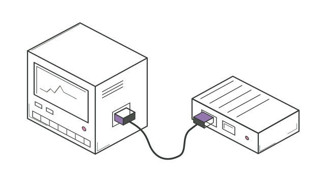
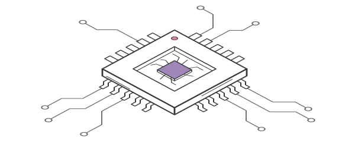

:date: 2026-11-26
:author: Vikrant Rathore
:pdf: article
:category: load balancing
:tags: embedded systems, post-quantum cryptography, web application firewall

If RSA breaks, what happens to an older device?
===============================================

An industrial controller can outlive the software that connects it to the network. Putting its web interface behind Sibuna can protect new traffic while the controller stays in service. Whether that helps depends on what the device uses RSA for.

.. more::

One algorithm, three different jobs
-----------------------------------

**Keeping a session secret.** Some older TLS configurations used RSA to transport the session secret. If a future quantum computer can recover the RSA private key, a recording of such a handshake and its traffic could become readable. The useful life of the data matters as much as the age of the device. See `NIST`_.

**Proving a server's identity.** TLS 1.3 can use an RSA certificate with an ephemeral key exchange. Recovering the signing key would make impersonation possible in new connections. That key alone cannot decrypt earlier ephemeral sessions. A quantum computer capable of breaking classical elliptic-curve key exchange would pose a separate threat to those recordings. See `RFC 8446`_.

**Deciding what may boot.** On supported ESP32 revisions, Espressif's Secure Boot v2 can use RSA-PSS with a 3072-bit key to verify the bootloader and application. A forged signature would undermine that decision. The manufacturer's update path and the device's hardware trust anchor determine how this risk can be addressed. See `Espressif Secure Boot v2`_ and `NIST IR 8259r1`_.

   AMD documents RSA-4096 in the hardware root of trust of the Zynq UltraScale+ MPSoC. For each device family we record the chip revision and the boot mode actually enabled. See `AMD UG1085`_.

Move the exposed connection first
---------------------------------

Consider a customer opening the device's website. We put Sibuna at its public HTTPS address. A compatible browser and Sibuna can negotiate X25519MLKEM768. This combines classical X25519 with ML-KEM-768 for new session keys. After decryption the HTTP firewall can admit, challenge or deny the request. When the policy admits it, Sibuna selects a healthy backend and connects to it separately. See `RFC 10024`_.

.. graphviz::
   :alt: The browser establishes hybrid TLS with Sibuna. The firewall inspects HTTP before Sibuna forwards an admitted request on a separate connection to the device.
   :caption: The browser, Sibuna and the device participate in two independent connections.

   digraph transport {
     graph [rankdir=LR, bgcolor="transparent", pad="0.18", nodesep="0.2", ranksep="0.32"];
     node [shape=box, style="rounded,filled", fontname="Helvetica", fontsize=13, color="#426858", fillcolor="#edf4ec", fontcolor="#18392c"];
     edge [fontname="Helvetica", fontsize=10, color="#386d55", arrowsize=0.7];
     browser [label="Customer browser"];
     subgraph cluster_edge {
       label="Sibuna"; fontname="Helvetica"; color="#a1b5a8"; style=rounded;
       tls [label="TLS"]; waf [label="HTTP firewall"];
     }
     device [label="Device website"];
     browser -> tls [label="X25519MLKEM768"]; tls -> waf; waf -> device [label="TLS"];
   }

In this jlavi configuration the public certificate chain and private key are in ``edge.pem``. The backend's ``ca_file`` and ``sni`` tell Sibuna which CA and name to trust. We use loopback addresses for this test. If the device offers only a classical group, its connection remains classical. Running the gateway beside the device can shorten that leg.

.. literalinclude:: ../../../book/examples/pq/secure-origin.jlv
   :language: text

Record what changed on each connection
--------------------------------------

In our test, the public connection negotiated hybrid TLS even when the origin accepted only X25519. The request returned HTTP 200. Giving Sibuna the wrong origin certificate name returned HTTP 502. The TLS groups, certificate identities and HTTP result belong in the service inventory. Firmware verification needs its own inventory entry and migration plan.

.. typst-diagram:: art/handshake-results.typ
   :alt: A hybrid frontend returned HTTP 200 with either a hybrid or a classical backend. A backend certificate name mismatch returned HTTP 502.
   :caption: Observed results with one frontend and three origin configurations.

The `migration guide <../book/post-quantum-transport.html>`_ gives the test policy, verification command and regional timelines. It also shows how an older device that initiates requests can use a local gateway for its outgoing connection.

.. _NIST: https://www.nist.gov/cybersecurity-and-privacy/what-post-quantum-cryptography
.. _RFC 8446: https://www.rfc-editor.org/rfc/rfc8446.html#section-E.1
.. _Espressif Secure Boot v2: https://docs.espressif.com/projects/esp-idf/en/latest/esp32/security/secure-boot-v2.html
.. _NIST IR 8259r1: https://doi.org/10.6028/NIST.IR.8259r1
.. _RFC 10024: https://www.rfc-editor.org/rfc/rfc10024.html
.. _AMD UG1085: https://docs.amd.com/r/en-US/ug1085-zynq-ultrascale-trm/Hardware-Root-Of-Trust-Secure-Boot-Details
